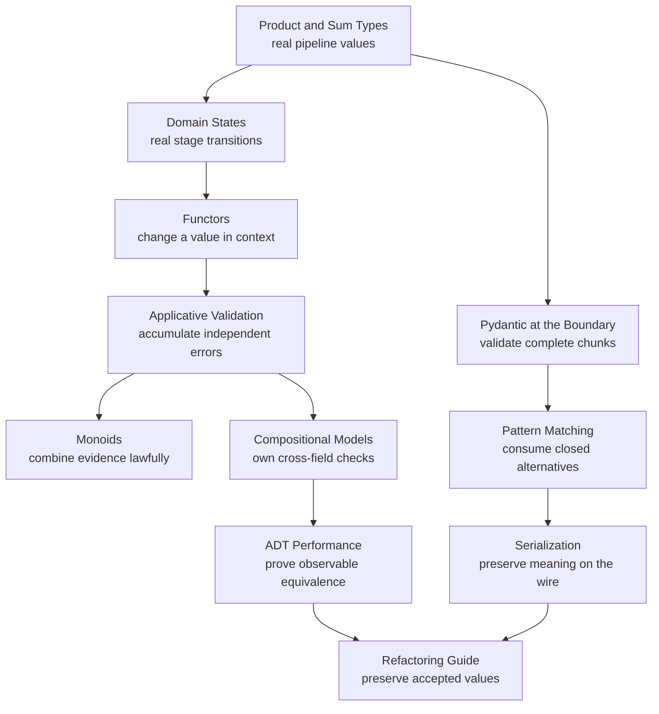

# Module 05: Algebraic Data Modelling and Validation

Module 4 made failures explicit. Module 5 now makes value shapes explicit:
which facts must travel together, which alternatives must remain separate, and
which boundary owns each invariant.

The primary learning surface remains the cumulative FuncPipe RAG application.
Focused models appear only when they isolate a decision the main stage types do
not expose. Their scope is named and explained; they are not parallel products
for their own sake.

## What you need before starting

You should be able to:

- read frozen dataclasses and union annotations;
- distinguish pure transformations from effectful operations;
- follow `Ok | Err` and `Some | NONE` from Module 4;
- run one selected pytest test from the course root.

If `Result` and `Option` are unfamiliar, revisit Module 4's failure-modeling
pages before continuing. This module builds operations and boundaries on those
containers rather than redefining them.

## Keep These Pages Open

Use these support surfaces while reading so value modelling stays connected to reviewable
domain states instead of turning into type-shape ornament:

- [Mid-Course Map](../module-00-orientation/mid-course-map.md) for the bridge through failures and modelling
- [Pressure Routes](../guides/pressure-routes.md) for domain-pressure routing
- [Anti-Pattern Atlas](../reference/anti-pattern-atlas.md) for symptom-first review of modelling mistakes
- [Capstone Map](../capstone/capstone-map.md) for the validation and domain-state surfaces in FuncPipe

Carry this question into every lesson:

> Which distinction already exists in FuncPipe, and what invalid value or
> lossy boundary are we removing?

Module 5 is not permission to invent types. It is practice in choosing the
smallest honest value shape for the cumulative RAG application. You begin with
the existing pipeline products and `Result` sum, then study operations and
boundaries that preserve their meaning.

Start with the [Module 05 Capstone Delta](capstone-delta.md). It separates the
new modelling behavior from broad package movement, names the stable ownership
boundaries, and gives a runnable route from Module 04.

## How to study independently

Use three passes for each lesson:

1. **Predict:** state the value, failure, or preserved fields before running
   code.
2. **Trace:** execute the small example and follow the corresponding FuncPipe
   source.
3. **Prove:** run the named learning test, then state both its claim and its
   limit.

Do not read the full implementation dump before identifying the problem. The
rewritten lessons keep examples small enough to execute and point to the exact
source only after the concept has a reason to exist.

## Learning outcomes

- distinguish “all these fields” products from “one of these cases” sums;
- trace `RawDoc → CleanDoc → ChunkWithoutEmbedding → Chunk` and name the
  guarantee added by each operation;
- reuse `Result` for success/failure instead of creating a parallel outcome;
- decide between fail-fast `Result` and accumulating `Validation`;
- validate a complete indexed chunk at the boundary without coupling the core
  to Pydantic;
- test preservation laws for mapping, aggregation, serialization, refactoring,
  and an alternative representation.

## Study route

Follow the dependency, not merely the file order:

1. Establish the real values in [Product and Sum Types](product-and-sum-types.md)
   and [Domain States](domain-state-adts.md).
2. Learn lawful operations in [Functors](functors.md),
   [Applicative Validation](applicative-validation.md), and
   [Monoids](monoids.md).
3. Cross external representations in
   [Pydantic at the Boundary](pydantic-smart-constructors.md),
   [Pattern Matching](pattern-matching.md), and
   [Serialization Beyond Pydantic](serialization-beyond-pydantic.md).
4. Apply the judgment to [Compositional Domain Models](compositional-domain-models.md),
   [ADT Performance](adt-performance.md), and the
   [Refactoring Guide](refactoring-guide.md).

## Exercises

Use [Module 05 Exercises](exercises.md) for six cumulative pieces of work
against the tracked reference state. They group related lessons instead of
inflating the count with syntax variations. Consult
[Exercise Answers](exercise-answers.md) only after recording the legal states,
predicted result, preservation claim, and limit of the evidence.

## Capstone checkpoints

- Run `make capstone-module-state-proof MODULE=05`.
- Find the test that proves embedding preserves ID, text, and offsets.
- Compare the Module 5 `ChunkModel` fields with `core.rag_types.Chunk`; account
  for every field crossing the conversion.
- Compare fail-fast `Result` with the independent checks accumulated by
  `Validation`.
- Explain why `rag.domain.AssembledChunk` is a focused assembly value and does
  not replace `core.rag_types.Chunk`.
- For the hybrid representation, distinguish the equivalence proof that exists
  from the performance benchmark that does not.

## Before moving on

You should be able to explain how algebraic modelling makes downstream
composition safer and where its cost is unjustified. Use the
[Refactoring Guide](refactoring-guide.md), then compare
`capstone/module-reference-states/module-04` with
`capstone/module-reference-states/module-05`. The generated history worktree is
a convenient view, but the tracked reference state is the source of truth.

## Closing criteria

- You can explain products and sums using the actual RAG types.
- You can trace the stage transition and state what remains unchanged.
- You can reject an unearned state machine and explain what pressure would earn
  one.
- You can review a constructor, adapter, or match and identify its owned
  invariants.
- You can distinguish semantic-equivalence evidence from performance evidence.
- You can run the learning proof and state what its evidence does not prove.

## Directory glossary

Use [Glossary](glossary.md) when you want the recurring language in this module kept stable while you move between lessons, exercises, and capstone checkpoints.
