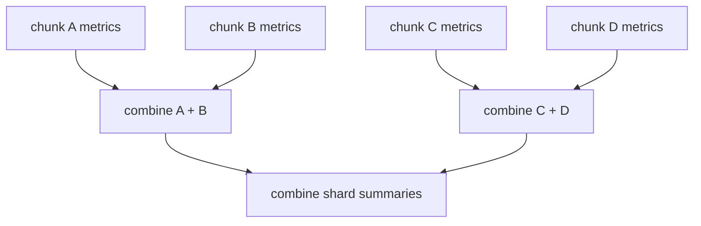

# Monoids: Aggregation You Can Regroup

FuncPipe processes more than one chunk. Eventually it must combine per-chunk
facts into a batch summary: how many were processed, how many succeeded, and
what latency was observed.

A loop can do that. A monoid earns its place when the combination rule itself
needs to be reusable and testable:

> A monoid is an associative combine operation together with an identity value.

Those two properties let a fold handle empty input and let an implementation
regroup work without changing the intended aggregate.

## Start from the metric, not the terminology

Module 5 represents one unit of evidence as an immutable product:

```python
@dataclass(frozen=True, slots=True)
class Metrics:
    processed: int = 0
    succeeded: int = 0
    latency_sum_ms: float = 0.0
    latency_max_ms: float = 0.0
```

Combining two values adds counts and latency totals, then keeps the larger
maximum:

```python
def combine(left: Metrics, right: Metrics) -> Metrics:
    return Metrics(
        processed=left.processed + right.processed,
        succeeded=left.succeeded + right.succeeded,
        latency_sum_ms=left.latency_sum_ms + right.latency_sum_ms,
        latency_max_ms=max(left.latency_max_ms, right.latency_max_ms),
    )
```

`Metrics()` is the identity. Combining it with a valid metric on either side
returns the same metric.

FuncPipe packages those two choices as `METRICS`, then `fold` supplies the
iteration:

```python
def fold(monoid, values):
    accumulated = monoid.empty()
    for value in values:
        accumulated = monoid.combine(accumulated, value)
    return accumulated
```

The separation matters. `fold` knows how to traverse; `METRICS` knows what
aggregation means.

## Run the FuncPipe aggregate

From `programs/python-programming/python-functional-programming`:

```bash
PYTHONPATH=capstone/module-reference-states/module-05/src \
../../../artifacts/venv/python-programming/python-functional-programming/capstone/bin/python \
  - <<'PY'
from funcpipe_rag.fp.monoid import METRICS, Metrics, fold

per_chunk = (
    Metrics(processed=1, succeeded=1, latency_sum_ms=12.5, latency_max_ms=12.5),
    Metrics(processed=1, succeeded=0, latency_sum_ms=8.0, latency_max_ms=8.0),
)

print(fold(METRICS, ()))
print(fold(METRICS, per_chunk))
PY
```

Expected output:

```text
Metrics(processed=0, succeeded=0, latency_sum_ms=0.0, latency_max_ms=0.0)
Metrics(processed=2, succeeded=1, latency_sum_ms=20.5, latency_max_ms=12.5)
```

The empty result is not a special case in `fold`. It follows from beginning
with the identity.

## Associativity permits regrouping

Associativity says:

```text
combine(combine(a, b), c) == combine(a, combine(b, c))
```

It does **not** say that inputs may be reordered. List concatenation is
associative:

```python
(["a"] + ["b"]) + ["c"] == ["a"] + (["b"] + ["c"])
```

but not commutative:

```python
["a"] + ["b"] != ["b"] + ["a"]
```

This distinction is important for logs and stable error reports. A tree
reduction may change grouping while preserving input order; arbitrary worker
completion order may still change the answer.



The diagram is justified only when the combine operation is associative for
the values being processed.

## Identity makes empty folds meaningful

The identity `e` must work on both sides:

```text
combine(e, value) == value
combine(value, e) == value
```

Not every associative operation has an honest identity in its domain. FuncPipe
models non-empty error tuples with a `Semi`—a semigroup—because “a failure with
no errors” should not exist. Tuple concatenation can still combine two
non-empty failures, but the type does not pretend that an empty failure is
valid.

Use the smallest honest abstraction:

| Need | Structure |
| --- | --- |
| combine one or more values associatively | semigroup |
| combine zero or more values | monoid |
| one local accumulation with no reuse or regrouping | a clear loop may be enough |

Replacing every `+=` with a named algebra is not a goal. The abstraction should
clarify a reusable aggregation policy or enable a law-based change.

## Why `Metrics` is a product monoid

Each field has its own operation and identity:

| Field | Combine | Identity |
| --- | --- | --- |
| `processed` | integer addition | `0` |
| `succeeded` | integer addition | `0` |
| `latency_sum_ms` | numeric addition | `0.0` |
| `latency_max_ms` | maximum | `0.0` for non-negative latency |

The product is lawful only within those domain assumptions. If negative
latencies were allowed, `0.0` would not be a right identity for `max`. Domain
constraints and algebraic laws are connected; a type definition alone does
not guarantee either.

FuncPipe's combine function rejects a non-finite latency sum. Callers should
still create sensible per-chunk metrics: the `Metrics` constructor itself does
not reject negative values or all non-finite fields.

## Floating-point honesty

Real-number addition is associative. IEEE-754 floating-point addition is not
exactly associative:

```python
(1e16 + -1e16) + 1.0  # 1.0
1e16 + (-1e16 + 1.0)  # 0.0
```

Therefore `METRICS` supports the useful *domain-level* grouping claim for
ordinary latency data, but arbitrary regrouping may change the last bits of
`latency_sum_ms`. Do not promise bit-identical totals from parallel tree
reduction merely because the API is named `Monoid`.

If exact regrouping is a requirement, choose a representation and algorithm
that provide it—for example integer microseconds within a safe range, decimal
arithmetic with an explicit context, or a reproducible summation strategy.

This limitation is precisely why laws should be tested against the intended
domain rather than repeated as slogans.

## `fold`, `fold_map`, and `tree_reduce`

FuncPipe exposes three traversal strategies:

- `fold(m, values)` combines values left to right;
- `fold_map(m, f, values)` transforms each input into the monoid and folds it;
- `tree_reduce(m, values)` combines balanced groups to reduce dependency
  depth.

For example, character counts can be mapped and folded in one pass:

```python
from funcpipe_rag.fp.monoid import SUM_INT, Sum, fold_map

count = fold_map(SUM_INT, lambda text: Sum(len(text)), ["typed", "rag"])
assert count == Sum(8)
```

`tree_reduce` does not create threads or processes. It changes grouping. Actual
parallel execution still needs an execution design, bounded resources, and an
order policy. The algebra makes regrouping defensible; it does not provide the
runtime.

## Inspect and verify

Read the real implementation and its laws:

```bash
sed -n '1,220p' \
  capstone/module-reference-states/module-05/src/funcpipe_rag/fp/monoid.py

PYTEST_DISABLE_PLUGIN_AUTOLOAD=1 \
PYTHONPATH=capstone/module-reference-states/module-05/src \
../../../artifacts/venv/python-programming/python-functional-programming/capstone/bin/pytest \
  -q capstone/module-reference-states/module-05/tests/learning/test_module_05_data_modelling.py \
  -k monoid_fold
```

For the property-based law checks, inspect
`capstone/module-reference-states/module-05/tests/test_monoid_laws.py`. Notice
the ranges chosen by the strategies. Those ranges are part of what the tests
actually prove.

## Check your understanding

1. Which two pieces make a semigroup into a monoid?
2. Why does `fold(METRICS, ())` return `Metrics()` without a branch for empty
   input?
3. How can an operation be associative but still order-sensitive?
4. Which assumption makes `0.0` an identity for maximum latency?
5. Why does a monoid interface not automatically make floating-point tree
   reduction exact or parallel?

Continue to [Pydantic at the Boundary](pydantic-smart-constructors.md) when you
can state the operation, identity, domain assumptions, and evidence for an
aggregate before choosing a reduction strategy.
