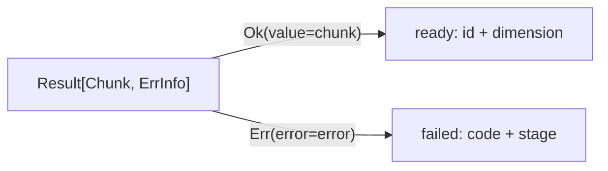

# Pattern Matching: Consume the Cases You Modelled

Product and sum types improve a design only if consumers read them clearly.
For FuncPipe's `Result[T, E]`, every consumer must answer the same question:

> What should happen for `Ok`, and what should happen for `Err`?

Python's `match` statement can make those cases and their payloads visible in
one place. It is a case-analysis tool, not a promise that Python has proved the
match exhaustive.

## Match the real chunk outcome

The cumulative pipeline already represents an embedding outcome as:

```text
Result[Chunk, ErrInfo] = Ok[Chunk] | Err[ErrInfo]
```

A presentation function can consume that closed union:

```python
from typing_extensions import assert_never
from funcpipe_rag.result.types import Err, ErrInfo, Ok, Result
from funcpipe_rag.core.rag_types import Chunk

def describe_chunk_outcome(outcome: Result[Chunk, ErrInfo]) -> str:
    match outcome:
        case Ok(value=chunk):
            return f"ready:{chunk.doc_id}:{len(chunk.embedding)}"
        case Err(error=error):
            return f"failed:{error.code}:{error.stage}"
        case other:
            assert_never(other)
```

Each class pattern both selects a variant and binds its payload. Keyword
patterns make the relationship explicit: `value` belongs to `Ok`; `error`
belongs to `Err`.



There is no `Pending` branch because `Pending` is not a real alternative in
this result. Adding variants to make the lesson look more sophisticated would
make the application model less honest.

## Run both cases

From `programs/python-programming/python-functional-programming`:

```bash
PYTHONPATH=capstone/module-reference-states/module-05/src \
../../../artifacts/venv/python-programming/python-functional-programming/capstone/bin/python \
  - <<'PY'
from typing_extensions import assert_never
from funcpipe_rag.core.rag_types import Chunk, ChunkWithoutEmbedding
from funcpipe_rag.rag.stages import embed_chunk
from funcpipe_rag.result.types import Err, ErrInfo, Ok, Result

def describe(outcome: Result[Chunk, ErrInfo]) -> str:
    match outcome:
        case Ok(value=chunk):
            return f"ready:{chunk.doc_id}:{len(chunk.embedding)}"
        case Err(error=error):
            return f"failed:{error.code}:{error.stage}"
        case other:
            assert_never(other)

prepared = ChunkWithoutEmbedding(
    doc_id="match-1", text="closed cases", start=0, end=12
)
print(describe(Ok(embed_chunk(prepared))))
print(describe(Err(ErrInfo(code="EMBED_FAIL", msg="offline", stage="embed"))))
PY
```

Expected output:

```text
ready:match-1:16
failed:EMBED_FAIL:embed
```

The output tests the branch behavior. It does not, by itself, prove static
exhaustiveness.

## What `assert_never` actually contributes

`assert_never` accepts a value statically typed as `Never`. After a type checker
narrows both known variants, the final variable should have that type:

```python
case other:
    assert_never(other)
```

If `Result` later gains a third alternative, a capable type checker can report
that `other` is no longer `Never`. At runtime, reaching the branch raises an
assertion error.

This technique needs all of the following:

- the input annotation is a closed union;
- the type checker understands the class patterns;
- static checking actually runs;
- no earlier wildcard swallows a case.

A parametrized test with one `Ok` and one `Err` proves those examples, not every
future union member. Static and runtime evidence complement one another.

For external data, an unknown case may be expected rather than impossible.
Decode and validate the external tag first; return a useful boundary error
instead of using `assert_never` as input validation.

## Prefer keyword class patterns

Dataclasses support positional matching through `__match_args__`:

```python
case Ok(chunk):
    ...
```

That is compact but couples the consumer to field order. The keyword form
survives reordering and is easier to review:

```python
case Ok(value=chunk):
    ...
```

The same rule applies to domain products:

```python
case ErrInfo(code=code, stage="embed"):
    ...
```

The literal `"embed"` is a value pattern. By contrast, an unqualified bare
name is normally a capture:

```python
case ErrInfo(code=expected):  # binds expected; it does not compare with it
    ...
```

Use literals, qualified enum members, or a guard when comparison is intended.

## Guards refine a variant

A guard adds a condition after a structural pattern succeeds:

```python
def failure_scope(result: Result[Chunk, ErrInfo]) -> str:
    match result:
        case Ok():
            return "none"
        case Err(error=ErrInfo(stage="embed", path=path)) if path:
            return "one chunk"
        case Err(error=ErrInfo(stage="embed")):
            return "embedding stage"
        case Err(error=_):
            return "another stage"
        case other:
            assert_never(other)
```

Order matters. The more specific embedding failure with a path must appear
before the general embedding failure.

Keep guards cheap and unsurprising. A guard that writes a log, mutates state,
or performs network I/O makes branch selection itself effectful and much harder
to reason about.

## `Option` is another closed sum

The same case analysis applies to explicit absence:

```python
from typing import TypeVar
from funcpipe_rag.fp.core import NoneVal, Option, Some

T = TypeVar("T")

def unwrap_or(option: Option[T], default: T) -> T:
    match option:
        case Some(value=value):
            return value
        case NoneVal():
            return default
        case other:
            assert_never(other)
```

The Module 5 property tests exercise both variants over many integer values.
The useful lesson is not “replace every `isinstance`.” It is that a consumer of
a meaningful closed sum should expose the alternatives and their behavior.

## When an `if` is clearer

Pattern matching is not automatically superior:

- a single boolean condition usually belongs in an `if`;
- checking one protocol capability may be clearer with `isinstance`;
- open plugin families are not closed unions and need an extension mechanism;
- mappings from string commands to handlers may be clearer as dictionaries.

Choose `match` when the data model is case-shaped and destructuring makes that
shape easier to audit.

Likewise, do not nest several levels of class patterns merely to avoid local
names. Deep patterns can hide error reporting and make schema changes ripple
through consumers. Bind the meaningful product, then use ordinary code for
subsequent calculations.

## Inspect the executable evidence

The focused tests are:

```bash
PYTEST_DISABLE_PLUGIN_AUTOLOAD=1 \
PYTHONPATH=capstone/module-reference-states/module-05/src \
../../../artifacts/venv/python-programming/python-functional-programming/capstone/bin/pytest \
  -q capstone/module-reference-states/module-05/tests/test_pattern_matching.py

PYTEST_DISABLE_PLUGIN_AUTOLOAD=1 \
PYTHONPATH=capstone/module-reference-states/module-05/src \
../../../artifacts/venv/python-programming/python-functional-programming/capstone/bin/pytest \
  -q capstone/module-reference-states/module-05/tests/learning/test_module_05_data_modelling.py \
  -k result_sum_type
```

Then inspect `describe_chunk_outcome` in the learning test. Account for three
separate claims:

1. each current variant returns the intended public description;
2. keyword patterns extract the intended payload;
3. the final branch asks static checking to keep the union closed.

## Check your understanding

1. Why is `case Ok(value=chunk)` safer than relying on field position?
2. What does a bare name inside a pattern usually do?
3. What must be true before `assert_never(other)` provides static
   exhaustiveness pressure?
4. Why should unknown wire tags be decoded as boundary errors instead?
5. When is an ordinary `if` more honest than a `match`?

Continue with
[Serialization Beyond Pydantic](serialization-beyond-pydantic.md) when you can
separate structural case analysis, static exhaustiveness evidence, and runtime
input validation.
