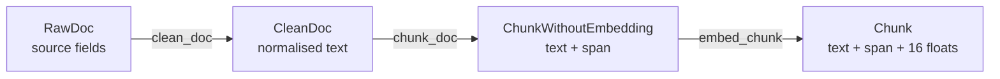

# Product and Sum Types in the RAG Pipeline

Module 4 gave FuncPipe a typed failure channel and a streaming document path. Module 5 now asks a different question:

> What information must exist together, and which alternatives must remain separate?

That question is the practical heart of algebraic data modelling.

## What you need before starting

You should be comfortable with frozen dataclasses, union types, and the `Ok | Err` result introduced in Module 4. Keep the Module 5 reference state open while you read:

```bash
cd programs/python-programming/python-functional-programming
sed -n '1,140p' \
  capstone/module-reference-states/module-05/src/funcpipe_rag/core/rag_types.py
```

The lesson uses the cumulative FuncPipe application, not a second modelling exercise.

## Two shapes, two questions

A **product type** means “all of these fields together.” Its possible values are combinations of its fields.

```python
from dataclasses import dataclass

@dataclass(frozen=True)
class DocumentKey:
    source: str
    document_id: str
```

A `DocumentKey` contains a source **and** a document ID.

A **sum type** means “exactly one of these alternatives.” In modern Python, a union of distinct dataclasses is often enough:

```python
ReadOutcome = ReadSucceeded | ReadFailed
```

A `ReadOutcome` is a success **or** a failure. It is not both, and it cannot be neither.

This distinction is more useful than the vocabulary:

| Modelling pressure | Shape | FuncPipe example |
| --- | --- | --- |
| Several facts travel together | product | `ChunkWithoutEmbedding` |
| A value is one of distinct cases | sum | `Ok[Chunk] | Err[ErrInfo]` |
| A value changes meaning after work completes | two product types | `ChunkWithoutEmbedding` then `Chunk` |
| A field is genuinely optional within one state | optional field | use sparingly; explain what `None` means |

## The invalid state we want to remove

Imagine one loose chunk class:

```python
@dataclass
class LooseChunk:
    doc_id: str
    text: str
    start: int
    end: int
    embedding: tuple[float, ...] | None = None
    error: str | None = None
```

It admits combinations that the pipeline cannot interpret:

- no embedding and no error;
- an embedding and an error;
- offsets that do not describe the text;
- mutable fields changing after indexing.

Adding an `is_ready` boolean makes more contradictory combinations. The problem is the shape, not a missing conditional.

## Products describe the real stages

FuncPipe already has the useful products:

```python
from dataclasses import dataclass, field
from collections.abc import Mapping

@dataclass(frozen=True)
class ChunkWithoutEmbedding:
    doc_id: str
    text: str
    start: int
    end: int
    metadata: Mapping[str, object] = field(default_factory=dict)

@dataclass(frozen=True)
class Chunk(ChunkWithoutEmbedding):
    embedding: tuple[float, ...] = ()
```

The first value means “the text span is ready to embed.” The second means “the span has a valid embedding.” They are different types because callers may do different work with them.

The application transition makes that distinction visible:

```python
def embed_chunk(chunk: ChunkWithoutEmbedding) -> Chunk:
    ...
```

The annotation is a design claim: embedding consumes a prepared chunk and returns an indexed chunk. A function that needs an embedding should ask for `Chunk`, not accept the earlier state and hope.



The classes share fields through inheritance, so `isinstance(indexed, ChunkWithoutEmbedding)` is true. That reuse is convenient, but the function signatures—not an `isinstance` check—communicate the stage boundary. In a code review, look at what a function accepts and returns.

## A sum describes success or failure

Embedding can also fail at an effectful boundary. FuncPipe does not need another `ChunkState` hierarchy for this. Module 4 already established:

```python
Result[Chunk, ErrInfo] = Ok[Chunk] | Err[ErrInfo]
```

A consumer handles the closed set of alternatives:

```python
from typing_extensions import assert_never
from funcpipe_rag.result.types import Err, ErrInfo, Ok, Result
from funcpipe_rag.core.rag_types import Chunk

def describe(result: Result[Chunk, ErrInfo]) -> str:
    match result:
        case Ok(value=chunk):
            return f"ready:{chunk.doc_id}:{len(chunk.embedding)}"
        case Err(error=error):
            return f"failed:{error.code}:{error.stage}"
        case other:
            assert_never(other)
```

`assert_never` is primarily a static exhaustiveness check. If the union gains another variant and the type checker understands the match, the forgotten case becomes visible. It is not a substitute for tests or boundary validation.

## Run the transition

Run this from the Functional Programming directory:

```bash
PYTHONPATH=capstone/module-reference-states/module-05/src \
../../../artifacts/venv/python-programming/python-functional-programming/capstone/bin/python \
  - <<'PY'
from funcpipe_rag.core.rag_types import RagEnv, RawDoc
from funcpipe_rag.rag.stages import chunk_doc, clean_doc, embed_chunk

raw = RawDoc("adt-1", "Types", "  Values before cleverness  ", "fp")
clean = clean_doc(raw)
prepared = chunk_doc(clean, RagEnv(chunk_size=40))[0]
indexed = embed_chunk(prepared)

print(type(prepared).__name__, prepared.text)
print(type(indexed).__name__, len(indexed.embedding))
print((prepared.doc_id, prepared.start, prepared.end) ==
      (indexed.doc_id, indexed.start, indexed.end))
PY
```

Expected output:

```text
ChunkWithoutEmbedding values before cleverness
Chunk 16
True
```

Trace the last line carefully. The operation changes the representation by adding an embedding, while preserving document identity and span.

## Invariants still need runtime enforcement

A dataclass annotation does not validate incoming JSON and Python does not enforce annotations at runtime. The domain constructors therefore check important invariants:

- offsets are integers;
- `start >= 0`;
- `end >= start`;
- metadata is a mapping;
- an indexed chunk has exactly 16 embedding values.

Try a failure:

```python
from funcpipe_rag.core.rag_types import Chunk

Chunk(
    doc_id="bad",
    text="x",
    start=0,
    end=1,
    embedding=(0.0, 1.0),
)
```

It raises `ValueError` because a two-dimensional value is not an embedding produced by this application.

One subtle boundary remains: `MappingProxyType` prevents replacing top-level metadata entries, but it does not recursively freeze a nested list or dict. “Frozen dataclass” is not the same as “deeply immutable object graph.” Prefer simple immutable metadata values when equality or safe sharing matters.

## What changed in Module 5

The previous reference state already had documents, chunks, `Result`, and deterministic embedding. Module 5 does not earn its keep by inventing parallel records. Its data-modelling delta is to make the existing stage distinctions explicit, test their preservation laws, and validate external representations before conversion.

The focused learning proof is:

```bash
make capstone-module-state-proof MODULE=05
```

Read these tests as executable explanations:

```text
capstone/module-reference-states/module-05/tests/learning/
└── test_module_05_data_modelling.py
```

Look for three claims:

1. product types keep the document span together;
2. `Result` separates successful chunks from failure information;
3. embedding changes the stage type while preserving the earlier value.

## Review questions

Before introducing a new model, ask:

- Is this several facts that must coexist, or several cases that must not coexist?
- Does the application already have a type expressing the same state?
- Which impossible value does the new shape remove?
- Which constructor enforces invariants at runtime?
- Which test proves the application-level claim?

Do not add a sum type merely because the topic is sum types. A new alternative must correspond to a real decision the application makes.

## Ready to continue?

Move on when you can:

- explain products as “and” and sums as “or” without relying on syntax;
- trace the three real chunk stages;
- explain why `Result[Chunk, ErrInfo]` is preferable to success/error nullable fields;
- distinguish type-checker evidence from runtime validation;
- run the Module 5 proof and identify the preservation assertions.

Next, [Domain State ADTs](domain-state-adts.md) examines when stage-specific products are sufficient and when an explicit state machine would actually be justified.
