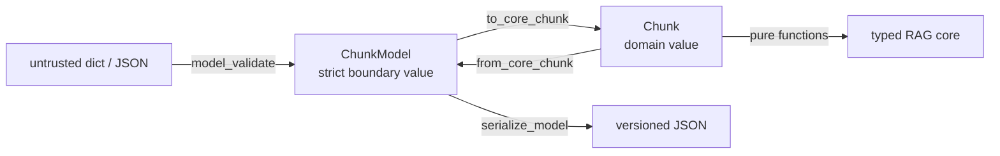

# Pydantic at the Boundary

The typed RAG stages are useful only after input has become trustworthy. JSON, CLI arguments, and saved records do not arrive as `Chunk` values; they arrive as strings, lists, dictionaries, missing fields, and extra fields.

Module 5 uses Pydantic for that crossing. It does not replace the frozen domain dataclasses with framework models.

## The boundary contract

An indexed chunk in FuncPipe carries:

- a non-empty document ID;
- non-empty text;
- start and end offsets;
- metadata;
- exactly 16 finite embedding values.

The domain `Chunk` constructor enforces core invariants. The boundary has additional responsibilities: reject unknown fields, parse JSON, report all field locations clearly, and serialize a stable versioned shape.



The arrow from boundary to domain should lose uncertainty, not lose information.

## Read the model before using it

Open the matching reference state:

```bash
cd programs/python-programming/python-functional-programming
sed -n '1,120p' \
  capstone/module-reference-states/module-05/src/funcpipe_rag/boundaries/adapters/pydantic_edges.py
```

The essential shape is:

```python
class ChunkModel(BaseModel):
    model_config = ConfigDict(
        strict=True,
        frozen=True,
        extra="forbid",
    )

    version: Literal[1] = 1
    doc_id: str = Field(min_length=1)
    text: str = Field(min_length=1, max_length=200_000)
    start: int = Field(ge=0)
    end: int = Field(ge=0)
    metadata: dict[str, Any] = Field(default_factory=dict)
    embedding: tuple[float, ...]
```

The model-level validator checks relationships that individual field validators cannot:

```python
if self.end - self.start != len(self.text):
    raise ValueError("offset span must equal text length")
if len(self.embedding) != 16:
    raise ValueError("embedding must contain 16 values")
if any(not math.isfinite(value) for value in self.embedding):
    raise ValueError("embedding values must be finite")
```

`start`, `end`, and `text` are individually valid in many combinations. Their relationship is the invariant.

## Validate, convert, and round-trip

Run:

```bash
PYTHONPATH=capstone/module-reference-states/module-05/src \
../../../artifacts/venv/python-programming/python-functional-programming/capstone/bin/python \
  - <<'PY'
from funcpipe_rag.boundaries.adapters.pydantic_edges import (
    ChunkModel,
    deserialize_model,
    from_core_chunk,
    serialize_model,
    to_core_chunk,
)

payload = {
    "doc_id": "boundary-1",
    "text": "trusted after validation",
    "start": 10,
    "end": 34,
    "metadata": {"source": "course"},
    "embedding": (0.0,) * 16,
}

edge = ChunkModel.model_validate(payload)
domain = to_core_chunk(edge)
encoded = serialize_model(from_core_chunk(domain))
decoded = deserialize_model(encoded, ChunkModel)

print(type(domain).__name__, domain.doc_id, len(domain.embedding))
print(decoded == edge)
print(encoded)
PY
```

The first two lines are:

```text
Chunk boundary-1 16
True
```

The JSON line contains every domain field plus `version`. A Python dictionary must supply a tuple because this model is strict. On the wire, JSON has only arrays; `deserialize_model` validates that JSON array into the declared tuple. Pydantic deliberately distinguishes its Python-input and JSON-input paths here.

## Why conversion functions matter

It is tempting to use `ChunkModel` throughout the application. Keeping an explicit conversion gives the core several advantages:

- pure domain code is not coupled to Pydantic;
- frozen dataclasses remain cheap, direct values;
- domain functions express domain types in their signatures;
- changing a wire format does not force a core rewrite;
- conversion can be tested as a preservation law.

The important law is:

```python
from_core_chunk(to_core_chunk(valid_model)) == valid_model
```

The equality includes identity, text, offsets, metadata, and embedding. An earlier adapter discarded document identity, offsets, and the vector during conversion; a round-trip test that checked only text could not reveal that loss. A useful test compares the complete value.

## Explore the failure surface

Use one base payload and change one pressure at a time:

```python
from pydantic import ValidationError

base = {
    "doc_id": "boundary-2",
    "text": "four",
    "start": 0,
    "end": 4,
    "embedding": (0.0,) * 16,
}

bad_payloads = [
    base | {"end": 3},                       # span and text disagree
    base | {"embedding": (0.0, 1.0)},       # wrong dimension
    base | {"embedding": (float("nan"),) + (0.0,) * 15},
    base | {"unexpected": True},             # unknown field
]

for payload in bad_payloads:
    try:
        ChunkModel.model_validate(payload)
    except ValidationError as error:
        print(error.errors()[0]["type"])
```

Do not teach learners to assert the entire formatted exception string. Pydantic’s rendering can change between versions. Tests should normally assert the rejected condition, the relevant field or message fragment, and the fact that no domain conversion ran.

## Smart constructors and Pydantic are related, not identical

A smart constructor is any function that refuses to create an invalid domain value. `Chunk.__post_init__` participates in that job. Pydantic adds a rich adapter layer for untrusted structured input.

Use the narrowest tool that owns the problem:

| Input situation | Appropriate owner |
| --- | --- |
| Internal typed call with already separated fields | domain constructor |
| JSON, CLI, environment, or persistence payload | Pydantic boundary |
| Failure expected during a pipeline effect | `Result` with `ErrInfo` |
| Several independent form errors should accumulate | applicative `Validation` |

Pydantic raises `ValidationError`; it does not automatically turn failures into the course’s `Result` type. An outer adapter decides whether to display the error, translate it, or return an `Err`.

## Versioning is a promise

`version: Literal[1] = 1` makes the accepted format explicit. It does not implement migration by itself. If a version 2 is introduced, decide:

- whether version 1 remains readable;
- where migration occurs;
- whether serialization emits only the newest version;
- which snapshot and round-trip tests protect both behaviors.

A schema snapshot catches accidental public-shape changes. It does not prove that old persisted values migrate correctly.

## Verify the teaching claims

Run:

```bash
make capstone-module-state-proof MODULE=05
```

For the focused boundary tests:

```bash
cd capstone
PYTHONPATH="$PWD/module-reference-states/module-05/src" \
  ../../../../artifacts/venv/python-programming/python-functional-programming/capstone/bin/pytest \
  -q module-reference-states/module-05/tests/test_pydantic_edges.py
```

The tests establish:

- valid values survive JSON and domain round-trips;
- non-finite vectors are rejected;
- any dimension other than 16 is rejected;
- the published schema remains stable;
- the learning proof converts only validated values.

They do not prove compatibility with a future schema or validate arbitrary external storage.

## Ready to continue?

Continue when you can:

- draw the untrusted → boundary → domain path;
- explain why Pydantic does not own the core;
- identify the cross-field invariants;
- demonstrate a full-value round-trip;
- distinguish schema stability from migration compatibility;
- choose between a domain constructor, Pydantic, `Result`, and applicative validation for a concrete failure.

Next, [Functor Mapping](functor-map.md) changes values inside an existing context without rewriting its success or failure structure.
