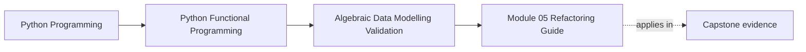

# Module 05 Refactoring Guide


<!-- page-maps:start -->
## Page Maps




<!-- page-maps:end -->

Read the first diagram as a placement map: this page closes the modelling work
before Module 06 changes composition. Read the second as an execution order.
Refactoring starts from a characterized observable, not from a preferred type
name.

This guide closes Module 05 with one standard: the code should reveal what
states exist, who validates them, and where transport representation ends.

## The pressure: a dictionary has too many owners

Suppose ingestion currently accepts a dictionary and constructs a chunk
directly:

```python
def legacy_chunk(raw: AcceptedChunkPayload) -> Chunk:
    return make_chunk(text=raw["text"], path=(), metadata=raw["metadata"])
```

The function is small, but the accepted contract is implicit. An empty string
passes. Extra fields are silently irrelevant. Every caller could choose a
different interpretation.

The Module 05 boundary makes the ownership split explicit:

```python
model = ChunkModel.model_validate(raw)
chunk = to_core_chunk(model)
```

`ChunkModel` owns untrusted input shape and runtime constraints.
`to_core_chunk` owns the translation. The resulting frozen `Chunk` remains an
ordinary core value.

## Separate preservation from contract tightening

Two questions must not be hidden in one assertion:

| Question | Evidence |
| --- | --- |
| Do previously accepted valid inputs produce the same core value? | Compare the complete legacy and refactored `Chunk` values |
| Which previously tolerated inputs are now rejected intentionally? | Name each malformed case and assert its boundary error |
| Did cumulative RAG behavior change? | Run the earlier cleaning, chunking, ordering, and failure proofs |
| Did a transport type enter the core? | Inspect imports and the converted value's type |

An equality proof over accepted inputs is a preservation claim. A new rejection
is a product decision. Record both; do not describe the second as “equivalent.”

## Runnable comparison

```bash
cd capstone/module-reference-states/module-05
PYTHONPATH=src pytest -q tests/learning/test_module_05_data_modelling.py \
  -k boundary_refactor_preserves_accepted_chunk_values
```

The test compares the complete chunk for one characterized payload. It then
shows the deliberate difference: the boundary rejects empty text before core
conversion. Add accepted cases before changing the old function; add rejected
cases only when the new contract is agreed.

## Refactoring sequence

1. **Name the observable.** Decide whether callers observe equality, exact
   errors, serialized bytes, ordering, identity, or another contract.
2. **Characterize accepted input.** Write tests against the existing path
   before introducing the replacement.
3. **Locate ownership.** Put transport shape in `boundaries/adapters/`,
   cross-field invariants in `rag/domain/`, and container laws in `fp/`.
4. **Introduce the new path beside the old path.** Compare complete public
   values using the same input.
5. **Separate intended rejection.** Test malformed inputs as contract changes,
   not equivalence cases.
6. **Run preservation proofs.** Earlier Module 04 behavior must still hold.
7. **Remove the duplicate owner.** Once evidence is sufficient, keep one
   construction route.
8. **Verify downstream states.** The Module 05 learning proof must still pass
   through the live capstone.

## Choose the narrowest abstraction

| Pressure | Prefer | Avoid |
| --- | --- | --- |
| Several fields always exist together | Frozen product type | Parallel dictionaries and positional tuples |
| Exactly one outcome is active | Tagged sum type | Boolean flags plus nullable payloads |
| Checks are independent | Applicative `Validation` | Fail-fast chaining that hides later feedback |
| A later check needs an earlier value | `Result` sequencing | Pretending the checks are independent |
| External shape needs runtime enforcement | Boundary adapter | Pydantic models throughout the core |
| Values must cross a durable boundary | Explicit versioned codec | `repr`, pickle, or incidental object layout |
| Aggregation has identity and associativity | Monoid | A convenient but unlawful combine |
| Faster representation is proposed | Equivalence proof plus benchmark | Performance claims based only on intuition |

## Stable comparison route

1. run `make PROGRAM=python-programming/python-functional-programming history-refresh`
2. open `capstone/_history/worktrees/module-05/src/funcpipe_rag/`
3. compare `fp/`, `rag/domain/`, and `boundaries/adapters/`
4. read `tests/learning/test_module_05_data_modelling.py`
5. run the matching law or boundary test for the changed owner

## What to refactor toward

- product and sum types that reveal domain meaning without extra commentary
- smart constructors that keep invariants close to the model
- validation that can accumulate multiple problems when that helps the caller
- serialization layers that adapt the model without rewriting it
- optimized representations whose public values match the clear reference path

## Review checklist

- Can a reviewer enumerate every legal variant without searching for flags?
- Does the narrowest responsible constructor reject each illegal state?
- Are independent and dependent checks represented differently?
- Does every error retain code, message, stage, and path needed by its caller?
- Can an external library type be removed without rewriting domain operations?
- Is serialization versioning explicit and migration bounded?
- Does aggregation state its identity and associative operation?
- Does an optimization preserve identity, order, metadata, and numeric results?
- Do Module 04 behaviors and later Module 05 proofs still pass?

## Exit standard

Before Module 06, you should be able to:

- justify the chosen value shape from a concrete invalid-state pressure;
- identify the owner of construction, validation, and transport conversion;
- distinguish preservation evidence from an intentional contract change;
- run one focused proof and explain what it does not establish; and
- show that the same Module 05 contract remains valid downstream.

Return to [Module 05 Exercises](exercises.md), review your reasoning against
[Exercise Answers](exercise-answers.md), and then continue to Module 06 only
when the comparison route is reproducible.
