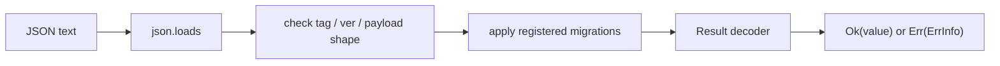

# Serialization: Preserve Meaning Across a Boundary

Pydantic can validate an incoming chunk, but validation and persistence are
different responsibilities. The moment FuncPipe stores a `Result` or sends it
to another process, the byte representation becomes a contract:

- Which sum variant was this?
- Which fields preserve the failure's provenance?
- Which schema version produced the payload?
- What should happen when the reader does not understand it?

Module 5 answers those questions with explicit encoders, decoders, and a small
versioned envelope.

## The value that must survive

Consider a failed embedding:

```python
failure = Err(
    ErrInfo(
        code="EMBED_FAIL",
        msg="model offline",
        stage="embed",
        path=(2, 4),
    )
)
```

Serializing only the message would lose the machine-readable code, pipeline
stage, and chunk path. Serializing `failure.__dict__` would couple the wire
format to an implementation detail and still would not say whether the payload
represented `Ok` or `Err`.

FuncPipe writes this envelope:

```json
{
  "tag": "result",
  "ver": 1,
  "payload": {
    "kind": "err",
    "error": {
      "code": "EMBED_FAIL",
      "msg": "model offline",
      "stage": "embed",
      "path": [2, 4]
    }
  }
}
```

The fields answer separate questions:

| Field | Meaning |
| --- | --- |
| `tag` | which codec family should read the value |
| `ver` | which schema of that family produced it |
| `payload.kind` | which member of the `Result` sum is present |
| `payload.error` | the data required to reconstruct `ErrInfo` |

## Follow the encoding path

`enc_result()` returns a function from a typed value to `Envelope`:

```python
def enc_result(enc_val=None, enc_err=None):
    encode_value = enc_val or json_encoder
    encode_error = enc_err or _default_enc_err

    def _enc(result):
        match result:
            case Ok(value=value):
                return Envelope(
                    tag="result",
                    ver=1,
                    payload={"kind": "ok", "value": encode_value(value)},
                )
            case Err(error=error):
                return Envelope(
                    tag="result",
                    ver=1,
                    payload={"kind": "err", "error": encode_error(error)},
                )
    return _enc
```

`to_json` then renders the envelope. The codec owns domain meaning; the JSON
renderer owns text syntax.

The reverse route performs more work:



The decoder rejects a wrong tag, an unknown version, an unknown `kind`, and
malformed `ErrInfo` fields. Type annotations alone cannot protect this
boundary; the runtime checks are part of the contract.

## Run the provenance round trip

From `programs/python-programming/python-functional-programming`:

```bash
PYTHONPATH=capstone/module-reference-states/module-05/src \
../../../artifacts/venv/python-programming/python-functional-programming/capstone/bin/python \
  - <<'PY'
import json

from funcpipe_rag.boundaries.adapters.serde import (
    dec_result,
    enc_result,
    from_json,
    to_json,
)
from funcpipe_rag.result.types import Err, ErrInfo

failure = Err(
    ErrInfo(
        code="EMBED_FAIL",
        msg="model offline",
        stage="embed",
        path=(2, 4),
    )
)
encoded = to_json(failure, enc_result())
decoded = from_json(encoded, dec_result())

print(json.loads(encoded)["payload"])
print(decoded == failure)
PY
```

Expected output:

```text
{'kind': 'err', 'error': {'code': 'EMBED_FAIL', 'msg': 'model offline', 'stage': 'embed', 'path': [2, 4]}}
True
```

The first line makes the representation inspectable. The second proves the
round trip for this value.

## State the round-trip law precisely

The useful law is:

```text
decode(encode(value)) == value
```

It holds only for values covered by the paired codecs. FuncPipe's default
`ErrInfo` codec preserves:

- `code`;
- `msg`;
- a non-empty `stage`;
- a non-empty integer `path`.

It does **not** serialize `cause` or `ctx`. Those fields may hold exceptions or
arbitrary objects without a stable JSON representation. Therefore the default
round-trip equality claim applies to `ErrInfo` values whose omitted fields are
`None`.

That limitation is a contract, not a reason to silently call `str()` on every
object. If a product needs persistent context, define a small JSON-shaped
context schema and an explicit codec for it.

The default success encoder similarly assumes the success value is already
JSON-compatible. A domain dataclass needs a supplied `enc_val`/`dec_val` pair:

```python
enc_result(enc_val=encode_chunk)
dec_result(dec_val=decode_chunk)
```

Without those functions, `json.dumps` discovering a dataclass at runtime will
fail. Explicit codecs keep that decision near the boundary.

## Why a version is not yet a migration

`ver=1` records history, but it does not make future data readable. A migration
must turn one understood envelope into the next:

```python
def chunk_v1_to_v2(envelope: Envelope) -> Envelope:
    payload = dict(envelope.payload)
    payload.setdefault("metadata", {})
    return Envelope(tag="chunk", ver=2, payload=payload)

MIGRATORS[("chunk", 1)] = chunk_v1_to_v2
```

`migrate` repeatedly looks up `(tag, version)` until no next migration exists.
It detects cycles and limits the chain to 32 steps. The final decoder must
still understand the version produced by the chain.

Migration design has several obligations:

- never reinterpret an old field silently;
- preserve information or document an intentional loss;
- make each step deterministic;
- test real historical envelopes;
- keep the registry scoped and controlled.

FuncPipe's `MIGRATORS` object is process-global. Tests that change it must
restore the previous contents, as `test_chunk_v1_migration` does. A production
service would usually assemble an immutable registry at startup rather than
let request code mutate it.

## Safe failure is a separate API choice

`from_json` raises for malformed input. That is convenient when a bad record
should stop the operation. `from_json_safe` translates decoding exceptions
into:

```python
Validation[T, DecodeErr]
```

This gives a caller a typed failure value, but it currently reports the
exception message at an empty path. It is not a complete structured diagnostic
system. If field-level paths matter, decoder functions must add them as they
descend through the payload.

Likewise, safe decoding does not impose input-size, nesting-depth, or resource
limits. Those protections belong at the I/O boundary before or around parsing
untrusted data.

## JSON, MessagePack, and streams share the codec

The `Envelope` codec is independent of the transport:

| Surface | Writer/reader | Important behavior |
| --- | --- | --- |
| JSON value | `to_json` / `from_json` | readable text; rejects NaN on write |
| MessagePack value | `to_msgpack` / `from_msgpack` | compact binary; requires the `msgpack` dependency |
| newline-delimited JSON | `iter_ndjson` | lazy record decoding; stops on the first raised decode error |
| MessagePack stream | `iter_msgpack` | lazy unpacking and envelope validation |

Using the same domain codec prevents the JSON and binary formats from inventing
different meanings. It does not mean they accept identical primitive ranges;
the MessagePack property test deliberately bounds integers to its supported
range.

## Pydantic and serde are complementary

Use the Pydantic adapter to validate an external chunk payload and convert it
to the core. Use serde when a particular representation must survive storage,
transport, or schema evolution.

Neither layer belongs inside the domain value:

```text
external payload -> Pydantic boundary model -> core value
core value -> explicit persistence codec -> envelope bytes
```

A public API could use both paths, but they answer different questions.

## Inspect and verify

Read the implementation:

```bash
sed -n '1,340p' \
  capstone/module-reference-states/module-05/src/funcpipe_rag/boundaries/adapters/serde.py
```

Run the application-level proof:

```bash
PYTEST_DISABLE_PLUGIN_AUTOLOAD=1 \
PYTHONPATH=capstone/module-reference-states/module-05/src \
../../../artifacts/venv/python-programming/python-functional-programming/capstone/bin/pytest \
  -q capstone/module-reference-states/module-05/tests/learning/test_module_05_data_modelling.py \
  -k serialization
```

Then inspect `tests/test_serde.py` for Option/JSON, Result/MessagePack, and
migration evidence. Do not expand those tests into a claim about values the
strategies never generate.

## Check your understanding

1. Why are both `tag` and `payload.kind` needed for a serialized `Result`?
2. Which `ErrInfo` fields does the default codec intentionally omit?
3. Why does a version number alone not make a schema migratable?
4. What must a custom success codec provide for a domain dataclass?
5. Which additional controls are needed before decoding large untrusted input?

Continue to [Compositional Domain Models](compositional-domain-models.md) when
you can describe the exact values a codec preserves, rejects, migrates, and
intentionally cannot round-trip.
