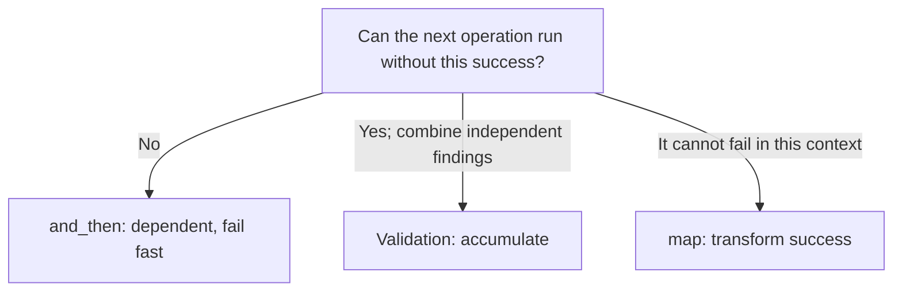

# `and_then`: Sequence Dependent Outcomes

Module 05 taught you to represent a fallible outcome as `Result[T, E]`.
Module 06 begins with the repeated control flow that appears when several
fallible operations depend on one another.

Suppose normalization is allowed only after a document passes an abstract
requirement. A direct implementation is valid:

```python
checked = require_abstract(raw)
if isinstance(checked, Err):
    return Err(checked.error)

return clean_checked(checked.value)
```

Add another prerequisite and the propagation branch appears again. The problem
is not that `if` is unfunctional. The problem is that every caller has become
an owner of the same rule: preserve the first failure and skip dependent work.

`and_then` gives that rule one owner.

## Begin with the function shape

For a `Result[RawDoc, ErrInfo]`, compare two possible next functions:

```text
clean_doc:        RawDoc -> CleanDoc
require_abstract: RawDoc -> Result[RawDoc, ErrInfo]
```

`clean_doc` returns a plain value, so it belongs under `map`.
`require_abstract` returns another `Result`, so it belongs under `and_then`.

```python
cleaned = source.map(clean_doc)
checked = source.and_then(require_abstract)
```

If you use `map(require_abstract)`, the output is conceptually:

```text
Result[Result[RawDoc, ErrInfo], ErrInfo]
```

The nested shape says two Result decisions remain. That is not the intended
flow. `and_then` uses the successful value to run the next operation and keeps
one surrounding `Result`.

## Run the FuncPipe example

The Module 06 learning proof uses the real `RawDoc`, `CleanDoc`, and
`clean_doc` types:

```python
events: list[str] = []

def require_abstract(doc: RawDoc) -> Result[RawDoc, ErrInfo]:
    if not doc.abstract.strip():
        return Err(
            ErrInfo(
                code="EMPTY_ABSTRACT",
                msg="abstract is required",
            )
        )
    return Ok(doc)

def clean_checked(doc: RawDoc) -> Result[CleanDoc, ErrInfo]:
    events.append(f"clean:{doc.doc_id}")
    return Ok(clean_doc(doc))
```

Now the dependent flow reads in execution order:

```python
result = (
    source
    .and_then(require_abstract)
    .and_then(clean_checked)
)
```

For an empty abstract, the observable result is:

```python
Err(ErrInfo(code="EMPTY_ABSTRACT", msg="abstract is required"))
```

and `events` remains `[]`. For a valid document, the result is the normalized
`CleanDoc` and `events` is `["clean:present"]`.

Run both routes:

```bash
cd capstone/module-reference-states/module-06
PYTHONPATH=src pytest -q tests/learning/test_module_06_explicit_context.py \
  -k result_chain_short_circuits_before_rag_cleaning
```

The event assertion matters. Comparing only the final `Err` cannot tell you
whether `clean_checked` ran and its result was later discarded.

## Read the implementation, not just the syntax

The relevant behavior in `result/types.py` is small:

```python
@dataclass(frozen=True)
class Ok(Generic[T, E]):
    value: T

    def and_then(
        self,
        f: Callable[[T], Result[U, E]],
    ) -> Result[U, E]:
        return f(self.value)


@dataclass(frozen=True)
class Err(Generic[T, E]):
    error: E

    def and_then(
        self,
        _: Callable[[T], Result[U, E]],
    ) -> Result[U, E]:
        return Err(self.error)
```

`Ok.and_then` calls the next operation. `Err.and_then` does not. There is no
hidden retry, exception catch, log emission, or asynchronous scheduling.
Those policies belong elsewhere.

The error type is unchanged across this particular chain. If two stages use
different error types, you need an explicit conversion or a shared error sum
type. Do not erase that design decision with an untyped catch-all.

## Why dependency determines the operation

Two checks can both be fallible without being dependent.

Title and abstract field validation may be independent: the learner benefits
from seeing both errors. Module 05 uses accumulating `Validation` for that
case.

Normalization is dependent on a valid document: it should not run after the
prerequisite fails. Module 06 uses fail-fast `Result.and_then` for that case.



The diagram is a semantic choice, not a preference for one API.

## The laws and their practical scope

The Module 06 Result law tests check:

```text
left identity:  Ok(x).and_then(f) == f(x)
right identity: m.and_then(Ok) == m
associativity:  m.and_then(f).and_then(g)
                ==
                m.and_then(lambda x: f(x).and_then(g))
```

Associativity means you can regroup lawful dependent operations without
changing the Result meaning. It does not mean you may reorder them. If `f`
must run before `g`, reversing those functions describes a different program.

The laws also assume the functions used in the comparison are suitable for
equational reasoning. A function that mutates a global list, reads the clock,
or performs network I/O can make two evaluations observably different even
when the Result implementation is lawful.

## `Option.and_then` uses the same structural idea

For `Option`, the stopping case is absence rather than failure:

```python
project = lookup_document(doc_id).and_then(find_project)
```

`Some.and_then` calls the next function. `NoneVal.and_then` preserves
`NoneVal`. The similarity is useful, but do not merge the meanings:

- `NoneVal` means a successful lookup found no value;
- `Err(error)` means the operation failed.

[Layered Containers](layered-containers.md) returns to this distinction when a
retrieval can either fail or find nothing.

## Common wrong turns

### Wrapping every operation in `Ok`

If a function is already infallible, `source.map(clean_doc)` is clearer than:

```python
source.and_then(lambda raw: Ok(clean_doc(raw)))
```

The second version invents a fallible-looking step without adding a failure.

### Using `tap` for required work

An observation helper must not become the owner of an essential domain
transformation. Required work belongs in `map` or `and_then`, where its output
is part of the flow.

### Catching exceptions inside every chained function

`and_then` sequences typed values; it does not classify Python exceptions.
Expected exceptions are converted at a narrow adapter boundary later in this
module.

### Claiming all branching has disappeared

The branch still exists in the `Result` variants. It is centralized and named,
not eliminated. Pattern matching at the outer boundary is still required to
consume `Ok` or `Err`.

## Check your understanding

For each function, choose `map` or `and_then` and justify the dependency:

```text
clean_doc: RawDoc -> CleanDoc
parse_env: str -> Result[RagEnv, ErrInfo]
chunk_all: CleanDoc -> list[Chunk]
require_title: RawDoc -> Result[RawDoc, ErrInfo]
```

Then predict whether the function runs for an existing `Err`.

You are ready for [Lifting Plain Functions](lifting-plain-functions.md) when
you can explain the choice from the return type and the application
dependency—not from memorized terminology.
