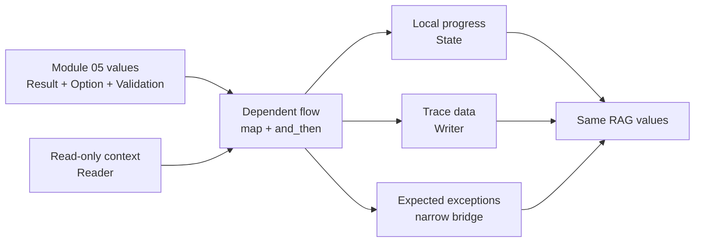

# Module 06 Capstone Delta

Module 05 left FuncPipe with immutable RAG values, `Result` and `Option`
failures, and accumulating `Validation`. Those types make each outcome honest,
but a multi-stage pipeline can still repeat propagation branches, close over
configuration, mutate counters, append diagnostic text, or catch exceptions too
widely.

Module 06 makes those flow rules explicit. The RAG transformations remain pure;
new composition operations and small context types describe how values,
failures, configuration, local state, and trace data travel between them.

## The application delta

| Delta question | Module 06 answer |
| --- | --- |
| Previous capability | Immutable RAG values with typed `Result`, `Option`, and accumulating `Validation` outcomes |
| New pressure | Dependent stages repeat propagation logic while configuration, counters, traces, and exception policy become hidden control flow |
| Concept introduced | Lawful `map`/`and_then`, applicative lifting, Reader, State, Writer, explicit container ordering, narrow exception bridges, and higher-order configuration toggles |
| Source surfaces | `result/types.py`, `fp/effects/`, `boundaries/adapters/exception_bridge.py`, and the existing pure functions in `rag/stages.py` |
| Proof surfaces | Module 06 law tests plus `tests/learning/test_module_06_explicit_context.py` |
| Preserved behavior | Module 05 parsing, validation, cleaning, chunking, deterministic embedding, streaming order, and typed failure values |
| Completed state | `capstone/module-reference-states/module-06/` |
| Learner route | Run one named learning test, inspect its source operation, then complete the matching exercise |
| Later states affected | Modules 07–09 and the live Module 10 capstone retain these composition contracts while adding boundaries, async coordination, interop, and operational review |

## Read the delta as flow



The diagram is not one required container stack. It is a decision map:

- use `map` for a plain transformation and `and_then` when the next stage can
  fail or be absent;
- use Reader only for shared read-only context;
- use State only for local values that genuinely change between stages;
- use Writer only when an ordered trace must remain inspectable as data;
- keep exception conversion at a boundary and name the exception class; and
- prefer an ordinary function when no additional effect rule is needed.

## Focus the reference-state comparison

Module 05 already establishes `rag/domain/` and `boundaries/adapters/` as stable
owners. The Module 05→06 comparison therefore does not require learners to
reinterpret domain modelling as a flow concept. The meaningful Module 06
teaching surface is:

```text
src/funcpipe_rag/
├── result/types.py
├── fp/effects/
│   ├── configurable.py
│   ├── layering.py
│   ├── reader.py
│   ├── state.py
│   └── writer.py
└── boundaries/adapters/exception_bridge.py
```

The existing functions in `rag/stages.py` supply the application pressure:
cleaning, chunking, and embedding need composition and context, but they do not
need to know how those rules are encoded.

## What changed in the RAG application

The application can now:

- short-circuit a dependent RAG flow without duplicating error branches;
- lift pure RAG construction over one or more successful typed values;
- justify refactors with executable identity, composition, and associativity
  laws;
- provide chunking configuration as an explicit Reader input;
- thread local progress without mutating a global counter;
- distinguish a missing retrieval result from a failed retrieval;
- accumulate ordered diagnostic data without emitting it;
- convert only named, expected boundary exceptions into typed failures; and
- toggle validation, logging, or metrics while preserving the underlying
  pipeline result.

## What did not change

Module 06 does not require every function to return Reader, State, or Writer.
`clean_doc`, `iter_chunk_doc`, and `embed_chunk` remain ordinary pure
functions. The context types earn their place only where they remove a concrete
hidden dependency or propagation rule.

The snapshot also does not ship one giant Reader-State-Writer RAG stack.
Layering is kept explicit because the outer container determines which outcome
dominates. Lesson sketches that combine several effects must not be mistaken
for the required application architecture.

## Working route

1. Compare `module-reference-states/module-05/` with
   `module-reference-states/module-06/`.
2. Read the current core and its named test in
   `tests/learning/test_module_06_explicit_context.py`.
3. Run that test with the Module 06 `src/` directory on `PYTHONPATH`.
4. Inspect the matching law or behavior test in the Module 06 test directory.
5. Complete the exercise and state what its evidence does not prove.
6. Confirm the same learning test remains present in downstream snapshots.

## Preservation checklist

Before accepting a flow refactor, confirm that:

- successful RAG values are unchanged;
- the same failure stops the same downstream work;
- input order and chunk order remain stable;
- configuration is passed explicitly and is not mutated;
- State starts from a caller-supplied value;
- Writer preserves the payload while accumulating ordered data;
- absence and failure retain distinct meanings;
- only expected boundary exceptions become typed errors; and
- later snapshots still satisfy the Module 06 learning proofs.

Continue with [and_then and bind](and-then-and-bind.md).
