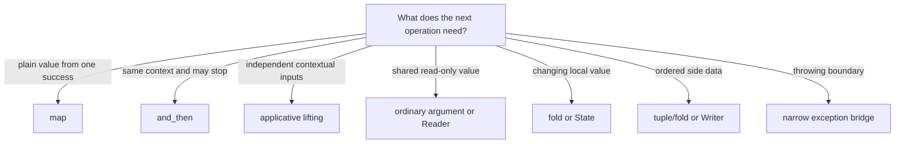

# Module 06 Capstone Delta: Make Flow Rules Observable

Module 05 can already represent a parsed value, a typed failure, a missing
value, and a collection of validation errors. The remaining problem is not
data modelling. It is repeated or hidden control flow.

Consider a document that must pass a prerequisite before normalization:

```python
checked = source.and_then(require_abstract)
cleaned = checked.and_then(clean_checked)
```

The useful change is not the method name. The useful change is that one
well-tested rule now owns failure propagation: if the first operation returns
`Err`, the second operation is not called. The RAG functions remain focused on
their domain transformations.

## Delta contract

| Question | Module 06 answer |
| --- | --- |
| Previous capability | Immutable RAG values with explicit `Result`, `Option`, and accumulating `Validation` outcomes |
| New pressure | Dependent stages repeat propagation branches; configuration, local progress, trace data, and exception policy are easy to hide |
| Concepts introduced | `and_then`, lifting, composition laws, Reader, State, Writer, explicit layer order, narrow exception bridges, and assembly-time policy |
| New source owners | `fp/effects/` and `boundaries/adapters/exception_bridge.py` |
| Existing application functions reused | `clean_doc`, `iter_chunk_doc`, and `embed_chunk` in `rag/stages.py` |
| Main proof | `tests/learning/test_module_06_explicit_context.py` |
| Preserved behavior | Module 05 parsing, normalization, chunk boundaries, order, deterministic embeddings, typed errors, and immutable values |
| Completed state | `capstone/module-reference-states/module-06/` |
| Downstream obligation | Modules 07–09 and the live Module 10 application retain the Module 06 composition behavior |

## The real source delta

The new teaching code has narrow ownership:

```text
src/funcpipe_rag/
├── fp/effects/
│   ├── configurable.py   # choose wrappers at assembly time
│   ├── layering.py       # transpose Result and Option deliberately
│   ├── reader.py         # read-only environment
│   ├── state.py          # explicit local state transition
│   └── writer.py         # value plus ordered trace data
└── boundaries/adapters/
    └── exception_bridge.py
```

The application does not gain a second chunker, cleaner, or embedder.
`rag/stages.py` supplies the existing behavior that the new flow tools compose.
That constraint keeps Module 06 cumulative: it changes how existing work is
connected without pretending the RAG domain has been replaced.

## Eleven claims, eleven observable proofs

| Learning claim | RAG evidence |
| --- | --- |
| A failed prerequisite skips dependent cleaning | an event list remains empty after `Err` |
| Independent configuration fields can be combined | `liftA2` builds `RagEnv` and preserves declared error order |
| Legal map regrouping preserves meaning | separate and composed cleaning projections return equal `Result` values |
| Read-only context is supplied at execution | one Reader runs with two chunk sizes |
| Local progress is explicit | the caller receives both the last chunk text and a new `Progress` |
| Only expected exceptions become typed errors | `ValueError` becomes `ErrInfo`; `RuntimeError` still raises |
| Layer order preserves public meaning | found, missing, and retrieval failure survive transposition |
| Trace data does not replace the payload | Writer returns the original chunk plus ordered entries |
| Refactoring keeps a boundary contract | legacy and bridged parsers agree on characterized inputs |
| Policy is chosen without duplicating normalization | strict mode skips normalization; permissive mode calls it once |
| A structural rewrite preserves RAG output | direct and mapped routes return identical embedded chunks |

These proofs are intentionally bounded. For example, the Reader test proves
that its chunk size is caller-supplied in the tested program. It does not prove
that Reader is the best representation for every function accepting
`RagEnv`.

## Read the module as a set of choices



The left side of each “or” is important. Passing an ordinary argument or
returning an ordinary tuple is often clearer. The module teaches Reader, State,
and Writer so you can recognize when repeated composition pressure earns those
abstractions—not so every function acquires a container.

## Compare Module 05 and Module 06

From the course directory:

```bash
make history-refresh
```

Then compare:

```text
capstone/_history/worktrees/module-05/src/funcpipe_rag/
capstone/_history/worktrees/module-06/src/funcpipe_rag/
```

Read new files before changed export files. An `__init__.py` difference may
only expose a new owner; it is not automatically a new application behavior.

For a focused executable comparison:

```bash
cd capstone/module-reference-states/module-06
PYTHONPATH=src pytest -q tests/learning/test_module_06_explicit_context.py
```

## Preservation questions

Before accepting any Module 06 refactor, answer:

- Does a valid `RawDoc` still normalize to the same `CleanDoc`?
- Does the same invalid prerequisite stop the same downstream work?
- Are chunk text, offsets, and order unchanged?
- Is configuration caller-supplied and immutable?
- Does State start from a value supplied by the caller?
- Does Writer retain the original payload and entry order?
- Are successful absence and failed retrieval still different cases?
- Is the caught exception class named and expected at that boundary?
- Do later reference states retain the Module 06 learning tests?

Continue with [and_then and bind](and-then-and-bind.md), where the first
propagation rule becomes executable.
