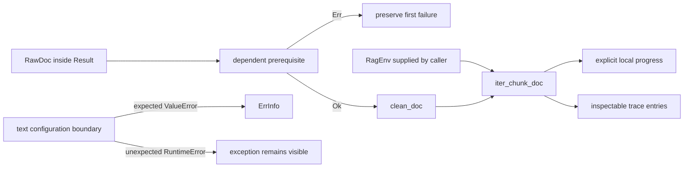

# Module 06: Monadic Flow and Explicit Context

Module 05 gave the FuncPipe application honest value shapes: success and
failure are different cases, absence is not `None`, and independent validation
errors can accumulate. Module 06 asks what happens when those values must move
through several dependent operations.

The module question is:

> Which part of a multi-stage flow should the function own, and which part
> should the surrounding context own?

A function such as `clean_doc` should own normalization. It should not also
repeat “return the earlier error,” read a global chunk size, update a global
counter, append to a hidden log, or decide which exceptions are recoverable.
Module 06 separates those concerns and makes each one observable.

Start with the [Module 06 Capstone Delta](capstone-delta.md). It identifies the
small set of new source files in the Module 06 reference state and explains
what remains unchanged from Module 05.

## What you need before starting

You should be able to:

- distinguish `Ok` from `Err`, and `Some` from `NoneVal`;
- explain why Module 05 uses `Validation` for independent field checks;
- trace `RawDoc -> CleanDoc -> Iterator[Chunk] -> EmbeddedChunk`;
- read a frozen dataclass and a generic callable type; and
- run one focused pytest test from a module reference state.

If those are not comfortable yet, revisit the Module 05
[product and sum type lesson](../module-05-algebraic-data-modelling-validation/product-and-sum-types.md)
and [applicative validation lesson](../module-05-algebraic-data-modelling-validation/applicative-validation.md).

## The progression in one RAG flow



The diagram is not a required stack of containers. Each branch answers a
different question:

- `Result.and_then` controls dependent success;
- Reader supplies shared read-only context;
- State returns a changing local value;
- Writer returns ordered side information;
- an exception bridge classifies one expected boundary failure.

Most FuncPipe functions remain ordinary functions. A context type is useful
only when it makes a real propagation rule easier to see and test.

## Study route: one decision at a time

### 1. Dependent or independent?

Read [and_then and bind](and-then-and-bind.md), then
[Lifting Plain Functions](lifting-plain-functions.md).

The first lesson handles a later operation that needs an earlier successful
value. The second handles plain transformations and independent inputs. Do not
continue until you can explain why a function returning `Result` belongs under
`and_then`, while `clean_doc` belongs under `map`.

### 2. What makes regrouping safe?

Read [Law-Guided Design](law-guided-design.md). Laws do not prove that a RAG
policy is correct. They prove that particular structural rewrites preserve the
container meaning. The distinction matters throughout the rest of the course.

### 3. Is context read-only or changing?

Read [Reader Pattern](reader-pattern.md), then
[Explicit State Threading](explicit-state-threading.md).

Run the same chunk program with two `RagEnv` values. Then run the same progress
program from an explicit initial value. Compare the signatures:

```text
Reader[RagEnv, A]  behaves like RagEnv -> A
State[Progress, A] behaves like Progress -> (A, Progress)
```

### 4. Which outcome dominates?

Read [Error-Typed Flows](error-typed-flows.md), then
[Layered Containers](layered-containers.md).

The first lesson separates expected boundary failures from bugs. The second
forces you to decide whether retrieval failure, successful absence, or a found
document is the public meaning.

### 5. Is side information part of the result?

Read [Writer Pattern](writer-pattern.md). Writer in this module returns string
trace entries for inspection; it does not write an operational log. Module 07
will place real emission behind an effect boundary.

### 6. Can the same behavior survive a rewrite?

Finish with [Refactoring try/except](refactoring-try-except.md),
[Configurable Pipelines](configurable-pipelines.md), and the
[Module 06 Refactoring Guide](refactoring-guide.md).

These pages characterize the old behavior first, change one control rule, and
compare complete outputs. They are the bridge into Module 07, where execution
and resource ownership become the main concern.

## How to study independently

For each lesson:

1. predict the success value and the failure, absence, state, or trace value;
2. run the named learning test;
3. read the smallest implementation that makes the assertion pass;
4. change one input and predict the new assertion before running it;
5. state which earlier FuncPipe behavior must remain true; and
6. write one sentence about what the focused test does not prove.

The module learning file is:

```text
capstone/module-reference-states/module-06/
└── tests/learning/test_module_06_explicit_context.py
```

Use the exact acceptance commands in the lessons or exercises. The broad
capstone suite is not the first debugging tool.

## Exercises and completion

The [Module 06 Exercises](exercises.md) form a cumulative review of the same
reference state. Use the [Exercise Answers](exercise-answers.md) only after
recording your own design choice and expected evidence.

You are ready for Module 07 when you can:

- choose `map`, `and_then`, or applicative lifting from the dependency shape;
- explain what identity and associativity allow you to refactor;
- decide whether an ordinary argument, Reader, State, or Writer earns its cost;
- keep absence, expected failure, and unexpected exceptions distinct;
- identify which container is outermost and what that means;
- compare complete RAG values before and after a control-flow rewrite; and
- point to the focused test that supports each claim.

Use the [Module 06 Glossary](glossary.md) when terms such as *dependent*,
*lift*, *outer context*, or *short-circuit* become ambiguous.
