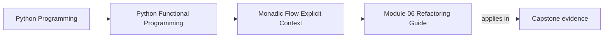

# Module 06 Refactoring Guide


<!-- page-maps:start -->
## Page Maps




<!-- page-maps:end -->

Read the first diagram as a placement map: this page is one concept inside its parent module, not a detached essay, and the capstone is the pressure test for whether the idea holds. Read the second diagram as the working rhythm for the page: name the problem, study the example, identify the boundary, then carry one review question forward.

This guide closes Module 06. The point is not to admire monadic vocabulary. The point is
to make sequencing, context, and failure propagation easier to read and safer to change.

## Final application pressure

The direct RAG route is already readable:

```python
cleaned = clean_doc(raw)
chunks = [embed_chunk(chunk) for chunk in iter_chunk_doc(cleaned, env)]
```

Do not replace it merely to display a container. A `Result` flow becomes useful
when a typed boundary or prerequisite already exists and the same
transformations must preserve that context:

```python
refactored = (
    source.map(clean_doc)
    .map(lambda doc: list(iter_chunk_doc(doc, env)))
    .map(lambda chunks: [embed_chunk(chunk) for chunk in chunks])
)
```

The important review question is not “is the second version more functional?”
It is “which failure or context rule requires the second shape, and did the RAG
output remain the same?”

## Runnable equivalence proof

The module’s final property generates document text and valid chunk sizes,
executes both routes, and compares the complete embedded chunk list:

```bash
cd capstone/module-reference-states/module-06
PYTHONPATH=src pytest -q tests/learning/test_module_06_explicit_context.py \
  -k explicit_flow_refactor_preserves_rag_chunk_output
```

The test covers empty input, short tails, multiple chunks, normalization,
offsets, order, and deterministic embeddings within its generated space. It
does not exercise file I/O or claim that wrapping an infallible route in
`Result` is automatically better design.

## Review the flow by responsibility

| Question | Evidence to inspect |
| --- | --- |
| Does a downstream stage depend on a successful value? | `and_then` proof and its skipped-work trace |
| Are successful values transformed without new failure? | `map` composition property |
| Are configuration values independent? | `liftA2` proof and declared error order |
| Is context read-only or changing? | Reader environment runs versus State progress result |
| Are absence and failure distinct? | layered retrieval cases |
| Is trace data part of the inspectable result? | Writer payload-and-entry assertion |
| Is an exception expected? | narrow exception bridge and propagation test |
| Does configuration change assembly or core logic? | validation-toggle call trace |

## Stable comparison route

1. run `make PROGRAM=python-programming/python-functional-programming history-refresh`
2. open `capstone/_history/worktrees/module-06/src/funcpipe_rag/fp/effects/`
3. run `tests/learning/test_module_06_explicit_context.py`
4. compare the learning claims with `test_monad_laws.py`,
   `test_reader_laws.py`, `test_state_laws.py`, and `test_writer_laws.py`

## What to refactor toward

- dependent steps composed without repetitive propagation code
- context passed explicitly instead of read from globals
- logs and side information carried as data when that keeps the flow honest
- exception-heavy code rewritten into reviewable containers and laws

## Exit standard

Before Module 07, you should be able to say which context travels through the flow, how
failure propagates, what output a refactor preserves, and what tests prove each
composition rule still holds.
