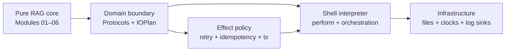

# Module 07 Capstone Delta

Module 06 left FuncPipe with pure, configurable RAG transformations, typed
failures, explicit environment values, and lawful composition. Those tools make
the computation understandable, but they do not say who may open files, obtain
time, emit logs, retry writes, or control a transaction.

Module 07 adds that missing architectural boundary. The pure RAG stages remain
in place. New domain-owned descriptions state which effects are permitted, and
infrastructure adapters interpret those contracts at the outside of the
application.

## The application delta

| Delta question | Module 07 answer |
| --- | --- |
| Previous capability | Pure RAG stages composed with explicit configuration and typed `Result` failures |
| New pressure | Files, clocks, logs, retries, and transactions can leak into pure code or become hidden global behavior |
| Concept introduced | Capability protocols, deferred `IOPlan` descriptions, resource-owning adapters, structured log data, idempotent writes, and explicit transaction bracketing |
| Source surfaces | `domain/capabilities.py`, `domain/composition.py`, `domain/effects/`, `domain/idempotent.py`, `domain/logging.py`, and `infra/adapters/` |
| Proof surfaces | `tests/unit/domain/`, `tests/unit/infra/adapters/`, and `tests/learning/test_module_07_effect_boundaries.py` |
| Preserved behavior | Existing RAG parsing, validation, chunking, embedding, streaming, configuration, and typed failure semantics from Modules 01–06 |
| Completed state | `capstone/module-reference-states/module-07/` |
| Learner route | Run one named learning test, then inspect the matching domain or adapter unit test |
| Later states affected | Modules 08 and 09 and the live Module 10 capstone retain these synchronous boundary contracts while adding async coordination, interop, and sustainment |

## Read the delta by ownership



The arrows describe allowed knowledge:

- the pure RAG core works with values and `Result`;
- the domain names the capabilities and effect descriptions the application
  needs;
- the shell decides when to interpret a description;
- infrastructure implements domain protocols;
- infrastructure may import domain contracts, but domain code must not import
  concrete adapters.

## Focus the reference-state comparison

The Module 07 snapshot adds the `domain/` and `infra/` packages and reorganizes
tests by ownership. Many files inherited from Module 06 differ only in their
end-of-module docstring. Treat those labels as snapshot metadata, not new
application behavior.

The meaningful new source route is:

```text
src/funcpipe_rag/
├── domain/
│   ├── capabilities.py
│   ├── composition.py
│   ├── effects/
│   │   ├── io_plan.py
│   │   ├── io_retry.py
│   │   └── tx.py
│   ├── idempotent.py
│   └── logging.py
└── infra/adapters/
    ├── atomic_storage.py
    ├── clock.py
    ├── file_storage.py
    ├── logger.py
    └── memory_storage.py
```

## What changed in the RAG application

The application can now:

- describe a storage read without performing it;
- substitute file and memory storage behind the same domain capability;
- keep a partially consumed file-backed iterator resource-safe;
- represent diagnostic entries as values before a shell emits them;
- derive a stable content key and make repeated chunk writes harmless;
- retry only explicitly idempotent effects with classified transient failures;
- pass session state explicitly and bracket success or failure with
  commit/rollback; and
- migrate one effect boundary at a time while comparing observable behavior
  with the previous implementation.

## What did not change

Module 07 does not replace the existing RAG pipeline with an effect framework.
Parsing, cleaning, chunk construction, embedding calculations, ranking, and
validation stay ordinary pure functions. `IOPlan` describes boundary work; it
does not make pure transformations effectful.

The reference state also does not contain a separate production shell that
wires every new capability into one large workflow. Lessons must distinguish
shipped helpers from clearly labelled architectural sketches. The executable
learning route uses the concrete, small behaviors that actually exist.

## Working route

1. Compare `module-reference-states/module-06/` with
   `module-reference-states/module-07/`.
2. Read the current core lesson and its named test in
   `tests/learning/test_module_07_effect_boundaries.py`.
3. Run that test with the Module 07 `src/` directory on `PYTHONPATH`.
4. Inspect the corresponding focused test under `tests/unit/domain/` or
   `tests/unit/infra/adapters/`.
5. Complete the matching exercise and state what the evidence does not prove.
6. Confirm the same learning test remains present in later snapshots.

## Preservation checklist

Before accepting a boundary change, confirm that:

- constructing an `IOPlan` performs no effect;
- only the shell calls `perform`;
- the domain imports protocols, never concrete infrastructure;
- adapters return typed failures rather than leaking expected exceptions;
- partial consumption closes owned resources;
- retries are bounded and restricted to idempotent behavior;
- transaction success commits and body failure rolls back;
- logs can be inspected before a logger emits them; and
- Modules 08–10 retain the same synchronous contracts.

Continue with [Ports and Adapters](ports-and-adapters.md).
