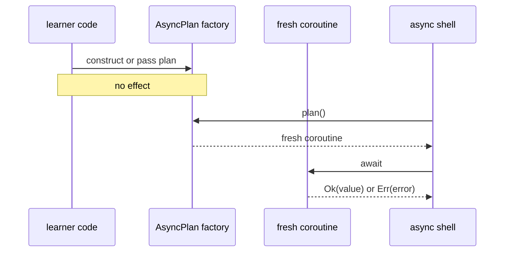

# async/await as Descriptions

Module 07 taught you to separate an effect description from the shell that
interprets it. Module 08 keeps that boundary while allowing the described
operation to wait.

This lesson answers one precise question:

> What value should represent one asynchronous operation before the application
> chooses to run it?

The FuncPipe answer is `AsyncPlan[T]`, a factory for a fresh awaitable that
returns `Result[T, ErrInfo]`.

## Prerequisites

Before continuing, you should be able to:

- distinguish a pure value from an effectful operation;
- read `Ok(value)` and `Err(error)` as explicit alternatives;
- explain why a callable can defer work; and
- run a coroutine with `asyncio.run`.

If the callable-as-description idea is unclear, revisit Module 07’s effect
boundaries before adding concurrency.

## Three values that look similar but behave differently

Consider:

```python
async def fetch_count() -> int:
    return 3
```

There are three relevant things:

| Expression | Value created | Replayable? | Work started? |
| --- | --- | --- | --- |
| `fetch_count` | coroutine function | yes | no |
| `fetch_count()` | coroutine object | no; it is one-shot | no |
| `asyncio.create_task(fetch_count())` | scheduled task | no | yes |

Calling an `async def` function does not run its body. It creates a coroutine
object. That object can be awaited only once.

This difference matters in a functional design. A reusable description should
not contain a one-shot coroutine that becomes invalid after the first
interpretation.

## The shipped `AsyncPlan` contract

Module 08 defines:

```python
AsyncPlan: TypeAlias = Callable[[], Awaitable[Result[T, ErrInfo]]]
```

Read the type from right to left:

1. execution eventually produces `Result[T, ErrInfo]`;
2. that result is delivered by an `Awaitable`;
3. a zero-argument callable creates the awaitable; and
4. calling the factory again must create a fresh awaitable.



The factory is replayable. The coroutine it returns is not.

## Run the smallest example

The following example uses the actual Module 08 implementation:

```python
import asyncio

from funcpipe_rag.domain.effects.async_ import AsyncPlan, async_lift
from funcpipe_rag.result.types import ErrInfo, Ok, Result

calls = 0


async def read_counter() -> Result[int, ErrInfo]:
    global calls
    calls += 1
    return Ok(calls)


plan: AsyncPlan[int] = async_lift(read_counter)

print(calls)
print(asyncio.run(plan()))
print(asyncio.run(plan()))
```

Expected output:

```text
0
Ok(value=1)
Ok(value=2)
```

The first line proves construction was inert. Different returned values do not
violate replayability: each execution is fresh, so an effect may observe a
different world.

Replayability means “can be executed again,” not “must produce an equal
result.”

## Counterexample: storing a coroutine object

This shape is wrong:

```python
coroutine = read_counter()


def broken_plan():
    return coroutine
```

The first `await broken_plan()` can succeed. The second raises:

```text
RuntimeError: cannot reuse already awaited coroutine
```

The durable correction is to store the factory:

```python
def plan():
    return read_counter()
```

Do not patch this failure by caching the first result unless caching is an
explicit application policy. A cached result and a replayable effect
description have different semantics.

## Compose plans without running them

`async_map` transforms a successful result with a synchronous function:

```python
from funcpipe_rag.domain.effects.async_ import async_map

doubled = async_map(plan, lambda value: value * 2)
```

No coroutine exists yet. When interpreted:

- `Ok(3)` becomes `Ok(6)`;
- `Err(error)` remains the same failure; and
- a fresh source execution occurs for every call.

`async_bind` chooses a later plan from an earlier successful value:

```python
from funcpipe_rag.domain.effects.async_ import async_bind, async_pure

labelled = async_bind(
    plan,
    lambda value: async_pure(f"count={value}"),
)
```

This is sequencing as data:

```text
run first plan
├── Err(error) → preserve error
└── Ok(value)  → build and run the next plan
```

Neither combinator needs to know which event loop or application shell will
interpret the result.

## Connect the description to FuncPipe

The Module 08 application path accepts:

```python
AsyncChunkEmbedder: TypeAlias = Callable[
    [ChunkWithoutEmbedding],
    AsyncPlan[Chunk],
]
```

An embedder receives a prepared chunk and returns a description. A deterministic
local adapter suitable for learning can be written as:

```python
import asyncio

from funcpipe_rag.core.rag_types import Chunk, ChunkWithoutEmbedding
from funcpipe_rag.domain.effects.async_ import AsyncPlan
from funcpipe_rag.rag.stages import embed_chunk
from funcpipe_rag.result.types import Ok


def embed_later(chunk: ChunkWithoutEmbedding) -> AsyncPlan[Chunk]:
    async def run() -> Ok[Chunk]:
        await asyncio.sleep(0)
        return Ok(embed_chunk(chunk))

    return run
```

`asyncio.sleep(0)` does not pretend to be a model call. It yields control so a
test can observe scheduling while `embed_chunk` preserves the course’s
deterministic embedding behavior.

Ownership remains clear:

| Surface | Responsibility |
| --- | --- |
| `embed_chunk` | map one prepared chunk to one deterministic embedded value |
| `embed_later` | adapt that operation to the `AsyncPlan` contract |
| `async_rag_chunks` | compose document preparation with bounded embedding |
| async shell | iterate the returned stream and therefore authorize execution |

## Why the whole RAG pipeline does not become `async def`

A tempting rewrite is:

```python
async def clean_doc(...): ...
async def chunk_doc(...): ...
async def validate_chunk(...): ...
```

Those functions do not wait. Making them coroutines would:

- force callers to await deterministic transformations;
- hide which boundary actually causes latency;
- make synchronous reuse harder;
- spread event-loop concerns through domain code; and
- weaken the earlier substitution and local-reasoning lessons.

Module 08 instead lifts only the waiting boundary. The design pressure earns
one async seam, not an async rewrite.

## Failure judgment

`AsyncPlan[T]` returns `Result[T, ErrInfo]`. Expected failures therefore remain
values:

```python
async def rejected() -> Result[int, ErrInfo]:
    return Err(ErrInfo(code="REJECTED", msg="input was not accepted"))
```

Cancellation is different. The async combinators re-raise
`asyncio.CancelledError` so the shell can stop work and release resources.
Cancellation is control flow from the runtime, not an ordinary per-record
domain failure.

Unexpected defects may be translated at a declared adapter boundary, but broad
exception handling inside every domain function would hide programming errors.

## Inspect the executable proof

Run:

```bash
make capstone-async-rag-proof
```

Then read:

```text
capstone/module-reference-states/module-08/
└── tests/learning/test_module_08_async.py
    └── test_async_rag_chunks_defers_embedding_and_matches_the_sync_core
```

The test proves:

- construction performs no embedding;
- every input chunk creates a fresh plan;
- interpreting the async stream produces the same `Chunk` values as
  synchronous `iter_rag`; and
- the behavior remains present in later module states.

It does not prove bounded concurrency; that is the pressure addressed in
[Backpressure](backpressure.md).

## Review questions

Before moving on, answer without looking back:

1. Why is `Callable[[], Awaitable[T]]` replayable while `Awaitable[T]` is not?
2. Which expression first authorizes a plan to run?
3. Why may two executions return different values without breaking the
   description contract?
4. Which FuncPipe transformations remain synchronous, and why?
5. Why is cancellation not converted into an ordinary `Err`?

Continue to [Async Generators](async-generators.md) when you can trace
construction, coroutine creation, and interpretation as three separate events.
