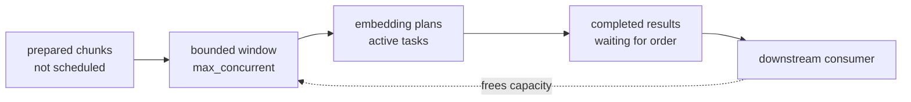

# Backpressure

Async generators are demand-driven, but a concurrent transform can still start
work faster than results are safely resolved. Backpressure is the rule that
limits that unresolved work.

For FuncPipe, the pressure appears at asynchronous embedding:

> How many prepared chunks may have embedding plans in flight before the
> application must wait?

Module 08 answers with `BackpressurePolicy` and
`async_gen_bounded_map`.

## Prerequisites

You should already be able to explain:

- why an `AsyncPlan` is a factory rather than one coroutine;
- how an `AsyncGen` pulls values on demand;
- why `Result` failures stay in the stream; and
- which FuncPipe stages remain synchronous.

Backpressure is not the first reason to introduce async code. It is the policy
needed after the application has independent waiting operations that may
usefully overlap.

## See the unbounded design pressure

This shape materializes every plan and offers them all to the runtime:

```python
plans = [embed_later(chunk) for chunk in every_chunk]
results = await asyncio.gather(*(plan() for plan in plans))
```

For a small fixed list, that can be reasonable. For a stream of unknown size,
it has three problems:

- all chunks and plans are materialized;
- all coroutine objects are created before a result is consumed; and
- the application has no declared ceiling for active embedding work.

Replacing the list comprehension with `asyncio.create_task` inside a loop does
not solve the problem unless task creation itself is bounded.

## The actual policy value

Module 08 ships:

```python
@dataclass(frozen=True)
class BackpressurePolicy:
    max_concurrent: int = 8
    ordered: bool = True

    def __post_init__(self) -> None:
        if self.max_concurrent < 1:
            raise ValueError("max_concurrent must be >= 1")
```

The two fields answer different questions:

| Field | Question answered |
| --- | --- |
| `max_concurrent` | What is the maximum number of mapping plans allowed in flight? |
| `ordered` | Must output positions match successful and failed input positions? |

The value rejects a zero or negative limit before a stream starts. That is
configuration validation, not a runtime scheduling failure.

## Where the policy enters FuncPipe

`async_rag_chunks` first creates a prepared stream:

```python
prepared: AsyncGen[ChunkWithoutEmbedding]
```

It then returns:

```python
async_gen_bounded_map(prepared, embedder, policy)
```



The policy applies only to the embedding mapper. It does not turn cleaning or
chunking into tasks.

## Run an application-level measurement

Use a fake embedder that records active calls:

```python
import asyncio

from funcpipe_rag.core.rag_types import Chunk, ChunkWithoutEmbedding, RagEnv, RawDoc
from funcpipe_rag.domain.effects.async_ import (
    AsyncPlan,
    BackpressurePolicy,
    async_gen_from_list,
)
from funcpipe_rag.rag import async_rag_chunks
from funcpipe_rag.rag.stages import clean_doc, embed_chunk
from funcpipe_rag.result.types import Ok

active = 0
maximum_active = 0


def embed_later(chunk: ChunkWithoutEmbedding) -> AsyncPlan[Chunk]:
    async def run() -> Ok[Chunk]:
        global active, maximum_active
        active += 1
        maximum_active = max(maximum_active, active)
        await asyncio.sleep(0)
        active -= 1
        return Ok(embed_chunk(chunk))

    return run


stream = async_rag_chunks(
    async_gen_from_list(
        [RawDoc("doc", "Title", "abcdefghijkl", "demo")]
    ),
    RagEnv(chunk_size=3),
    clean_doc,
    embed_later,
    BackpressurePolicy(max_concurrent=2, ordered=True),
)


async def collect():
    return [item async for item in stream()]


results = asyncio.run(collect())
print(maximum_active)
print([(item.value.doc_id, item.value.start) for item in results])
```

Expected output:

```text
2
[('doc', 0), ('doc', 3), ('doc', 6), ('doc', 9)]
```

The fake yields control once so both allowed plans can become active. The call
log proves the ceiling was reached but never exceeded. The coordinate list
proves ordered output.

This test does not use wall-clock delays. A `sleep(0)` scheduling point is
enough to expose overlap deterministically.

## Trace the ordered window

Assume chunks at positions `0`, `3`, `6`, and `9`, a concurrency limit of `2`,
and position `3` finishing before position `0`.

| Moment | Active tasks | Completed buffer | Emitted |
| --- | --- | --- | --- |
| start | `0`, `3` | — | — |
| `3` completes | `0` | `3` | — |
| capacity opens | `0`, `6` | `3` | — |
| `0` completes | `6` | `0`, `3` | `0`, then `3` |
| continue | at most two | bounded by unresolved positions | input order |

The ordered implementation limits the distance between the next input index
and the next emit-ready index. A fast later result cannot cause an unbounded
buffer behind one slow earlier item.

`max_concurrent` therefore limits more than simultaneous function bodies. In
ordered mode it also bounds the unresolved scheduling window.

## Decide whether ordering belongs to the contract

| Situation | `ordered=True` | `ordered=False` |
| --- | --- | --- |
| Stable index snapshots used in teaching | preferred | makes evidence harder to compare |
| Downstream requires document/chunk order | required | invalid |
| Results are independent writes keyed by chunk identity | optional | may reduce head-of-line waiting |
| First completed result should be observed immediately | delays later positions behind earlier ones | appropriate if order has no meaning |
| Reproducible failure traces | easier to review | requires a separate correlation strategy |

Do not choose unordered execution merely because it sounds faster. First show
that result order is semantically irrelevant and that failures can still be
associated with their inputs.

## Understand failure positions

The source stream may yield:

```text
Ok(chunk 0)
Err(source failure)
Ok(chunk 2)
```

`async_gen_bounded_map` does not call the embedder for the failed item. In
ordered mode, the `Err` still occupies its input position:

```text
Ok(embedded chunk 0)
Err(source failure)
Ok(embedded chunk 2)
```

This is why the Module 08 application can continue after a malformed document
without silently moving the failure elsewhere in the trace.

An exception raised by an embedding plan is translated by the bounded mapper to
`ErrInfo`. `asyncio.CancelledError` is re-raised so cancellation can propagate
through the runtime.

## Cancellation must release capacity

The mapper owns:

- its source iterator;
- its set of pending tasks;
- its semaphore permits; and
- its ordered result buffer.

Its `finally` path cancels pending tasks, awaits their completion with
`return_exceptions=True`, and closes the source iterator when possible.

A concurrency bound that leaks tasks after the consumer stops is not a real
bound. Review shutdown paths as part of the backpressure contract.

## What this bound does not prove

The application proof establishes a local mapping window. It does not prove:

- that an upstream adapter has no internal buffer;
- that a remote service honors the same concurrency limit;
- that every task uses equal memory;
- that two concurrent requests are optimal;
- that retries cannot multiply effects; or
- that the whole process has a fixed memory ceiling.

Those require additional boundary and policy evidence. Module 08 keeps the
claim narrow: FuncPipe does not schedule more than the declared number of
embedding plans through this mapper.

## Inspect the implementation and proof

Read:

```text
capstone/module-reference-states/module-08/src/funcpipe_rag/
├── domain/effects/async_/concurrency.py
└── rag/async_rag.py
```

Run:

```bash
make capstone-async-rag-proof
```

The relevant test is:

```text
test_async_rag_chunks_applies_the_backpressure_policy_to_embedding
```

For the generic scheduling implementation, also inspect:

```text
test_bounded_map_caps_in_flight_work_and_preserves_order
```

One proves the RAG application uses the policy. The other isolates the generic
mapper law. Both are necessary: a correct combinator proves little if the
application never calls it.

## Common wrong turns

- **Semaphore hidden in an adapter:** callers cannot review or vary the
  application policy.
- **Task per input plus semaphore inside each task:** all tasks are still
  allocated eagerly.
- **Unbounded output queue:** active calls may be bounded while completed
  results grow without limit.
- **Ordered flag ignored for failures:** result positions become misleading.
- **Sleeping in tests:** wall time makes proofs slow and flaky.
- **Making pure stages async:** spreads coordination without introducing a
  waiting boundary.

## Move-forward criteria

You can continue when you can:

- identify the exact line where FuncPipe introduces concurrent tasks;
- explain both fields of `BackpressurePolicy`;
- distinguish active-task bounds from whole-process memory bounds;
- trace an out-of-order completion through ordered emission;
- explain why a source `Err` never invokes the embedder;
- describe cleanup after partial consumption; and
- defend an ordered or unordered choice using application requirements.

Next, [Retry and Timeout Policies](retry-and-timeout-policies.md) asks what
happens when one of those bounded embedding plans fails or waits too long.
