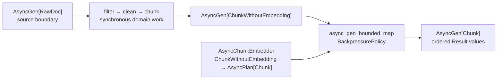

# Module 08 Capstone Delta

Module 07 leaves FuncPipe with a synchronous streaming indexer and explicit
effect boundaries. A `RawDoc` can be filtered, cleaned, split into bounded
chunks, and embedded without hiding file or service access inside the pure
core. That design remains correct when embedding is local and immediate.

Module 08 introduces a new pressure:

> What changes when the embedding boundary can wait, several chunks can be in
> flight, and the application must still bound work and preserve useful
> ordering?

The answer is not “make the RAG core async.” The Module 08 state adds one
application-level description named `async_rag_chunks`. It reuses the
synchronous filter, cleaner, and chunker, then schedules only the injected
embedding plan.

## Establish the delta before reading the implementation

| Delta question | Module 08 answer |
| --- | --- |
| Previous capability | Module 07 can stream `RawDoc → CleanDoc → ChunkWithoutEmbedding → Chunk` synchronously behind explicit boundaries |
| New pressure | An embedding adapter may wait, and starting one task per chunk would make concurrency and memory unbounded |
| Concept introduced now | `AsyncGen` describes a replayable result stream; `AsyncPlan` describes one delayed embedding; `BackpressurePolicy` controls their composition |
| Source that changes | `src/funcpipe_rag/rag/async_rag.py` and its public export from `funcpipe_rag.rag` |
| Proof of the teaching claim | Four `async_rag_chunks` tests in `tests/learning/test_module_08_async.py` |
| Earlier behavior preserved | Cleaning, chunk coordinates, embedding values, typed stream failures, and the synchronous `iter_rag` route |
| Completed reference state | `capstone/module-reference-states/module-08/` |
| Learner-visible route | `make capstone-async-rag-proof` from the course root |
| Later states affected | Module 09 and the live Module 10 endpoint retain the same async indexing contract |

This is the application capability added in Module 08. The generic async
combinators support it; they are not a substitute for it.

## Read the ownership boundaries



The diagram has two deliberate seams:

1. `prepare_document` owns deterministic CPU work and creates no tasks.
2. `async_gen_bounded_map` owns task scheduling and is the only place where the
   concurrency policy applies.

That separation protects the pure core from async creep. `clean_doc` should not
become `async def` merely because a later adapter waits.

## Trace construction separately from execution

The public function returns an `AsyncGen[Chunk]`:

```python
stream = async_rag_chunks(
    docs,
    RagEnv(chunk_size=3),
    clean_doc,
    embed_later,
    BackpressurePolicy(max_concurrent=2, ordered=True),
)
```

At this point:

- no document has been cleaned;
- no chunk has been created;
- no embedding plan has run; and
- no task exists.

Work begins only when a shell iterates `stream()`:

```python
results = [item async for item in stream()]
```

This distinction is the first Module 08 review habit. Calling
`async_rag_chunks` describes coordination. Iterating the returned stream
interprets it.

## Follow one document through the code

For a document whose normalized abstract is `abcdefghijkl` and whose chunk
size is `3`, the synchronous preparation path yields coordinates:

```text
("doc", 0)
("doc", 3)
("doc", 6)
("doc", 9)
```

Each prepared chunk becomes an independent `AsyncPlan[Chunk]`. With
`max_concurrent=2`, an execution can look like this:

| Event | In flight | Next ordered result allowed |
| --- | ---: | --- |
| start chunk 0 | 1 | none |
| start chunk 3 | 2 | none |
| chunk 3 finishes first | 1 | still waiting for chunk 0 |
| start chunk 6 | 2 | still waiting for chunk 0 |
| chunk 0 finishes | 1 | chunks 0 and 3 can be emitted |
| continue within the same window | at most 2 | chunk 6, then chunk 9 |

`ordered=True` does not force tasks to finish in order. It buffers completed
results until their input position is next. The bound limits both active work
and the unresolved ordering window.

Choosing `ordered=False` changes a domain-visible behavior: results may arrive
in completion order. It is appropriate only when downstream indexing does not
require source order and the learner can prove that claim.

## Compare the synchronous and asynchronous routes

The async path does not define new cleaning, chunking, or embedding semantics.
The learning proof runs the same documents through both APIs:

```python
expected = [Ok(chunk) for chunk in iter_rag(docs, env, clean_doc)]
actual = [item async for item in async_stream()]

assert actual == expected
```

Equality here is meaningful because `Chunk` is a value. It compares document
identity, coordinates, text, and the deterministic embedding vector. The proof
says that coordination was added without changing those values.

It does **not** prove that an arbitrary remote embedding service is equivalent
to the local deterministic embedder. That would require a separate adapter
contract and controlled test double.

## Keep failures in the stream

The input type is:

```python
AsyncGen[RawDoc]
```

Expanding the alias gives:

```python
Callable[[], AsyncIterator[Result[RawDoc, ErrInfo]]]
```

A source failure is already an `Err` value. `async_gen_and_then` forwards it
without calling the cleaner or embedder. Validation failures raised while
preparing a document are translated to `ErrInfo`. Later valid documents remain
eligible for processing.

The application proof observes this sequence:

```text
ok:before
err:SOURCE
err:UNEXPECTED
ok:after
```

Only `before` and `after` reach the embedding adapter. This is continuation
semantics, not fail-fast semantics. A shell that wants fail-fast behavior must
choose and implement that policy explicitly.

Unexpected programming defects are not broadly swallowed by
`async_rag_chunks`. The preparation boundary translates declared
`TypeError`/`ValueError` failures; other exceptions remain defects that should
fail the run and be repaired.

## Compare Module 07 and Module 08 without rewriting history

Refresh the generated worktrees:

```bash
make history-refresh
make history-verify
```

Then inspect only the application delta:

```bash
git diff --no-index \
  capstone/_history/worktrees/module-07/src/funcpipe_rag/rag \
  capstone/_history/worktrees/module-08/src/funcpipe_rag/rag
```

The important addition is `rag/async_rag.py`. The existing synchronous RAG
files remain the source of cleaning, chunking, and local embedding behavior.
Do not copy the whole Module 08 tree into Module 07, and do not edit generated
worktrees.

## Run the smallest honest proof

From `programs/python-programming/python-functional-programming`:

```bash
make capstone-async-rag-proof
```

The command runs only the four Module 08 application proofs:

- constructing the stream defers embedding and preserves synchronous values;
- the application respects the declared concurrency ceiling and ordering; and
- source and validation failures remain visible without erasing later work; and
- the cumulative filter/source/validation/embedding trace retains every
  expected position.

Use the full Module 08 learning route only when a change affects the generic
async laws:

```bash
make capstone-module-state-proof MODULE=08
```

## What Module 08 deliberately does not add

The reference state contains no:

- network model client;
- external vector database;
- hidden global semaphore;
- background worker process;
- automatic retry around every embedding;
- claim that concurrency improves semantic relevance; or
- retrieval or generation behavior.

Those additions would either require a later design pressure or create fake
production complexity. Module 08 is about making asynchronous indexing
coordination explicit and testable.

## Preservation checklist

Before accepting a change to this path, verify:

- constructing an `AsyncGen` performs no application work;
- synchronous filter, clean, and chunk behavior remains unchanged;
- the embedding boundary is injected as `AsyncChunkEmbedder`;
- `max_concurrent` is positive and visible at the call site;
- the ordering choice is intentional;
- source `Err` values do not invoke the embedder;
- preparation validation failures remain values;
- later valid inputs can still be processed;
- Module 09 retains the same contract; and
- the live Module 10 endpoint still supports retrieval over the resulting
  chunks.

Continue with [async/await as Descriptions](async-await-as-descriptions.md), then
[Async Generators](async-generators.md), and finally
[Backpressure](backpressure.md). Those three cores explain the types and
composition used by this application delta.
