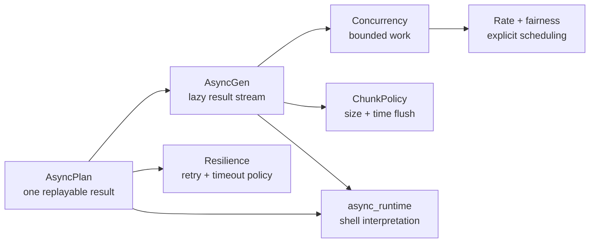

# Module 08 Capstone Delta

Module 07 left FuncPipe with pure RAG stages, typed `Result` failures, deferred
`IOPlan` effects, capability protocols, and resource-safe interpreters. Those
contracts answer **what** work may happen and **where** effects are allowed. They
do not answer how an async shell coordinates many slow operations without
unbounded work, hidden retries, unfairness, or timing-dependent tests.

## The application delta

| Delta question | Module 08 answer |
| --- | --- |
| Previous capability | Synchronous effect descriptions and resource-safe adapters around the pure RAG pipeline |
| New pressure | Embedding and storage operations may wait independently; naive task creation can overrun memory, reorder results, repeat effects, or make tests depend on wall time |
| Concept introduced | Replayable `AsyncPlan` and `AsyncGen` descriptions with explicit concurrency, resilience, fairness, and chunking policies |
| Source surfaces | `domain/effects/async_/`, `infra/adapters/async_runtime.py`, and the async exports in `domain/effects/` |
| Proof surfaces | `tests/unit/domain/test_async_*.py` and the learner route in `tests/learning/test_module_08_async.py` |
| Preserved behavior | Pure RAG transformations, typed failures, lazy traversal, capability boundaries, and resource cleanup from Modules 01–07 |
| Completed state | `capstone/module-reference-states/module-08/` |
| Learner route | Run one named test from `tests/learning/test_module_08_async.py`, then inspect the matching focused unit test |
| Later states affected | Modules 09 and 10 retain the Module 08 learning proofs while adding interop and sustainment behavior |

## Read the source delta in ownership order

The arrows are dependency and study order, not execution order. `AsyncPlan` and
`AsyncGen` are callables that create fresh awaitables or async iterators. Merely
constructing either value must not perform I/O. `async_runtime` is the shell that
finally drives a plan.

## What did not change

Module 08 does not make the RAG core asynchronous. Cleaning, chunk construction,
validation, and result modelling remain synchronous value transformations.
Adapters lift those functions when an async shell needs them. This prevents
“async creep” from turning every domain function into a coroutine merely because
one boundary waits on I/O.

The Module 08 state also does not contain a separate `domain/rag_async.py`.
Lessons should use the shipped combinators and tests rather than an imagined
parallel application. The cumulative RAG behavior remains in its established
packages; Module 08 adds coordination descriptions around it.

## Working route

1. Refresh history from the repository root.
2. Compare `module-reference-states/module-07/` with
   `module-reference-states/module-08/`.
3. Read the current core lesson and its named test in
   `tests/learning/test_module_08_async.py`.
4. Run that single test with the Module 08 `src/` directory on `PYTHONPATH`.
5. Inspect the adjacent `tests/unit/domain/test_async_*.py` file for broader laws.
6. Complete the matching exercise and state what the proof does not establish.

## Preservation checklist

Before accepting an async change, confirm that:

- constructing a plan or stream remains effect-free;
- replay creates a fresh coroutine or iterator;
- source and domain failures stay `Result` values;
- concurrency, queues, and batches have explicit bounds;
- cancellation closes tasks, iterators, and acquired resources;
- retry is limited and does not silently authorize duplicate effects;
- clocks, sleepers, and failure schedules are injectable in tests; and
- Module 09 adapters and the live Module 10 endpoint retain the same behavior.

Continue with [async/await as Descriptions](async-await-as-descriptions.md).
