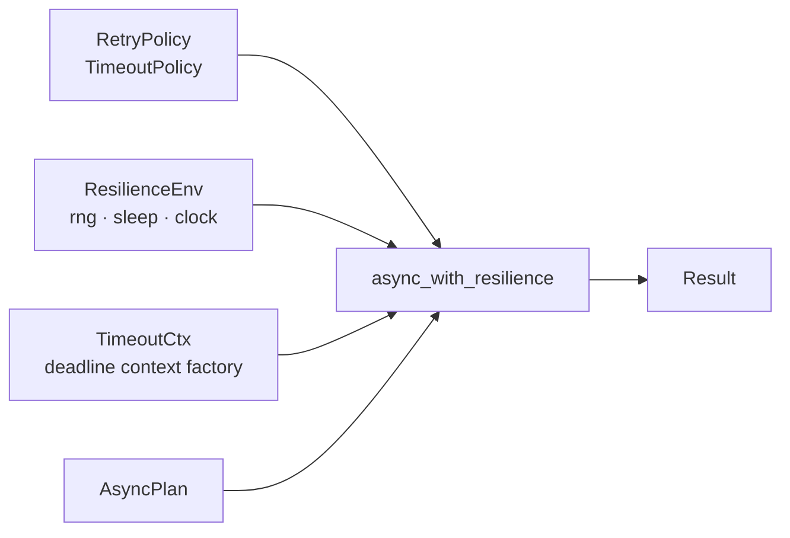
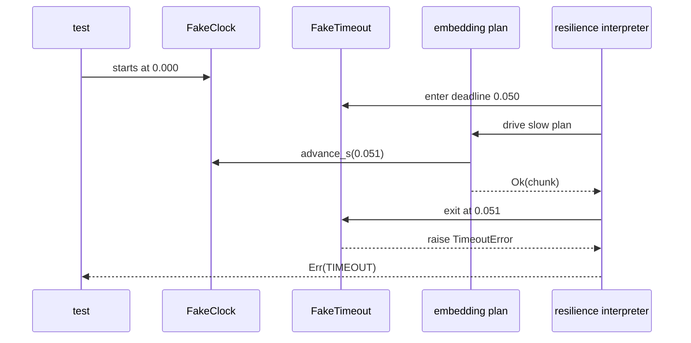

# Deterministic Async Testing

Retry and timeout policies depend on observations that normal unit tests do not
control:

- how long sleep takes;
- which random jitter value is chosen;
- when a deadline is considered crossed; and
- how the event loop schedules ready work.

A test that waits for real time is slow and can fail because the machine is
busy. A test that mocks `asyncio` globally may pass while exercising behavior
the application never uses.

FuncPipe takes a narrower approach: inject the capabilities the resilience
interpreter needs, then assert its decisions directly.

## What deterministic means here

For the same:

- input values;
- policy values;
- fake clock movement;
- random seed; and
- recorded failure schedule,

the test should produce the same:

- `Result` sequence;
- attempt count;
- requested backoff delays; and
- logical timeout decision.

This does **not** mean a fake clock perfectly simulates the operating system,
network stack, or `asyncio` cancellation. Determinism is useful only when the
claim stays as narrow as the fake.

## The capability boundary

The shipped resilience API separates policy from execution:



`RetryPolicy` and `TimeoutPolicy` are immutable decisions.
`ResilienceEnv` owns replaceable runtime capabilities:

```python
@dataclass(frozen=True)
class ResilienceEnv:
    rng: Random
    sleep: Sleep
    clock: Clock
```

`async_with_resilience` uses `rng` and `sleep` directly. The fake timeout
context closes over the same fake `clock` to decide whether its deadline was
crossed. The `clock` field is not an automatic global time replacement; code
must receive and advance it explicitly.

That detail prevents a common misunderstanding: constructing a `FakeClock`
does nothing unless the step and timeout context observe that specific object.

## Three controlled test tools

### Recording sleep

Backoff tests care which delays the interpreter requests, not how long the
machine actually pauses:

```python
delays: list[float] = []


async def record_sleep(seconds: float) -> None:
    delays.append(seconds)
    await asyncio.sleep(0)
```

The zero-duration yield permits normal async scheduling without adding a
wall-clock dependency.

### Seeded randomness

`make_test_resilience_env(seed=42)` creates a local `Random(42)`. Rebuilding the
environment with the same seed replays the same jitter sequence. Do not seed
Python's module-level random generator; that leaks state between tests.

Use `jitter_factor=0` when proving exponential backoff itself. Use a fixed seed
only when jitter is the subject of the proof.

### Logical timeout context

`FakeTimeout` records a deadline when its context is entered and compares the
fake clock when the context exits:

```python
clock = FakeClock()
timeout_ctx = make_fake_timeout_ctx(clock)
```

If the step advances the clock to or beyond the deadline, context exit raises
`TimeoutError`. The resilience interpreter translates that exception into a
typed `TIMEOUT` failure.

## Replay the application timeout

The FuncPipe proof uses two one-chunk documents:

```text
slow  → logical time advances by 0.051 s → TIMEOUT at 0.050 s
after → logical time does not advance     → Ok
```

The expected stream is:

```text
err:TIMEOUT
ok:after
```

The second result matters. It shows the logical timeout belongs to one
embedding plan rather than terminating the entire indexing stream.

## Runnable example

This is the same composition used by the Module 08 learning proof:

```python
import asyncio

from funcpipe_rag.core.rag_types import (
    Chunk,
    ChunkWithoutEmbedding,
    RagEnv,
    RawDoc,
)
from funcpipe_rag.domain.effects.async_ import (
    AsyncPlan,
    BackpressurePolicy,
    FakeClock,
    RetryPolicy,
    TimeoutPolicy,
    async_gen_from_list,
    make_fake_timeout_ctx,
    make_test_resilience_env,
    resilient_mapper,
)
from funcpipe_rag.rag import async_rag_chunks
from funcpipe_rag.rag.stages import clean_doc, embed_chunk
from funcpipe_rag.result.types import ErrInfo, Ok, Result


def run_once() -> tuple[list[str], list[str], float]:
    clock = FakeClock()
    attempted: list[str] = []

    def timed_embedder(chunk: ChunkWithoutEmbedding) -> AsyncPlan[Chunk]:
        async def run() -> Result[Chunk, ErrInfo]:
            attempted.append(chunk.doc_id)
            if chunk.doc_id == "slow":
                clock.advance_s(0.051)
            return Ok(embed_chunk(chunk))

        return run

    resilient_embedder = resilient_mapper(
        timed_embedder,
        RetryPolicy(max_attempts=1),
        TimeoutPolicy(timeout_ms=50),
        env=make_test_resilience_env(clock=clock),
        timeout_ctx=make_fake_timeout_ctx(clock),
    )
    stream = async_rag_chunks(
        async_gen_from_list(
            [
                RawDoc("slow", "Slow", "cross deadline", "demo"),
                RawDoc("after", "After", "within deadline", "demo"),
            ]
        ),
        RagEnv(chunk_size=32),
        clean_doc,
        resilient_embedder,
        BackpressurePolicy(max_concurrent=1, ordered=True),
    )

    async def collect() -> list[Result[Chunk, ErrInfo]]:
        return [item async for item in stream()]

    labels = [
        f"ok:{item.value.doc_id}" if isinstance(item, Ok) else f"err:{item.error.code}"
        for item in asyncio.run(collect())
    ]
    return labels, attempted, clock.now_s()


first = run_once()
second = run_once()

print(first)
print(first == second)
```

Expected output:

```text
(['err:TIMEOUT', 'ok:after'], ['slow', 'after'], 0.051)
True
```

Each call builds a fresh clock, embedder trace, resilience environment, timeout
context, and stream description. Reusing the first clock would begin the second
run at `0.051`, so the inputs would no longer be equivalent.

Run the maintained proof:

```bash
make capstone-embedding-resilience-proof
```

## Read the logical timeline



The `Ok(chunk)` is intentionally discarded because the attempt crossed its
logical deadline before the context exited. This proves timeout translation and
stream continuation under a controlled clock.

It does not prove the plan was interrupted at 50 ms. In this fake, the plan
finishes and the deadline is checked afterward.

## Fake timeout versus production timeout

| Behavior | `FakeTimeout` proof | Production `asyncio.wait_for` |
| --- | --- | --- |
| deadline representation | logical clock value | event-loop timer |
| real waiting | none | yes |
| timeout translated to `ErrInfo` | yes | yes |
| interrupts the awaitable at the deadline | no | attempts cancellation |
| proves cleanup during cancellation | no | only with a dedicated integration test |
| deterministic in a unit test | yes | not at tight timing boundaries |

The correct conclusion is:

> Given this logical elapsed time, the resilience policy chooses `TIMEOUT`.

The incorrect conclusion is:

> This test proves a real provider request is cancelled and cleaned up at
> exactly 50 ms.

Use a narrow real-`asyncio` integration test when cancellation and resource
cleanup are the behavior being reviewed.

## Test retry without sleeping

For retry, the most useful evidence is a trace:

```python
attempted: list[str] = []
delays: list[float] = []


async def flaky_step() -> Result[int, ErrInfo]:
    attempted.append("embed")
    if len(attempted) < 4:
        return Err(ErrInfo(code="TRANSIENT", msg="try again"))
    return Ok(42)


async def record_sleep(seconds: float) -> None:
    delays.append(seconds)
    await asyncio.sleep(0)
```

With a 5 ms base, zero jitter, and four attempts, assert:

```text
len(attempted) == 4
delays == [0.005, 0.010, 0.020]
result == Ok(42)
```

The maintained test uses a non-global counter. The abbreviated snippet keeps
attention on the three observations. Never assert elapsed time for this unit
claim.

## Choose the smallest honest fake

| Claim under test | Inject | Do not add |
| --- | --- | --- |
| exact exponential backoff | recording sleep, zero jitter | fake clock |
| deterministic jitter | recording sleep, fixed seed | real sleep |
| logical timeout translation | fake clock and fake timeout context | wall-clock tolerance |
| backpressure ceiling | active counter and scheduling yield | timeout policy |
| cancellation cleanup | controlled real `asyncio` task/resource | logical-only timeout fake |
| provider protocol translation | adapter test double | retry unless repetition is the claim |

More fakes do not make a test more rigorous. They create more state whose
relationship to production must be defended.

## Failure schedules are data

An effective resilience test describes failures as an input sequence:

```python
schedule = ["TRANSIENT", "TRANSIENT", "OK"]
```

The fake embedder consumes one entry per attempt. The test can then compare:

- how many entries were consumed;
- which delays were requested;
- which final `Result` was emitted; and
- whether replaying the same schedule produces the same observations.

Property-based tests can generate schedules and shrink a failing case. They
should still assert a named law, such as “attempts never exceed
`max_attempts`.” Random schedules without a law are just noisy examples.

## Avoid these false proofs

### A timing threshold

```python
started = time.monotonic()
await plan()
assert time.monotonic() - started < 0.06
```

Machine load can change the result without changing application behavior.

### One shared fake clock

```python
clock = FakeClock()
assert run_with(clock) == run_with(clock)
```

The second execution begins with mutated state from the first.

### A fake that claims cancellation

```python
clock.advance_s(1)
assert resource.cancelled
```

Advancing a value does not send cancellation to a task.

### Global patching

```python
with patch("asyncio.sleep"):
    ...
```

This changes every sleep in the process, including scheduling behavior the test
may rely on. Inject the one sleep capability owned by resilience policy.

## Inspect the real evidence

Read these surfaces in order:

1. `domain/effects/async_/resilience.py`
   - `FakeClock`
   - `FakeTimeout`
   - `make_test_resilience_env`
   - `async_with_resilience`
2. `tests/learning/test_module_08_async.py`
   - `test_retry_policy_records_bounded_attempts_and_backoff`
   - `test_fake_clock_replays_the_same_timeout_decision`
   - `test_async_rag_chunks_replays_logical_embedding_timeout`
3. `tests/unit/domain/test_async_resilience.py`
   - capped backoff properties
   - fake-time timeout translation
   - non-idempotent retry warning

The application proof connects the generic timing controls to FuncPipe. The
unit proofs isolate policy mechanics. Both levels are needed: one prevents
fictional application claims, and the other keeps failure diagnosis small.

## Before moving on

You understand this core when you can explain:

1. Which observations make a retry test deterministic?
2. Why must each replay construct a fresh fake clock?
3. What exactly does `FakeTimeout` prove?
4. What cancellation behavior does it leave unproved?
5. Why is a seeded local `Random` preferable to global seeding?
6. When is a real-`asyncio` integration test still necessary?

Then run:

```bash
make capstone-embedding-resilience-proof
make capstone-module-state-proof MODULE=08
```

If you cannot state the boundary of the fake in one sentence, narrow the test
before adding more fixtures.
