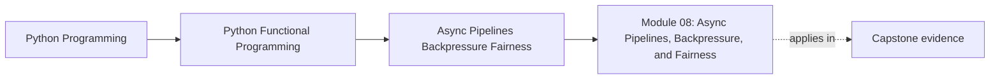
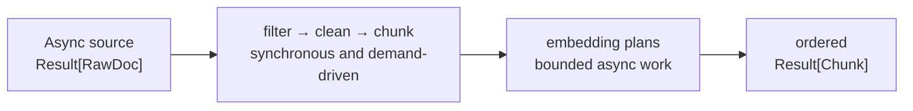

# Module 08: Async Pipelines, Backpressure, and Fairness


<!-- page-maps:start -->
## Page Maps




<!-- page-maps:end -->

Read the first diagram as a placement map: this page sits between the course promise, the lesson pages listed below, and the capstone surfaces that pressure-test the module. Read the second diagram as the study route for this page, so the diagrams point you toward the `Lesson map`, `Exercises`, and `Closing criteria` instead of acting like decoration.

## Keep These Pages Open

Use these support surfaces while reading so async coordination stays reviewable and does
not quietly become magical concurrency vocabulary:

- [Mid-Course Map](../module-00-orientation/mid-course-map.md) for the bridge into effect and async pressure
- [Review Checklist](../reference/review-checklist.md) for the engineering bar around fairness and observability
- [Boundary Review Prompts](../reference/boundary-review-prompts.md) for pressure on async abstractions
- [Capstone Map](../capstone/capstone-map.md) for the async effect and runtime adapter surfaces in FuncPipe

Carry this question into the module:

> Which async behavior is being coordinated explicitly, and where would hidden scheduling or buffering make the system harder to reason about?

This module treats async code as a coordination problem, not a style choice. You move
from effect boundaries to bounded concurrency, fairness, and testable async plans
that do not smear runtime behavior across the whole codebase.

## Learning outcomes

- distinguish a replayable `AsyncPlan` from a coroutine object and a running task;
- trace how an `AsyncGen` pulls source values only when a consumer asks;
- defend where FuncPipe introduces concurrency and where it deliberately stays
  synchronous;
- prove that `BackpressurePolicy` limits in-flight embedding while preserving
  ordered `Result` values; and
- use injected clocks, sleepers, and adapters to test coordination without
  depending on wall-clock timing.

## Begin with the application pressure

Read [Module 08 Capstone Delta](capstone-delta.md) before the individual
combinators. Module 07 can describe and interpret effects, but its RAG indexing
path remains synchronous. Module 08 adds one application path,
`rag/async_rag.py`, because embedding is the first stage with a useful
independent concurrency boundary.



The diagram is intentionally asymmetric. Cleaning and chunking remain the
tested synchronous core. The module coordinates injected embedding plans; it
does not convert every RAG function to `async def`.

## Lesson map

- [Module 08 Capstone Delta](capstone-delta.md)
- [async/await as Descriptions](async-await-as-descriptions.md)
- [Async Generators](async-generators.md)
- [Backpressure](backpressure.md)
- [Retry and Timeout Policies](retry-and-timeout-policies.md)
- [Deterministic Async Testing](deterministic-async-testing.md)
- [Rate Limiting and Fairness](rate-limiting-and-fairness.md)
- [Async Adapters](async-adapters.md)
- [Async Service Integrations](async-service-integrations.md)
- [Async Chunking](async-chunking.md)
- [Async Pipeline Laws](async-pipeline-laws.md)
- [Exercises](exercises.md)
- [Exercise Answers](exercise-answers.md)
- [Refactoring Guide](refactoring-guide.md)

## Exercises

Use [Module 08 Exercises](exercises.md) after each core. Each prompt names a
focused test in the Module 08 reference state and an earlier contract that must
remain true. Consult [Exercise Answers](exercise-answers.md) only after producing
your own execution evidence. Finish with the cumulative indexing-policy lab: it
requires you to explain filtering, three distinct failure positions, bounded
overlap, and later-value continuity in one proof.

## Capstone checkpoints

- Establish the Module 07-to-08 application pressure with
  [Module 08 Capstone Delta](capstone-delta.md) before reading the combinators.
- Inspect `rag/async_rag.py` beside
  `domain/effects/async_/combinators.py`.
- Identify the exact boundary between synchronous document preparation and
  asynchronous embedding plans.
- Run the four application proofs:

  ```bash
  make capstone-async-rag-proof
  ```

- Compare the Module 07 and Module 08 reference states using the route in the
  [Refactoring Guide](refactoring-guide.md).

## Before moving on

You should be able to explain how async coordination stays reviewable, what
protects embedding from runaway fan-out, and why a typed failure does not erase
later valid work. Use the [Refactoring Guide](refactoring-guide.md) and compare
the generated Module 07 and Module 08 worktrees before moving forward.

## Closing criteria

- You can explain how concurrency stays bounded instead of accidental.
- You can identify which async abstractions describe work and which consumer
  action actually drives execution.
- You can defend an async design in terms of fairness, backpressure, and testability.
- You can state which synchronous RAG laws Module 08 preserves and point to the
  executable evidence.

## Directory glossary

Use [Glossary](glossary.md) when you want the recurring language in this module kept stable while you move between lessons, exercises, and capstone checkpoints.
