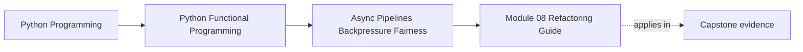

# Module 08 Refactoring Guide


<!-- page-maps:start -->
## Page Maps




<!-- page-maps:end -->

Read the first diagram as a placement map: this page closes Module 08 by
reviewing its application evidence. Read the second as the working rhythm:
predict a behavioral difference, inspect the narrow source delta, run the
proof, and then decide whether the new abstraction earned its place.

This guide is not a checklist for making code “more async.” It helps you review
one precise change: Module 08 adds bounded asynchronous embedding to FuncPipe
without rewriting synchronous filtering, cleaning, chunking, or embedding
semantics.

## Stable comparison route

From `programs/python-programming/python-functional-programming`:

```bash
make history-refresh
make history-verify
```

The refresh reconstructs generated comparison worktrees from the tracked
reference states. Do not hand-edit `_history/worktrees/`.

Begin with a presence check:

```bash
test ! -e capstone/_history/worktrees/module-07/src/funcpipe_rag/rag/async_rag.py
test -e capstone/_history/worktrees/module-08/src/funcpipe_rag/rag/async_rag.py
```

That result tells you the application capability appears at the intended
teaching boundary. It does not yet tell you whether the capability is correct.

Now compare only the earned surfaces:

```bash
git diff --no-index -- \
  capstone/_history/worktrees/module-07/src/funcpipe_rag/rag \
  capstone/_history/worktrees/module-08/src/funcpipe_rag/rag

git diff --no-index -- \
  capstone/_history/worktrees/module-07/tests/learning \
  capstone/_history/worktrees/module-08/tests/learning
```

`git diff --no-index` returns status 1 when differences exist. That is expected.
Read the differences; do not use the command's status as a verification result.

## Predict the delta before reading it

Write down answers to these questions first:

| Review question | Expected Module 08 answer |
| --- | --- |
| Which stage benefits from overlap? | the injected embedding plan |
| Which stages stay synchronous? | filtering, cleaning, and chunking |
| What limits overlap? | `BackpressurePolicy.max_concurrent` |
| What controls observation order? | `BackpressurePolicy.ordered` |
| How do expected failures travel? | as `ErrInfo` values in the stream |
| What starts execution? | iterating the returned `AsyncGen` |

If the source delta contradicts an answer, investigate the contradiction instead
of rewriting your prediction after the fact.

## Trace the application composition

The public function should be small enough to reconstruct:

```text
AsyncGen[RawDoc]
    │
    ├── async_gen_and_then
    │     filter → clean → gen_chunk_doc
    │     TypeError/ValueError → ErrInfo
    │
    └── async_gen_bounded_map
          injected AsyncChunkEmbedder
          BackpressurePolicy
                │
                ▼
          AsyncGen[Chunk]
```

Review the two boundaries separately.

### Document preparation

`prepare_document` is demand-driven, but its work is synchronous. Confirm that:

- a rejected document returns without producing a position;
- a source `Err` bypasses the preparation callback;
- validation exceptions become `ErrInfo`;
- one clean document may expand to several ordered chunks; and
- the existing `clean_doc` and `gen_chunk_doc` remain authoritative.

Do not accept a duplicate async cleaner or chunker merely because the outer
stream is asynchronous. That would create two definitions of RAG behavior.

### Embedding coordination

The prepared stream enters `async_gen_bounded_map`. Confirm that:

- `embedder(chunk)` returns an `AsyncPlan`, not a started task;
- no more than `max_concurrent` plans are active;
- an embedding `Err` remains a value;
- ordered mode emits positions in source order; and
- collection or partial iteration, not construction, drives the work.

The generic async package also teaches queues, fairness, resilience, and
resource ownership. Those tools are available policies; their existence does
not imply that `async_rag_chunks` secretly applies all of them.

## Run evidence at three scales

First run only the application claim:

```bash
make capstone-async-rag-proof
```

Read all four test names. Together they prove:

1. construction defers embedding and successful values match the synchronous
   RAG core;
2. the application reaches but does not exceed its declared concurrency bound,
   while chunk coordinates stay ordered; and
3. source and validation failures do not erase later valid work; and
4. filtering plus source, validation, and embedding failures retain the complete
   expected application trace.

Then run the completed Module 08 state:

```bash
make capstone-module-state-proof MODULE=08
```

This second command matters because the new behavior is valid only if the
learning promises from Modules 01–07 remain true in the same state.

Finally, compare forward:

```bash
make capstone-module-state-proof MODULE=09
```

Module 09 must retain the Module 08 public capability while adding interop
boundaries. The live Module 10 capstone must retain it as well.

## What to refactor toward

- a replayable description whose execution boundary is obvious;
- one shared backpressure policy at the stream owner;
- synchronous domain transformations reused without async wrappers;
- typed failures that keep their observable sequence positions;
- injected timing and embedding behavior in tests; and
- application proofs that assert both output values and operational bounds.

## Refactor away from these shapes

```python
# Started eagerly, single-use, and detached from stream policy.
task = asyncio.create_task(embed(chunk))
```

```python
# Hides a concurrency decision inside every item.
async def clean_and_chunk_and_embed(doc: RawDoc) -> list[Chunk]:
    ...
```

```python
# Tests a scheduler delay rather than a contract.
await asyncio.sleep(1)
assert elapsed < 2
```

The first shape confuses description with execution. The second duplicates the
synchronous core and makes its expansion difficult to observe. The third is
slow and can pass or fail because of machine timing. Prefer plan factories,
named policy, and scheduling yields with explicit counters.

## Review record

Before moving on, write a short review with this evidence:

| Claim | Evidence to cite |
| --- | --- |
| Module 08 introduces the application path at the correct point | Module 07/08 presence comparison |
| construction performs no embedding | pre-consumption trace assertion |
| successful values preserve the synchronous core | equality with `iter_rag` |
| concurrency is genuinely bounded | `maximum_active == max_concurrent` |
| failures remain values | ordered label sequence |
| later valid work survives | final `ok:after` assertion |
| downstream continuity holds | Module 09 state proof and live import |

Also record what the evidence does **not** establish: real provider throughput,
network cancellation, retry idempotency, database writes, semantic vector
quality, or unordered-output suitability.

## Exit standard

Before Module 09, you should be able to draw the application flow from memory,
identify the one stage that runs concurrently, explain every position in the
cumulative exercise output, and show which executable proof supports each
claim. If you can only describe generic `asyncio` syntax, repeat the application
trace and focused proof.
