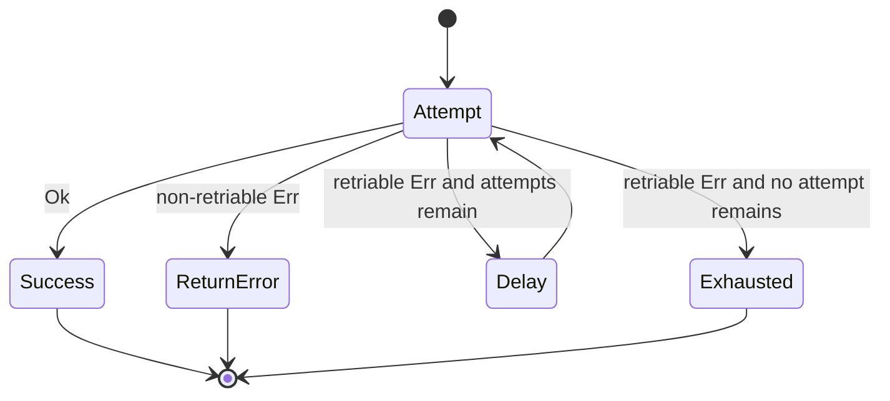
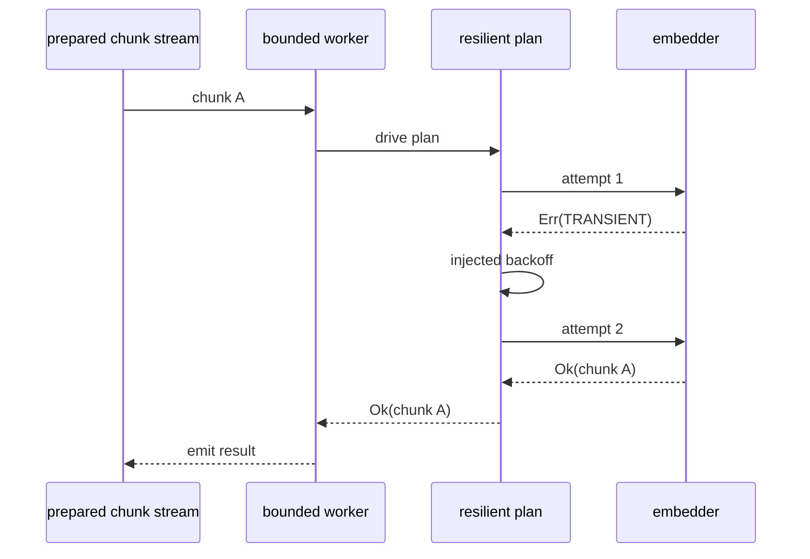

# Retry and Timeout Policies

Backpressure answers **how many embedding plans may run at once**. It does not
answer what one worker should do when its plan fails transiently or takes too
long.

This core adds that decision without creating a second RAG pipeline. FuncPipe
keeps `async_rag_chunks` unchanged and wraps the injected embedder:

```text
AsyncChunkEmbedder
        │
        ▼
resilient_mapper(retry, timeout)
        │
        ▼
async_rag_chunks(..., embedder=resilient_embedder)
```

That placement matters. A retry repeats one chunk's embedding plan. It does not
re-read the source, clean the document again, or replay chunks that already
succeeded.

## What you should learn

By the end of this core, you should be able to:

- distinguish attempts from retries;
- predict which errors are returned immediately and which are retried;
- derive an exponential backoff trace without using wall-clock time;
- explain why a timeout applies to each attempt rather than the whole stream;
- decide whether repeating an effect is safe;
- trace how retry interacts with the backpressure window; and
- prove that one exhausted chunk does not erase later documents.

You should already understand `AsyncPlan`, `AsyncGen`, typed `Result` values,
and `BackpressurePolicy` from the preceding cores.

## Begin with the failure, not the policy

Suppose embedding produces these observations:

```text
chunk A → TRANSIENT
chunk A → Ok
chunk B → TRANSIENT
chunk B → TRANSIENT
chunk C → Ok
```

Several responses are possible:

| Response | Problem |
| --- | --- |
| restart the complete indexing stream | repeats source and preparation work that did not fail |
| retry every `Err` | repeats permanent validation and contract failures |
| swallow the failure | makes missing index entries invisible |
| retry the chunk under explicit policy | keeps repetition local and reviewable |

The last choice is FuncPipe's design. `RetryPolicy` describes when repetition is
permitted. `async_with_resilience` interprets that policy for one `AsyncPlan`.
`resilient_mapper` lifts the same decision over an item-to-plan function such as
an embedder.

## The shipped policy values

The Module 08 reference state defines:

```python
@dataclass(frozen=True)
class RetryPolicy:
    max_attempts: int = 1
    retriable_codes: frozenset[str] = frozenset(
        {"TRANSIENT", "TIMEOUT", "RATE_LIMIT"}
    )
    backoff_base_ms: int = 100
    max_backoff_ms: int = 10_000
    jitter_factor: float = 0.1
    idempotent: bool = True


@dataclass(frozen=True)
class TimeoutPolicy:
    timeout_ms: int
```

`max_attempts` includes the first execution. Therefore:

| `max_attempts` | Maximum retries after the first failure |
| ---: | ---: |
| 1 | 0 |
| 2 | 1 |
| 4 | 3 |

Calling a field `max_retries` would suggest a different count. Read the name
literally when predicting traces.

Invalid policy values fail during construction. Negative backoff, a timeout of
zero, and jitter outside `[0.0, 1.0]` are configuration errors, not asynchronous
stream failures.

## Follow one retry decision



The observable outcomes differ:

| Final observation | Returned value |
| --- | --- |
| any attempt succeeds | that attempt's `Ok` |
| failure code is not retriable | the original `Err` |
| all permitted attempts return retriable failures | `Err` with code `MAX_RETRIES` |
| one attempt crosses a timeout and no retry remains | `Err` with code `TIMEOUT` |
| timeout is retried until attempts are exhausted | `Err` with code `MAX_RETRIES` |
| caller cancels the operation | `CancelledError` is re-raised |

The exhausted error retains the attempt count and last failure in `ErrInfo.ctx`.
That is useful review evidence, but it is not a substitute for logging at the
runtime boundary.

## Derive backoff before executing it

With jitter disabled, the delay after failed attempt \(n\) is:

\[
\operatorname{delay}(n)
=
\frac{
  \min(\text{base}_{ms} \times 2^{n-1}, \text{cap}_{ms})
}{1000}
\]

For `backoff_base_ms=5`, `max_backoff_ms=12`, and four attempts:

| Failed attempt | Uncapped delay | Recorded delay |
| ---: | ---: | ---: |
| 1 | 5 ms | 0.005 s |
| 2 | 10 ms | 0.010 s |
| 3 | 20 ms | 0.012 s |

There is no delay after success and no delay after the final failed attempt.

Jitter varies each delay around its exponential base. It reduces synchronized
retries in real systems, but it makes a teaching trace harder to inspect. Use
`jitter_factor=0` when proving the backoff law. Use a seeded `Random` when the
jitter calculation itself is the behavior under test.

## Runnable application example: recover one chunk

This example uses the real Module 08 application composition. The fake embedder
fails once and then returns the existing deterministic local embedding.

```python
import asyncio

from funcpipe_rag.core.rag_types import (
    Chunk,
    ChunkWithoutEmbedding,
    RagEnv,
    RawDoc,
)
from funcpipe_rag.domain.effects.async_ import (
    AsyncPlan,
    BackpressurePolicy,
    RetryPolicy,
    async_gen_from_list,
    make_test_resilience_env,
    resilient_mapper,
)
from funcpipe_rag.rag import async_rag_chunks
from funcpipe_rag.rag.stages import clean_doc, embed_chunk
from funcpipe_rag.result.types import Err, ErrInfo, Ok, Result

attempted: list[str] = []


def flaky_embedder(chunk: ChunkWithoutEmbedding) -> AsyncPlan[Chunk]:
    async def run() -> Result[Chunk, ErrInfo]:
        attempted.append(chunk.doc_id)
        if len(attempted) == 1:
            return Err(ErrInfo(code="TRANSIENT", msg="try the chunk again"))
        return Ok(embed_chunk(chunk))

    return run


resilient_embedder = resilient_mapper(
    flaky_embedder,
    RetryPolicy(
        max_attempts=2,
        retriable_codes=frozenset({"TRANSIENT"}),
        backoff_base_ms=0,
        jitter_factor=0,
    ),
    env=make_test_resilience_env(),
)

stream = async_rag_chunks(
    async_gen_from_list([RawDoc("doc", "Title", "one chunk", "demo")]),
    RagEnv(chunk_size=32),
    clean_doc,
    resilient_embedder,
    BackpressurePolicy(max_concurrent=1, ordered=True),
)


async def collect() -> list[Result[Chunk, ErrInfo]]:
    return [item async for item in stream()]


results = asyncio.run(collect())
print([f"ok:{item.value.doc_id}" for item in results if isinstance(item, Ok)])
print(len(attempted))
```

Expected output:

```text
['ok:doc']
2
```

Construction performs no attempt. Iteration asks the bounded worker to drive
the resilient plan. The first typed failure is consumed by retry policy; the
second attempt produces the one visible chunk.

The executable learning proof uses a local counter rather than the module-level
counter shown here:

```bash
make capstone-embedding-resilience-proof
```

## Where retry sits inside backpressure



One bounded worker owns the resilient plan for the duration of its attempts.
Retries do not create extra backpressure slots. They do keep the existing slot
occupied longer, so aggressive retry can reduce throughput even when
`max_concurrent` is unchanged.

This is why retry count and concurrency count are separate policies:

- backpressure limits simultaneous chunks;
- retry limits repeated attempts for one chunk; and
- timeout limits the duration of one attempt.

Multiplying those limits gives an upper bound on possible embedding calls, not
a promise about completion time.

## Exhaustion remains local

The application proof uses two documents:

```text
fails → attempt 1 → TRANSIENT
      → attempt 2 → TRANSIENT
      → err:MAX_RETRIES

after → attempt 1 → ok:after
```

The resulting sequence is:

```text
err:MAX_RETRIES
ok:after
```

That final success is essential evidence. A test that asserts only
`MAX_RETRIES` could still hide a stream implementation that stops after the
first exhausted item.

## Timeout is a boundary around each attempt

When no test timeout context is supplied, `async_with_resilience` uses
`asyncio.wait_for` around `step()`. The configured timeout is rebuilt for every
attempt.

Consequences:

- `timeout_ms=50` and `max_attempts=3` do **not** create one 50 ms total budget;
- a timed-out attempt may be retried only when `TIMEOUT` is retriable;
- production timeout cancels the current awaitable;
- cancellation requested by the caller is never translated into `ErrInfo`; and
- a timeout cannot undo an external side effect that completed before
  cancellation arrived.

A total request deadline would need a different owner and a different policy.
Do not infer it from this per-attempt wrapper.

## Repetition requires an idempotency argument

Retry policy answers **may the interpreter try again?** It cannot prove that
trying again is safe.

| Effect | Retry judgment |
| --- | --- |
| deterministic local `embed_chunk` | safe; same input produces the same value |
| read from a remote service | often safe, but rate and consistency contracts matter |
| append a row | unsafe unless duplicates are acceptable or deduplicated |
| charge a payment | unsafe without an idempotency key and provider guarantee |
| upsert by stable chunk coordinate | potentially safe; the storage contract must say so |

`RetryPolicy.idempotent=False` emits a runtime warning when a repeated attempt
begins. It does not block the attempt, roll back effects, or make the operation
safe. Treat the flag as an explicit review signal.

The warning must occur even if the repeated attempt succeeds. The focused unit
proof `test_non_idempotent_warning_is_emitted_before_a_retry_recovers` protects
that behavior.

## Counterexamples worth rejecting

### Retrying the complete stream

```python
# Wrong ownership: a chunk failure can replay successful documents.
for attempt in range(3):
    results = [item async for item in async_rag_chunks(... )()]
```

### Retrying every failure code

```python
# Validation and programming errors do not become transient through repetition.
RetryPolicy(max_attempts=3, retriable_codes=frozenset({"UNEXPECTED", "INVALID"}))
```

### Hiding real time in a unit test

```python
started = time.monotonic()
result = await plan()
assert time.monotonic() - started >= 0.3
```

The last test is slow and scheduler-dependent. The next core replaces sleep,
randomness, and deadline observation with controlled capabilities.

## Inspect the shipped implementation

From the Module 08 reference state, read in this order:

1. `domain/effects/async_/resilience.py`
   - `RetryPolicy`
   - `TimeoutPolicy`
   - `async_with_resilience`
   - `resilient_mapper`
2. `rag/async_rag.py`
   - the injected `AsyncChunkEmbedder` boundary
3. `tests/learning/test_module_08_async.py`
   - per-chunk recovery
   - exhausted-retry continuity
4. `tests/unit/domain/test_async_resilience.py`
   - policy bounds, backoff cap, timeout translation, and idempotency warning

Do not look for `EmbeddedChunk`, `EmbeddingCap`, or a separate
`async_rag_pipeline_resilient_bounded`. Those are not part of this course state.
The application composes the shipped generic mapper with its existing embedder
boundary.

## Before moving on

You are ready for deterministic async testing when you can answer:

1. Why is `max_attempts=3` two retries rather than three?
2. Which exact value appears after retry exhaustion?
3. Why does retry occupy one backpressure slot instead of acquiring a new one?
4. What must be true before repeating an effect?
5. Why is a per-attempt timeout not a total stream deadline?
6. Which observations should a fast test record instead of elapsed wall time?

If any answer depends on “the framework handles it,” trace the state diagram
again and run:

```bash
make capstone-embedding-resilience-proof
```
