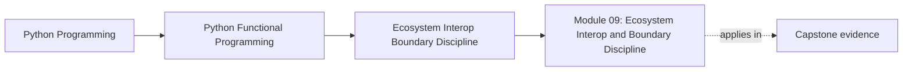

# Module 09: Ecosystem Interop and Boundary Discipline


<!-- page-maps:start -->
## Page Maps




<!-- page-maps:end -->

Read the first diagram as a placement map: this page sits between the course promise, the lesson pages listed below, and the capstone surfaces that pressure-test the module. Read the second diagram as the study route for this page, so the diagrams point you toward the `Lesson map`, `Exercises`, and `Closing criteria` instead of acting like decoration.

## Keep These Pages Open

Use these support surfaces while reading so interop stays disciplined and does not erase
the boundaries the earlier modules established:

- [Mastery Map](../module-00-orientation/mastery-map.md) for the late-course route into interop and sustainment
- [Pressure Routes](../guides/pressure-routes.md) for framework and library pressure
- [Anti-Pattern Atlas](../reference/anti-pattern-atlas.md) for interop symptoms that hide design regressions
- [Capstone Map](../capstone/capstone-map.md) for the CLI, distributed, and interop surfaces in FuncPipe

Carry this question into the module:

> How can this code touch ordinary Python libraries and frameworks without letting those integrations dissolve the core design contracts?

This module answers a practical adoption question: how do you keep the course’s design
discipline when the code has to touch real libraries, frameworks, data tools, and team
conventions? The answer is not purity theater. It is deliberate interop.

## Learning outcomes

- how to use standard-library and third-party tools without surrendering reviewability
- how to wrap imperative libraries behind functional facades
- how to preserve explicit configuration across CLI, service, data, and distributed work
- how to turn team conventions into stable adoption patterns

## Lesson map

- [Module 09 Capstone Delta](capstone-delta.md)
- [Standard Library Functional Tools](stdlib-functional-tools.md)
- [Helper Libraries](helper-libraries.md)
- [Data Processing](data-processing.md)
- [Web and Services](web-and-services.md)
- [Data and ML Pipelines](data-and-ml-pipelines.md)
- [CLI and Config Pipelines](cli-and-config-pipelines.md)
- [Distributed Dataflow](distributed-dataflow.md)
- [Distributed Dataflow Review](distributed-dataflow-review.md)
- [Functional Facades](functional-facades.md)
- [Cross-Process Composition](cross-process-composition.md)
- [Team Adoption](team-adoption.md)
- [Exercises](exercises.md)
- [Exercise Answers](exercise-answers.md)
- [Refactoring Guide](refactoring-guide.md)

## Exercises

Use [Exercises](exercises.md) for decision-making work against the Module 09
reference state. Each prompt names its starting context, constraints, observable
evidence, acceptance command, and earlier contract to preserve. Compare your
reasoning with [Exercise Answers](exercise-answers.md) only after running the
focused proof.

## Capstone checkpoints

- Identify where FuncPipe prefers stdlib tools over extra abstraction layers.
- Review which external integrations keep configuration and contracts explicit.
- Compare interop wrappers with the core they are protecting.

## Before moving on

You should be able to explain how to adapt real libraries without letting them rewrite the
course’s core architecture. Use [Refactoring Guide](refactoring-guide.md) and compare
against `capstone/_history/worktrees/module-09` before moving forward.

Complete the final team-adoption exercise and run all Module 09 learning proofs:

```bash
pytest -q tests/learning/test_module_09_interop.py
```

## Closing criteria

- You can explain where interop is a boundary problem rather than a reason to abandon the course’s design rules.
- You can judge whether a wrapper keeps configuration, failure, and review evidence explicit enough for long-term maintenance.
- You can defend a library choice in terms of contracts, not convenience alone.

## Directory glossary

Use [Glossary](glossary.md) when you want the recurring language in this module kept stable while you move between lessons, exercises, and capstone checkpoints.
