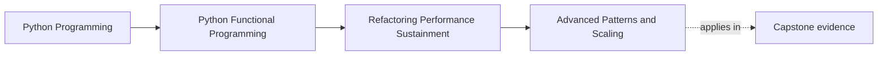
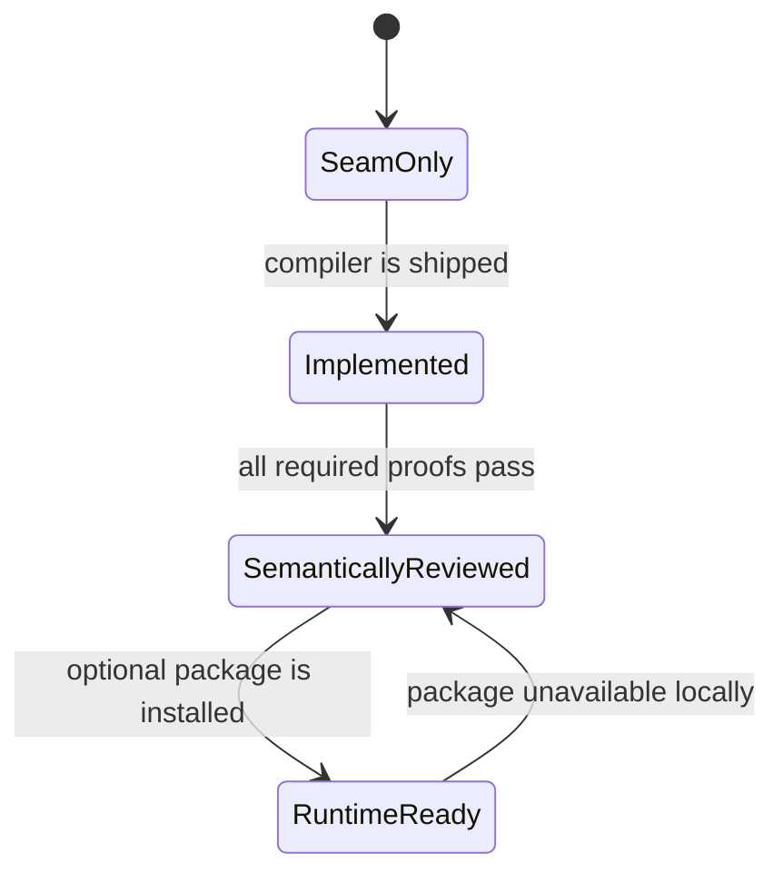

# Advanced Patterns and Scaling

<!-- page-maps:start -->
## Page Maps




<!-- page-maps:end -->

An advanced feature is useful when it makes an existing contract easier to express
or preserves that contract under new pressure. It is not useful merely because it
is sophisticated.

FuncPipe already uses two earned Python features:

- structural pattern matching exhausts known `Result` variants at serialization
  boundaries; and
- `ParamSpec` preserves the call signature of memoized functions.

Neither feature requires the application to become distributed. Scaling is a
separate decision with a much larger proof obligation.

## Review the pressure before choosing a feature

| Pressure | Smallest honest response | Evidence |
| --- | --- | --- |
| Handle a closed value family | `match` over owned variants | every variant has an explicit route |
| Preserve higher-order call signatures | `ParamSpec` and `TypeVar` | strict type checking plus behavior test |
| Process independent local plans concurrently | bounded `async_gather` | bound, order, failure, and cleanup tests |
| Move execution to another process or engine | explicit compiler/adapter | semantic parity for delivery, ordering, failure, and pressure |
| Make a normal loop look more “functional” | keep the readable loop | application behavior remains obvious |

The table prevents a common escalation: a local performance problem does not
automatically justify a distributed backend.

## Pattern matching earns its place at a closed boundary

The serialization adapter owns a closed `Result` family:

```python
match result:
    case Ok(value=value):
        return encode_success(value)
    case Err(error=error):
        return encode_failure(error)
```

The match is valuable because the adapter must translate both variants and keep
their meaning visible. A chain of predicates could work, but it would make
exhaustiveness harder to review.

Do not use a match only to disguise ordinary polymorphism or open-ended extension.
If external plugins can introduce new values, a closed pattern match may encode
the wrong ownership model.

## `ParamSpec` preserves a callable contract

The memo policy wraps functions with different parameter lists. A broad
`Callable[..., object]` would erase useful type information. `ParamSpec` lets the
wrapper return a callable with the same parameters:

```python
P = ParamSpec("P")
R = TypeVar("R")

def memoize(
    function: Callable[P, R],
) -> Callable[P, R]:
    ...
```

This feature earns its complexity at a higher-order API boundary. It would add
little value to a function with one fixed RAG argument shape.

## A package is not a backend

Module 09 leaves explicit Dask and Beam attachment points, but the course does not
ship either compiler. Import availability answers only:

> Can this Python environment import the optional package?

It does not answer:

- can FuncPipe translate its pipeline into that backend?
- does the translation preserve chunk and failure values?
- what delivery semantics apply after retries?
- which order is preserved?
- where does backpressure live?

Module 10 represents these distinctions:

```python
status = BackendStatus(
    name="dask",
    installed=True,
    compiler_shipped=False,
)

assessment = assess_scaling(status, REQUIRED_SCALING_PROOFS)

assert assessment.implementation_ready is False
assert assessment.runtime_ready is False
```

Import success cannot turn an unimplemented seam into a feature.

## Readiness is a state transition



The current teaching capstone stays at `SeamOnly`. That is an honest and usable
state: local execution remains the oracle, and no optional backend is required to
complete the course.

`assess_scaling` expects proof names for:

- `ordering`;
- `failure`;
- `delivery`; and
- `backpressure`.

These names are reminders of Module 08 and Module 09 contracts, not substitutes
for tests. Supplying a string such as `"ordering"` is meaningful only after a
real compiler has an executable parity test for ordering.

## Missing proof remains visible

```python
status = BackendStatus(
    name="dask",
    installed=True,
    compiler_shipped=True,
)
verified = frozenset({"ordering", "delivery"})

assessment = assess_scaling(status, verified)

assert assessment.missing_proofs == ("backpressure", "failure")
assert assessment.implementation_ready is False
```

Stable ordering of missing proof names makes the assessment reviewable. The
decision does not install a package, import a backend, run a cluster, or compile a
pipeline; those are effectful observations and executions outside this pure rule.

## Run the focused evidence

From `capstone/`:

```bash
pytest -q tests/unit/review/test_scaling.py
pytest -q tests/learning/test_module_10_sustainment.py \
  -k scaling_review_separates_installation_implementation_and_proof
```

Expected learning observations:

- installed without compiler is not implementation-ready;
- compiler plus all declared semantic proofs may be implementation-ready even
  when the local package is absent; and
- runtime readiness additionally requires local installation.

This separation lets code review evaluate an implementation without requiring
every learner to install an optional ecosystem.

## Failure routes

### Import-and-claim

```python
if dask_available():
    return "distributed-ready"
```

This reports environment state as application capability.

### Compiler-and-claim

A translation function can run while changing failure selection or materializing
an unbounded stream. Implementation existence is not semantic parity.

### Distributed example without application pressure

Adding a cluster-shaped example to a deterministic local course makes the RAG
application harder to understand and teaches configuration rather than functional
judgment.

### Advanced syntax everywhere

Pattern matching and higher-order typing can obscure simple logic when the domain
is not closed or the signature does not need preservation. The review question is
always whether the feature clarifies an owned contract.

## What the evidence proves

The focused tests prove that supplied installation, compiler, and proof facts are
classified independently and that missing semantic proof names remain visible.

They do not prove:

- that Dask or Beam is installed;
- that FuncPipe ships a distributed compiler;
- that a backend preserves RAG semantics;
- that distributed execution is faster; or
- that the four proof categories are complete for a future deployment.

Those claims must wait for a real application pressure and executable adapter.
The local FuncPipe pipeline remains the complete course product.

Continue with [DDD and FP](ddd-and-fp.md) to assign language and review ownership
without turning package boundaries into invented services.
