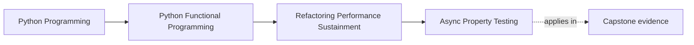
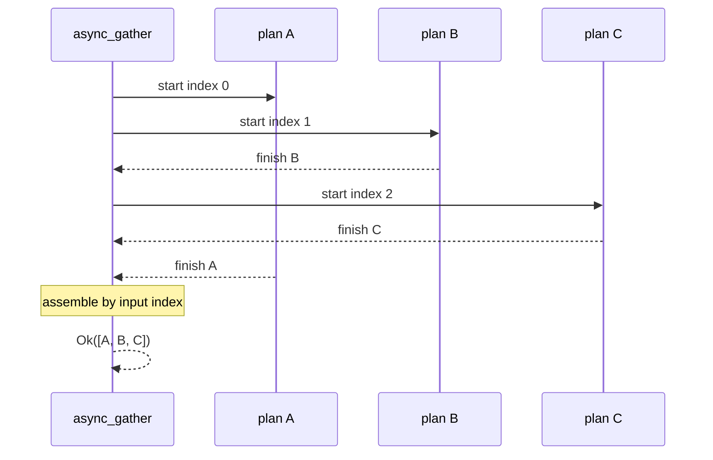

# Async Property Testing

<!-- page-maps:start -->
## Page Maps




<!-- page-maps:end -->

Async property tests should vary scheduling pressure while asserting value-level
contracts. They should not guess scheduler behavior from sleep duration.

Module 08 gave `async_gather` three promises:

- no more than the declared number of plans run concurrently;
- successful output preserves input order; and
- failures remain `ErrInfo` values rather than escaping as ordinary exceptions.

Module 10 asks whether generated inputs can preserve those promises without
network calls, real clocks, or shared coroutine objects.

## Separate three kinds of order

For input plans `[A, B, C]`:

- **start order** describes when tasks are scheduled;
- **completion order** describes which task finishes first;
- **result order** describes the returned list.

`async_gather` promises result order. It does not promise completion order.



The scheduler may produce `B, C, A` completion, while the value contract remains
`A, B, C`.

## Plans must be replayable descriptions

This is unsafe:

```python
coroutine = do_work()
plans = [lambda: coroutine, lambda: coroutine]
```

A coroutine object can be awaited only once. Reusing it makes generated tests fail
for lifecycle reasons unrelated to gather ordering.

FuncPipe's `async_pure(value)` returns a plan that creates a fresh coroutine on
every call:

```python
plans = [async_pure(value) for value in values]
```

This preserves the Module 08 distinction between an `AsyncPlan` description and
one execution of that plan.

## Generate values and pressure

The learning proof varies both input and concurrency:

```python
@given(
    values=st.lists(st.integers(), max_size=12),
    concurrency=st.integers(min_value=1, max_value=4),
)
def test_bounded_async_gather_preserves_input_order(
    values: list[int],
    concurrency: int,
) -> None:
    gathered = asyncio.run(
        async_gather(
            [async_pure(value) for value in values],
            concurrency=concurrency,
        )()
    )

    assert isinstance(gathered, Ok)
    assert gathered.value == values
```

The strategy includes:

- an empty list, which must yield `Ok([])`;
- one item, which exposes unnecessary special cases;
- duplicate integers, which prevent set equality from impersonating order proof;
- concurrency `1`, which exercises the sequential bound; and
- limits larger than some generated lists, which checks that capacity does not
  create extra output.

The maximum sizes keep the proof fast. The application claim concerns ordering
across pressure values, not stress capacity.

## Why no arbitrary sleeps?

This test is not evidence:

```python
await asyncio.sleep(0.01)
assert task_b.done()
```

It depends on machine load, event-loop implementation, and an assumed timing
relationship. A passing run says little about the declared ordering contract.

Use controlled awaits only when they expose a deliberate interleaving or resource
lifecycle. Even then, assert values, counts, or cleanup—not elapsed wall time.

The broader capstone test suite uses fakes with `await asyncio.sleep(0)` to yield
control at known logical points. The assertion remains about replayed output,
deduplication, state, or open resource counts.

## Failure selection is a separate property

`async_gather` returns the first error by input index, not the first error to
finish. A property for that behavior needs generated `Ok` and `Err` plans and an
expected index-based oracle.

Do not weaken the successful-order property by mixing every async concern into one
test. Focused properties make counterexamples explainable:

| Claim | Generated pressure | Observable evidence |
| --- | --- | --- |
| Successful order | values and concurrency | returned values equal input list |
| Bound | plan lifecycle counter | maximum active count never exceeds limit |
| Error selection | positioned `Err` values | returned error matches lowest failing input index |
| Cleanup | cancellation point | no active resource remains |
| Replay | repeated plan execution | equal `Result` values from fresh coroutines |

## Run the focused evidence

From `capstone/`:

```bash
pytest -q tests/learning/test_module_10_sustainment.py \
  -k bounded_async_gather_preserves_input_order
pytest -q tests/unit/domain/test_async_law_properties.py
```

The first command is the smallest proof for ordered gather across generated
concurrency limits. The second exercises replay, deduplication, and partial
cancellation with controlled fakes.

If the first property fails, inspect the minimized `values` and `concurrency`.
A case such as `[0, 1]` with concurrency `2` is more diagnostic than a long,
random-looking workload.

## What the evidence proves

The learning property proves that successful, replayable, pure plans return
values in input order for the generated list and concurrency ranges.

The companion tests add evidence that:

- replaying the same async description yields equal emitted values and state;
- successful keys are not duplicated; and
- partially consumed streams close their fake resource count.

They do not prove:

- fairness between independent streams;
- behavior under a real service outage;
- wall-clock timeout accuracy;
- every cancellation interleaving;
- executor thread safety; or
- performance under a large production workload.

Those require a separate claim and a controlled boundary test. Async complexity
does not excuse vague evidence.

Continue with [Advanced Patterns and Scaling](advanced-patterns-and-scaling.md) to
decide when a more complex execution route has earned its application cost.
