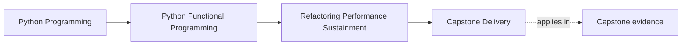
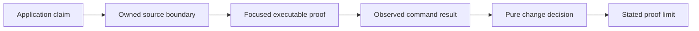

# Capstone Delivery

<!-- page-maps:start -->
## Page Maps




<!-- page-maps:end -->

The course ends by delivering evidence for the deterministic local FuncPipe
application learners actually built. You do not need a cluster, deployment
platform, protected release repository, or external model call to demonstrate
functional-programming judgment.

The final product is a reviewable chain:



Every link has a different responsibility. A source path is not a passing test. A
passing test is not proof of an untested workload. A pure decision is only as
credible as its supplied evidence.

## What the completed capstone contains

The live `capstone/` is the Module 10 endpoint. It preserves the cumulative
application and adds sustainment surfaces:

| Surface | Responsibility |
| --- | --- |
| `src/funcpipe_rag/review/evidence.py` | classify whether a claim's named paths are discoverable |
| `review/performance.py` | compare supplied measurements with an explicit multidimensional budget |
| `review/observability.py` | fold immutable stage facts without changing RAG control flow |
| `review/migration.py` | classify contract shape before a semantic translator is judged |
| `review/scaling.py` | separate installation, implementation, and declared semantic proof |
| `review/change.py` | compose only the decisions relevant to one proposed change |
| `boundaries/shells/review_cli.py` | perform filesystem discovery and render the review inventory |
| `tests/learning/test_module_10_sustainment.py` | connect each review rule to the cumulative RAG application |

This is a teaching application, not a production template. Its value is that every
review concept has a small implementation and executable proof learners can trace.

## Build one change dossier

Choose one proposed change, such as selecting the hybrid embedding route. Record
these six items.

### 1. Application claim

Use domain language:

> The hybrid embedding route preserves each chunk's text, provenance, model,
> expected dimension, failure position, and vector meaning.

Avoid implementation-only claims such as “the NumPy code returns a list.”

### 2. Source boundary

Name both compared routes and the predicate:

```text
src/funcpipe_rag/rag/domain/perf.py
```

The file location is discoverability evidence. Read the code and confirm the
predicate compares every public field relevant to the claim.

### 3. Focused proof

```bash
pytest -q tests/unit/rag/domain/test_perf_equivalence.py
pytest -q tests/learning/test_module_10_sustainment.py \
  -k optimized_embedding_preserves_the_domain_contract
```

Record the command and observed result. Do not replace the focused route with a
whole-suite command in the dossier; a reviewer should be able to reproduce the
specific claim quickly.

### 4. Applicable decisions

An optimization needs semantic equivalence and a budget decision. It does not need
a migration assessment when no public contract shape changes:

```python
evidence = ChangeEvidence(
    semantic_equivalent=True,
    claims=(embedding_claim,),
    budget=evaluate_budget(budget, observation),
    migration=None,
)

decision = review_change(evidence)
```

If peak memory violates the budget, the change remains blocked even when the
equivalence proof passes.

### 5. Preserved earlier contracts

Name the relevant course inheritance:

- Module 04 failure values retain their positions;
- Module 05 `Chunk` metadata remains application-owned;
- Module 07 measurement effects remain outside pure decisions; and
- Module 08 concurrency does not alter ordered output.

Do not claim preservation of every course behavior if the change does not touch
it. Relevant precision is more credible than a universal checklist.

### 6. Proof limit

For example:

> Generated equivalence covers the declared text and batch-size strategy. It does
> not establish real workload performance or hardware-specific numeric behavior.

This statement is part of delivery, not an apology. It tells the next maintainer
what evidence a broader claim would require.

## Discoverability and execution are different gates

Run:

```bash
make review-check
```

The command calls `funcpipe-rag-review check` and fails when a published evidence
claim names a missing source or test path. It answers:

> Can a learner reach every proof the review inventory promises?

It does not execute those tests.

Now run:

```bash
pytest -q tests/learning/test_module_10_sustainment.py
```

This executes the Module 10 learning claims. It does not run the whole capstone
suite or verify generated history.

Use the distinction deliberately:

| Evidence | Answers | Does not answer |
| --- | --- | --- |
| `make review-check` | are declared paths discoverable? | do tests pass? |
| focused pytest | does one teaching claim pass? | is every module preserved? |
| history verification | does generated Module 10 match the live endpoint? | is runtime behavior correct? |
| strict docs build | do course pages and diagrams render? | do code claims execute? |
| final broad gate | do cumulative configured checks pass together? | is every external environment represented? |

## Inspect the learner-facing report

```bash
make inspect
```

The command writes a text summary, JSON summary, documentation copies, route file,
and manifest under the repository `artifacts/` tree. Read `summary.txt` first.

Check:

- package groups have stable responsibilities and owners;
- nested source paths do not inflate counts;
- test groups state what they prove;
- proof routes name their cost and purpose; and
- every evidence claim has a narrow command.

The JSON form supports mechanical inspection. The text form supports a learner.
Neither should be treated as a runtime test report.

## Compare the cumulative endpoint

Module 09 remains the preserved state before sustainment review. Module 10 is the
live capstone and generated endpoint:

```bash
git diff --no-index \
  module-reference-states/module-09/src/funcpipe_rag \
  src/funcpipe_rag/review
```

Expect the review package only at the Module 10 side. Earlier reference states
must not gain these concepts retroactively.

After source changes, use the established history refresh and verification route.
The generated Module 10 worktree must contain `review/change.py` and its tests,
while Modules 01–09 remain faithful to their own teaching endpoints.

## Delivery failure routes

### A persuasive document without a command

The claim cannot be reproduced. Add a focused executable route or narrow the
claim to what can be inspected.

### A passing command without a named assertion

A broad suite may pass while the claimed behavior is never asserted. Point to the
test and explain the important assertion.

### A benchmark without equivalence

The faster candidate may be doing different work. Establish domain equivalence
first.

### A production checklist for unshipped machinery

Listing schema registries, deployment controls, distributed runtimes, or release
systems the course does not implement makes the capstone harder to review and
teaches learners to confuse aspiration with evidence.

### One strongest command after every edit

Repeated broad runs slow feedback and hide which proof matters. Use focused tests
during learning and reserve the broad gate for final confirmation.

## Final learner review

Before calling the capstone delivered, you should be able to answer:

1. What application behavior does your dossier claim?
2. Which source boundary owns it?
3. Which focused test proves the important relationship?
4. Which review decisions apply, and which do not?
5. Which earlier module contracts must survive?
6. What did you observe when the command ran?
7. What remains outside the proof?

If another learner can follow those answers from claim to code to evidence, the
capstone has fulfilled its purpose. Delivery here means understandable,
executable, and honest—not decorated with infrastructure the course never taught.

Complete [Module 10 Exercises](exercises.md), compare your reasoning with
[Exercise Answers](exercise-answers.md), and use the
[Refactoring Guide](refactoring-guide.md) for the final self-review.
