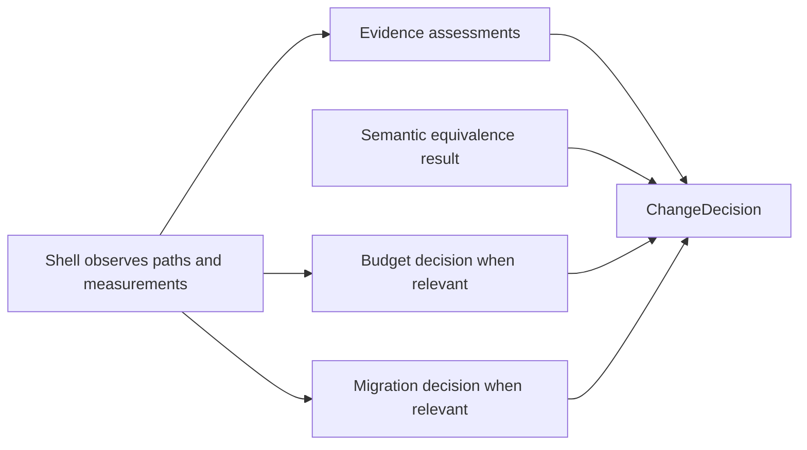

# Module 10 Capstone Delta

Module 09 left FuncPipe with one deterministic local RAG application, explicit
effect boundaries, bounded asynchronous execution, and adapters that translate
ecosystem values into the application model. Module 10 does not add another
integration. It teaches how to decide whether a proposed change is safe.

## The maintenance pressure

A test can pass while answering the wrong question. A benchmark can improve while
the output changes. A migration can preserve field names while corrupting meaning.
A dependency can be installed while the application has no adapter for it.

The final application pressure is therefore:

> How can a maintainer combine the evidence that applies to one change without
> mistaking discoverability, measurement, or installation for proof?

The live capstone now represents that decision explicitly. Effectful shells
discover files and collect measurements. Small pure functions classify each
observation. `review_change` composes those decisions and names every blocker.

## The application delta

| Delta question | Module 10 answer |
| --- | --- |
| Previous capability | Module 09 can run and inspect a local RAG pipeline through disciplined ecosystem boundaries |
| New pressure | A maintainer needs a reviewable acceptance decision for a refactor, optimization, or contract change |
| Concept introduced | Sustainment as observed facts, independent pure decisions, and one composed verdict |
| New source | `capstone/src/funcpipe_rag/review/change.py` |
| Supporting decisions | `review/evidence.py`, `performance.py`, `migration.py`, `observability.py`, and `scaling.py` |
| Shell boundary | `boundaries/shells/review_cli.py` discovers paths and renders the review inventory |
| Direct proof | `capstone/tests/unit/review/test_change.py` |
| Learning proof | `capstone/tests/learning/test_module_10_sustainment.py` |
| Preserved behavior | Modules 01–09 RAG values, laws, streaming, failure, async, and adapter contracts |
| Completed state | The live capstone and generated `capstone/_history/worktrees/module-10/` |
| Later states affected | None; Module 10 is the cumulative endpoint |

## Follow the data, not the vocabulary



The arrows into `ChangeDecision` carry values, not callbacks. The decision does not
walk the filesystem, run a benchmark, call a service, or execute tests. This
preserves the boundary discipline from Module 07 and makes the acceptance rule
cheap to test.

Optional checks are genuinely optional. A pure internal refactor may need semantic
equivalence and its named regression proof but no migration assessment. A metadata
contract change needs migration evidence. A performance-motivated change needs a
budget decision. Applying every available tool to every change would create
ceremony rather than confidence.

## Read the new decision

```python
decision = review_change(
    ChangeEvidence(
        semantic_equivalent=True,
        claims=(cleaning_law,),
        budget=evaluate_budget(budget, observation),
    )
)

assert decision.acceptable is False
assert decision.blockers == ("performance:peak_memory",)
```

The proposed implementation preserves cleaning semantics and has a complete
claim-to-test route. It is still rejected because it exceeds the declared memory
budget. A latency improvement does not cancel an independent memory limit.

This result proves only that the supplied evidence fails the declared rule. It
does not prove that the measurement workload is representative or that the named
test was executed. Observation quality and proof execution remain separate review
responsibilities.

## Compare Module 09 and Module 10

Start with the smallest useful comparison:

```bash
cd programs/python-programming/python-functional-programming/capstone
git diff --no-index \
  module-reference-states/module-09/src/funcpipe_rag \
  src/funcpipe_rag/review
```

Expected observation:

- Module 09 has the application and ecosystem seams;
- Module 10 adds review values and decision functions;
- the RAG stages themselves do not need to change;
- the review shell is outside the pure decision package.

`git diff --no-index` returns status `1` when differences exist. Here that status
is expected evidence, not a failed comparison.

Then execute the focused endpoint:

```bash
pytest -q tests/unit/review/test_change.py
pytest -q tests/learning/test_module_10_sustainment.py \
  -k change_review_composes_only_applicable_application_evidence
```

The first command proves the decision table in isolation. The second connects it
to FuncPipe's cleaning law and performance values.

## What must remain true

Module 10 is incomplete if its review machinery changes the application being
reviewed. Before accepting work in this module, confirm:

- document cleaning, chunking, embedding, and retrieval meanings remain intact;
- Module 04 failures still travel as explicit values;
- Module 07 shells still own filesystem and measurement effects;
- Module 08 ordering and bounded-concurrency laws remain valid;
- Module 09 adapters still translate into application-owned values;
- equivalent behavior is established before performance can justify selection;
- a missing proof path blocks the claim rather than becoming a warning; and
- generated Module 10 history matches the live capstone endpoint.

Continue with [Systematic Refactor](systematic-refactor.md) to learn how to obtain a
trustworthy starting observation before composing a verdict.
