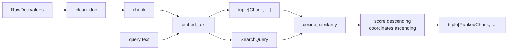

# Module 10 Capstone Delta

Module 09 leaves FuncPipe with a disciplined **indexing** pipeline. It reads
documents, cleans and chunks them, computes deterministic local embeddings, and
keeps ecosystem dependencies at named boundaries. That is useful infrastructure,
but it is not yet retrieval: no application function accepts a question and
returns ordered chunks.

Module 10 completes that local learning loop without rewriting the frozen Module
01–09 reference states. The live endpoint adds explicit query and ranked-result
values, one shared embedding contract, pure cosine scoring, deterministic
tie-breaking, and a focused index-to-retrieval proof. The module's existing
sustainment model then gives learners a concrete behavior worth reviewing.

## The application pressure

The word “RAG” can hide three different capabilities:

1. **indexing** turns documents into embedded chunks;
2. **retrieval** turns a query and an index into ranked chunks; and
3. **generation** turns retrieved context into a response.

The preserved Module 09 state implements the first capability. It does not
implement the second or third. Calling embedding output “retrieval” would make
the course architecture sound more complete than the code.

The live pressure is therefore:

> How can FuncPipe add a small, deterministic retrieval path by composing the
> value, purity, boundary, and evidence rules already taught—without pretending
> that a hash vector is semantic search or that generation exists?

That pressure earns a narrow application change. It does not earn a vector
database, model SDK, web service, or another framework.

## The application delta

| Delta question | Module 10 answer |
| --- | --- |
| Previous capability | Module 09 builds a deterministic local index of embedded chunks through explicit boundaries |
| Missing product behavior | No query value, similarity function, ranking rule, or index-to-result entry point exists |
| Concept applied | Compose immutable values, pure functions, deterministic ordering, and claim-scoped evidence into retrieval |
| New domain values | `rag/domain/retrieval.py`: `SearchQuery` and `RankedChunk` |
| New pure behavior | `rag/retrieval.py`: `make_query`, `cosine_similarity`, and `retrieve` |
| Preserved implementation | `embed_chunk` still produces the same 16-dimensional vector; `embed_text` makes that contract reusable |
| Direct learning proof | `tests/learning/test_module_10_retrieval.py` |
| Focused command | `make capstone-retrieval-proof` from the course directory |
| Sustainment behavior | `review/` still classifies evidence, performance, migration, observation, and scaling facts |
| Completed state | The live capstone and generated `capstone/_history/worktrees/module-10/` |
| Frozen comparison | `capstone/_history/worktrees/module-09/` remains the exact Module 09 endpoint |

## Trace one query through the live endpoint



The shared `embed_text` node matters. If query and chunk vectors came from
different local contracts, matching dimensions would not make their scores
meaningful. `embed_chunk` delegates to the same function, so extracting the
text-level operation preserves the earlier chunk result exactly.

`SearchQuery` is a product type:

```python
query = SearchQuery(
    text="typed retrieval",
    embedding=Embedding(
        vector=embed_text("typed retrieval"),
        model="local-sha256",
    ),
    top_k=3,
)
```

All three fields are required. Blank text, an empty embedding, or a non-positive
`top_k` is rejected before ranking begins. A loose dictionary with optional
fields would move those checks into every caller.

`RankedChunk` keeps the returned chunk, score, and one-based rank together.
The value rejects non-finite scores and invalid positions. This does not prove
that the score measures human relevance; it proves that downstream code cannot
receive an internally contradictory ranked-result value.

## Read the ranking rule as a total order

`retrieve` evaluates every supplied chunk with pure cosine similarity and sorts
by:

1. score descending;
2. document ID ascending;
3. start offset ascending;
4. end offset ascending; and
5. chunk text ascending.

The secondary keys are part of the public behavior. Without them, two equal
scores would inherit input order. A caller changing source order could then
change published ranks even though every score stayed equal.

The function returns at most `query.top_k` immutable results. It does not mutate
the index or hide I/O. An empty index produces an empty tuple. A malformed vector
dimension or zero vector fails at the narrow similarity contract rather than
producing a misleading score.

## Run the exact product proof

From `programs/python-programming/python-functional-programming/`:

```bash
make capstone-retrieval-proof
```

The proof establishes four claims:

- query text and chunk text use one deterministic embedding function;
- illegal query and ranked-result values are rejected;
- equal scores are ordered by stable chunk coordinates; and
- the live ingestion pipeline can index two documents and retrieve the exact
  local match.

To inspect the historical boundary first:

```bash
make history-refresh
git -C capstone/_history/worktrees/module-09 \
  ls-files 'src/funcpipe_rag/rag/*retriev*'
git -C capstone/_history/worktrees/module-10 \
  ls-files 'src/funcpipe_rag/rag/*retriev*'
```

The Module 09 command returns no retrieval paths. The Module 10 command exposes
the live retrieval source and domain model. That difference is intentional:
history is preserved rather than rewritten to make the final product appear to
have existed earlier.

## The sustainment delta now reviews real behavior

Module 10 still teaches evidence-led change. Effectful shells discover paths and
collect measurements. Pure review functions classify observations.
`review_change` composes only the decisions relevant to the proposed change.

Retrieval makes those lessons concrete. A maintainer can now ask:

- does replacing `cosine_similarity` preserve score and ordering semantics?
- does a faster top-k implementation preserve the deterministic tie-break?
- does changing the embedding model require a migration rather than a refactor?
- does a proposed vector backend keep failure and materialization at the edge?
- which focused command supports each claim?

A benchmark cannot excuse a changed ordering contract. A present test file does
not prove its command passed. A same-shaped embedding does not prove the same
meaning. These are exactly the distinctions the review package models.

## What this capstone does not claim

The local SHA-256-derived vectors are deterministic teaching fixtures. They can
prove an exact local match and make ranking mechanics reproducible. They do not
encode language meaning, so this course does **not** claim semantic relevance,
production retrieval quality, or generalization to paraphrases.

The endpoint also does not provide:

- approximate nearest-neighbor indexing;
- persistence for a vector index;
- a remote embedding service;
- relevance judgments or retrieval evaluation metrics;
- prompt construction;
- answer generation; or
- a networked query API.

Those can become later product pressures. Adding them here would obscure the
functional contracts under infrastructure. The completed teaching claim is
narrower and executable: FuncPipe now has a deterministic local
index-to-ranked-chunks path, and learners can state exactly what its proof does
and does not establish.

Continue with [Systematic Refactor](systematic-refactor.md) to learn how to
characterize this behavior before changing its implementation.
