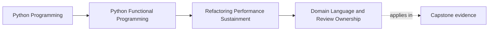
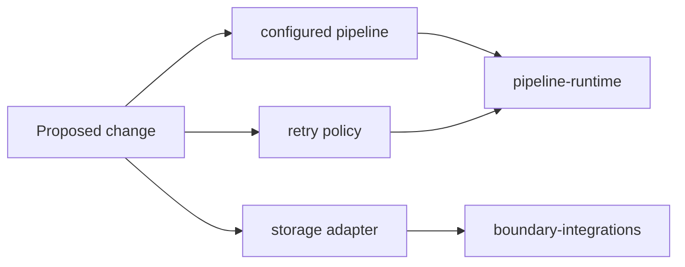

# Domain Language and Review Ownership

<!-- page-maps:start -->
## Page Maps




<!-- page-maps:end -->

Domain-driven design contributes a useful question to functional code:

> Which part of the application owns this language and its invariants?

It does not require turning every directory into a bounded context or every
package into a service. FuncPipe remains one local application. Module 10 uses
domain language to make review responsibility visible without reorganizing code
for diagram symmetry.

## Read the existing application boundaries

FuncPipe has five review groups:

| Group | Stable responsibility | Review owner |
| --- | --- | --- |
| `functional-core` | reusable algebra, results, trees, and streaming | `functional-foundations` |
| `rag-model` | RAG values, stages, and domain assembly | `rag-domain` |
| `orchestration-and-policy` | configured flow and explicit runtime choices | `pipeline-runtime` |
| `effect-boundaries` | capabilities, shells, adapters, and concrete edges | `boundary-integrations` |
| `interop` | ecosystem value translation | `ecosystem-interop` |

These are review routes, not claims of independent deployment. A group may span
several Python directories when one change requires the same engineering
judgment.

## Ownership follows meaning

Consider a change touching:

```text
src/funcpipe_rag/pipelines/configured.py
src/funcpipe_rag/policies/retry.py
```

Both belong to `orchestration-and-policy`. The durable question is how a pipeline
assembles policy, so `pipeline-runtime` reviews the combined change.

If the same work also changes:

```text
src/funcpipe_rag/boundaries/adapters/storage.py
```

then `boundary-integrations` joins the review because concrete storage translation
and lifecycle are now affected.

Counting directories would produce three owners. Following responsibility
produces the two kinds of judgment the change actually needs.



## Keep application language local

RAG terms belong in the RAG model:

- document;
- chunk;
- embedding;
- metadata;
- ranking or retrieval result.

Operational terms belong in orchestration and policy:

- retry decision;
- concurrency limit;
- timeout;
- circuit state;
- materialization policy.

Boundary terms describe translation and effects:

- storage adapter;
- filesystem shell;
- web payload;
- serialization;
- clock capability.

When `ChunkMetadata` starts carrying retry counters, domain and operational
language have crossed without an earned reason. When a retry policy imports a
concrete filesystem adapter, policy and effect ownership have crossed.

The first response should be to clarify the value boundary, not split the
application into services.

## What would justify a larger boundary?

A separate bounded context may be useful when several signals persist:

- the same term has genuinely different meanings;
- invariants change independently;
- translation between the meanings is unavoidable;
- different owners must make changes at different cadences; and
- the separation reduces, rather than relocates, coupling.

One different package name or one scalability idea is not enough. FuncPipe does
not have this pressure in Module 10, so it keeps its current package architecture.

## The executable ownership proof

`PACKAGE_GROUPS` in the review shell publishes the group, paths, purpose, tests,
and owner. The learning proof asserts the complete owner mapping:

```python
ownership = {
    group["name"]: group["owner"]
    for group in build_summary(PROJECT_ROOT)["package_groups"]
}

assert ownership == {
    "functional-core": "functional-foundations",
    "rag-model": "rag-domain",
    "orchestration-and-policy": "pipeline-runtime",
    "effect-boundaries": "boundary-integrations",
    "interop": "ecosystem-interop",
}
```

Run:

```bash
pytest -q tests/learning/test_module_10_sustainment.py \
  -k package_groups_name_review_ownership_not_only_directories
funcpipe-rag-review summary --format text --project-root .
```

Read the group purposes beside the owners. An owner label without a stated
responsibility is only a name.

## Failure routes

### One bounded context per directory

This confuses filesystem organization with domain meaning and creates translation
work that the application does not need.

### Moving files to match a diagram

Package churn risks imports and generated history while leaving the underlying
responsibilities unchanged.

### One owner for the whole repository

The label is easy to maintain but does not tell a reviewer which knowledge a
change requires.

### Naming current people

Personal names age quickly and make responsibility depend on one staffing moment.
Use stable capability labels in the teaching application.

### Ownership as authority proof

The report can state who should review a group. It cannot enforce approvals or
prove that an organization has assigned those people.

## What the evidence proves

The focused test proves that every published review group has the expected stable
responsibility label. The summary makes the paths and tests for each group
inspectable.

It does not prove:

- independent deployability;
- organizational approval rules;
- absence of every cross-package dependency;
- that five groups are ideal for all future changes; or
- that review ownership alone preserves domain invariants.

The mapping is a learning and sustainment aid for the application that exists.
Change it when domain responsibility changes, not when a new diagram looks
attractive.

Continue with [Versioning and Migration](versioning-and-migration.md), where a
contract shape and its domain translation must be reviewed separately.
