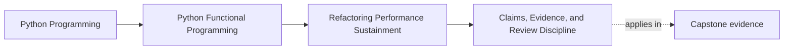
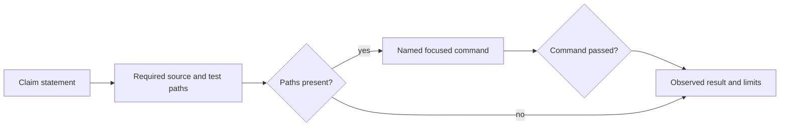

# Claims, Evidence, and Review Discipline

<!-- page-maps:start -->
## Page Maps




<!-- page-maps:end -->

Governance in this teaching application means making important claims reviewable.
It does not mean inventing approval boards, release processes, or organization
charts the repository cannot enforce.

The smallest useful governance unit is:

- a precise application statement;
- the source paths that own it;
- the test paths that assert it; and
- the narrow command that executes the proof.

FuncPipe represents that unit as `EvidenceClaim`.

## A claim is a route, not a result

The live review inventory includes:

```python
EvidenceClaim(
    name="change-acceptance",
    statement=(
        "A proposed change is accepted only when its applicable proofs agree."
    ),
    required_paths=(
        "src/funcpipe_rag/review/change.py",
        "tests/unit/review/test_change.py",
    ),
    command="pytest -q tests/unit/review/test_change.py",
)
```

This value says where the implementation and proof should be and how a learner can
run them. It does not say the command passed.

The distinction prevents stale prose from becoming authority:



`assess_evidence` owns only the `discover` decision. Test execution belongs to the
verification route.

## Keep filesystem effects in the shell

The pure assessment receives already-observed paths:

```python
assessment = assess_evidence(
    claim,
    frozenset(
        {
            "src/funcpipe_rag/review/change.py",
            "tests/unit/review/test_change.py",
        }
    ),
)

assert assessment.complete is True
assert assessment.missing_paths == ()
```

If the test path is absent:

```python
assessment = assess_evidence(
    claim,
    frozenset({"src/funcpipe_rag/review/change.py"}),
)

assert assessment.complete is False
assert assessment.missing_paths == ("tests/unit/review/test_change.py",)
```

The function does not call `Path.exists`. The review shell performs discovery,
then passes plain path strings into the decision. This preserves the effect
boundary from Module 07 and makes missing-path behavior deterministic.

## What deserves a published claim?

Publish claims that help a maintainer accept or reject meaningful application
changes:

- an optimization preserves the RAG domain contract;
- bounded async coordination preserves order;
- metadata translation preserves provenance;
- a performance decision evaluates independent limits; or
- composed acceptance keeps every applicable blocker.

Do not publish a claim for every helper or test. The inventory should route
high-value review, not mirror the whole repository.

A useful statement names behavior:

> Pure and hybrid embeddings preserve one domain contract.

A weak statement names implementation presence:

> The performance module exists.

The latter is already observable from the path and says nothing about correctness.

## Fail closed, then explain the limit

When a required path is missing, `complete=False`. A warning with successful exit
would let automation and readers treat an incomplete route as trustworthy.

When every path is present, report only discoverability:

```text
change-acceptance: complete
verify: pytest -q tests/unit/review/test_change.py
```

Do not render “passed” until the command has actually run and its result has been
captured by the appropriate verification route.

This language discipline is part of functional judgment: values should not claim
more authority than they contain.

## Run both layers deliberately

From `capstone/`:

```bash
make review-check
pytest -q tests/unit/review/test_evidence.py
pytest -q tests/learning/test_module_10_sustainment.py \
  -k governance_claim_fails_closed_when_executable_evidence_is_missing
```

Interpret the commands separately:

- `make review-check` observes the real repository and fails on incomplete claims;
- the unit test proves ordered missing-path classification; and
- the learning test demonstrates why implementation without proof is incomplete.

The final Module 10 learning test or broad course gate supplies execution evidence
for other claims. Do not make the fast inventory command run every named test.

## Failure routes

### Prose-only governance

A policy page with no source or proof route becomes stale and cannot answer
whether behavior survives.

### Path presence called proof

A test file can exist without asserting the statement, and an asserting test can
fail. Discovery is only the first gate.

### One broad command for every claim

A broad failure is hard to diagnose and expensive to reproduce. Each claim should
name the narrowest command that demonstrates its behavior.

### Filesystem access in `assess_evidence`

Hidden I/O makes the decision hard to replay and mixes observation with policy.

### An inventory of every implementation detail

Too many low-value claims obscure the application contracts learners need to
review.

## What the evidence proves

The focused tests prove:

- claim fields cannot be empty;
- every claim requires at least one path;
- missing paths retain declared order;
- complete observations produce a complete assessment; and
- the real CLI fails when a published route is incomplete.

They do not prove:

- that a present test asserts the statement well;
- that the named command passed;
- that an owner approved a change;
- that external review rules were followed; or
- that every important application behavior has a claim.

Human review still judges claim quality. The executable model keeps that review
connected to the course application instead of replacing it with ceremony.

Continue with [Capstone Delivery](capstone-delivery.md) to assemble claim,
execution result, applicable decisions, and proof limits into one learner-owned
change dossier.
