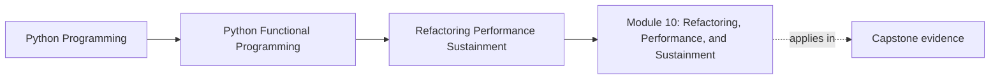

# Module 10: Refactoring, Performance, and Sustainment

<!-- page-maps:start -->
## Page Maps




<!-- page-maps:end -->

This final module is about maintaining the application you built, not imagining a
different production platform. You will review one FuncPipe change from observable
facts to an acceptance decision and learn where that decision remains uncertain.

## Prerequisites

Before starting, you should be able to:

- explain the pure-core/effect-shell split from Module 07;
- distinguish async completion order from output order from Module 08;
- identify the value translation owned by a Module 09 adapter;
- run one focused pytest command from `capstone/`; and
- compare Module 09 with the live Module 10 endpoint.

If those feel distant, use the
[Mastery Map](../module-00-orientation/mastery-map.md) to select the missing proof.
Do not rerun the whole course merely to recover one contract.

## The module question

> What evidence would let another maintainer accept this change for the right
> reason, and what remains outside that evidence?

The question matters because different changes need different proof. A function
rename does not need a benchmark. An optimization does. A metadata contract change
needs a translator and migration review. An optional backend proposal needs
ordering, failure, delivery, and pressure semantics before installation matters.

Module 10 completes one missing product behavior and then makes change evidence
reviewable:

- query and ranked-result states become explicit immutable values;
- one pure retrieval function scores and deterministically orders the local index;
- shells collect observations;
- pure functions classify evidence, performance, migration, and scaling facts;
- `review_change` combines only the checks relevant to a proposed change; and
- the resulting blockers remain inspectable values.

Read [Module 10 Capstone Delta](capstone-delta.md) before the cores. It names the
exact Module 09-to-10 source and proof surfaces.

## Study sequence

### Complete and characterize the local product

1. [Retrieval as Functional Composition](retrieval-as-functional-composition.md)
   — turn the embedded index into ranked chunk values without hiding ordering or
   overclaiming semantic relevance.

2. [Systematic Refactor](systematic-refactor.md) — characterize behavior before
   moving code.
3. [Performance Budgeting](performance-budgeting.md) — separate semantic
   equivalence, measurement, and the budget decision.
4. [Observability](observability.md) — retain execution facts without turning
   metrics into hidden policy.

### Strengthen the evidence

5. [Property-Based Regression](property-based-regression.md) — generate domain
   cases for a stable semantic predicate.
6. [Async Property Testing](async-property-testing.md) — vary scheduler pressure
   while asserting ordering and boundedness laws.
7. [Advanced Patterns and Scaling](advanced-patterns-and-scaling.md) — decide
   whether a more complex execution route has earned its cost.

### Keep contracts understandable

8. [DDD and FP](ddd-and-fp.md) — assign language and review ownership without
   inventing services.
9. [Versioning and Migration](versioning-and-migration.md) — distinguish
   structural compatibility from semantic translation.
10. [Governance](governance.md) — connect each important claim to a narrow
   executable route.

### Deliver the learning result

11. [Capstone Delivery](capstone-delivery.md) — assemble a review dossier for the
    deterministic local application that actually exists.

Use [Exercises](exercises.md) alongside the cores. Each exercise changes or reviews
the live capstone and names an earlier contract that must survive. Open
[Exercise Answers](exercise-answers.md) after producing your own evidence.

## Your observable learner work

By the end, produce one short change review containing:

- the behavior being preserved or intentionally changed;
- the source and tests that establish that behavior;
- any performance, migration, or scaling decision that actually applies;
- the focused command you ran and its result;
- the blockers returned by the composed decision; and
- one sentence stating what the evidence does not prove.

This is more useful than a generic “production-ready” checklist. It makes the
claim, application boundary, and proof route reviewable by another learner.

## Smallest honest verification route

From `capstone/`:

```bash
pytest -q tests/unit/review/test_change.py
pytest -q tests/learning/test_module_10_sustainment.py \
  -k change_review_composes_only_applicable_application_evidence
```

Use `make review-check` when you need to confirm that all published evidence paths
are discoverable. That command does not execute their tests. Use the final course
gate only after focused work passes.

## Conditions for finishing

You are ready to finish the course when you can:

- reject a faster change that violates an independent budget;
- explain why a present test path is not the same as a passing test;
- require a semantic translator when shape comparison is insufficient;
- keep observations separate from application control flow;
- apply only the review checks relevant to the proposed change;
- preserve Modules 01–09 while changing Module 10 review behavior; and
- state the limits of every proof you cite.

Use the [Refactoring Guide](refactoring-guide.md) for a final before-and-after
review and the module [Glossary](glossary.md) when vocabulary becomes unstable.
