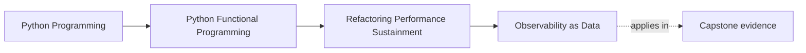
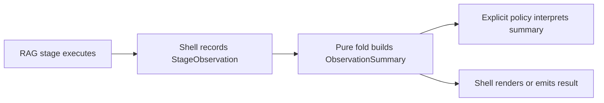

# Observability as Data

<!-- page-maps:start -->
## Page Maps




<!-- page-maps:end -->

Observability should explain execution without secretly controlling it. If a
metrics fold raises when a failure count is nonzero, then metrics have become an
undocumented error policy. If it writes to a module-global list, repeated tests no
longer reason about the same inputs.

FuncPipe models stage observations as immutable values and summarizes them with a
pure fold. A separate shell may later emit the summary, and a separate policy may
decide what blocks a release.

## The application pressure

Suppose cleaning processes two documents, chunking produces four chunks with one
failure, and embedding handles three:

```python
observations = (
    StageObservation("clean", processed=2, failures=0, latency_ms=1.0),
    StageObservation("chunk", processed=4, failures=1, latency_ms=2.0),
    StageObservation("embed", processed=3, failures=0, latency_ms=5.0),
)
```

A maintainer needs totals and execution order. The RAG pipeline does not need the
summary to decide whether a `Result` is `Ok` or `Err`; that decision already has an
explicit domain route from Module 04.

## Validate facts at construction

`StageObservation` rejects states that cannot describe one stage:

```python
@dataclass(frozen=True, slots=True)
class StageObservation:
    stage: str
    processed: int
    failures: int
    latency_ms: float

    def __post_init__(self) -> None:
        if not self.stage:
            raise ValueError("stage must not be empty")
        if min(self.processed, self.failures) < 0 or self.latency_ms < 0:
            raise ValueError("observation values cannot be negative")
        if self.failures > self.processed:
            raise ValueError("failures cannot exceed processed items")
```

The type does not claim that a clock was accurate or every event was captured. It
only prevents internally impossible supplied values.

This is an important boundary: validation protects the meaning of a value; it does
not certify the effect that produced it.

## Fold without hidden policy

```python
def summarize_observations(
    observations: tuple[StageObservation, ...],
) -> ObservationSummary:
    return ObservationSummary(
        processed=sum(item.processed for item in observations),
        failures=sum(item.failures for item in observations),
        latency_ms=sum(item.latency_ms for item in observations),
        stages=tuple(item.stage for item in observations),
    )
```

For the sample:

```python
summary = summarize_observations(observations)

assert summary.stages == ("clean", "chunk", "embed")
assert summary.processed == 9
assert summary.failures == 1
assert summary.latency_ms == 8.0
```

The stage tuple preserves encounter order. Sorting it would make output stable but
destroy its value as a compact execution trace.

The empty input has a deliberate identity:

```python
assert summarize_observations(()) == ObservationSummary(
    processed=0,
    failures=0,
    latency_ms=0,
    stages=(),
)
```

That identity makes summaries composable and removes the need for a special
“first observation” branch.

## Keep four responsibilities separate



- **Execution** produces application values and `Result` failures.
- **Observation** reads clocks or counters at an effect boundary.
- **Summarization** combines already-observed values.
- **Policy** decides whether a fact matters to acceptance.
- **Emission** writes text, JSON, logs, or metrics.

Combining these steps makes testing harder and ownership unclear. Separating them
does not require a logging framework or telemetry service.

## A counterexample: failure count as control flow

```python
def summarize_observations(items):
    if any(item.failures for item in items):
        raise RuntimeError("pipeline failed")
    ...
```

This is wrong for FuncPipe:

- Module 04 already models application failure explicitly;
- a summary of a partially successful run becomes impossible to inspect;
- changing instrumentation changes control flow; and
- callers cannot distinguish an observed failure from a broken metrics function.

If the application needs “no failed chunks” as an acceptance policy, write a pure
policy over `ObservationSummary` and pass its result into the relevant review. Do
not hide it inside the fold.

## Run the evidence

From `capstone/`:

```bash
pytest -q tests/unit/review/test_observability.py
pytest -q tests/learning/test_module_10_sustainment.py \
  -k observability_is_data_that_does_not_change_pipeline_decisions
```

Expected learning-test result:

```text
1 passed
```

Now add this value locally and predict the new summary before running the test:

```python
StageObservation("rank", processed=3, failures=0, latency_ms=1.5)
```

The stage sequence should end with `"rank"`, processed should become `12`,
failures should remain `1`, and latency should become `9.5`.

## What the evidence proves

The focused tests prove:

- immutable input values produce equal summaries;
- totals and encounter order are deterministic;
- the empty tuple has a defined identity; and
- invalid stage facts are rejected.

They do not prove:

- that the runtime captured every stage;
- that latency clocks are monotonic;
- that an external sink delivered an event;
- that one observed failure should block a change; or
- that summary overhead is negligible.

Those claims belong to observation shells, explicit policy, and performance
evidence respectively.

## Review checkpoint

Inspect one instrumentation change and ask:

1. Which function reads the clock, counter, or environment?
2. Which value crosses into pure code?
3. Can the same values be replayed in a test?
4. Does the instrumentation alter `Result` control flow?
5. Who decides whether the observation blocks acceptance?

If those answers are not visible, the instrumentation is carrying more authority
than its name suggests.

Continue with [Property-Based Regression](property-based-regression.md) to replace
anecdotal examples with generated evidence for a stable domain predicate.
