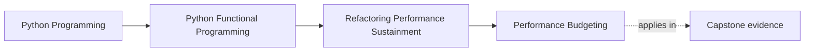
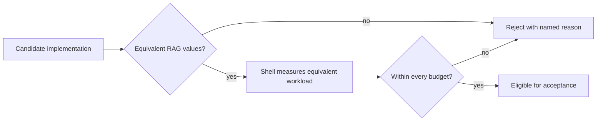

# Performance Budgeting

<!-- page-maps:start -->
## Page Maps




<!-- page-maps:end -->

“Faster” is not a sufficient acceptance criterion. An implementation can reduce
latency by changing its output, consuming unbounded memory, or moving work outside
the measured region.

FuncPipe separates three questions:

1. Does the candidate preserve the RAG domain contract?
2. Is the supplied observation trustworthy for the workload under discussion?
3. Does that observation meet every declared budget dimension?

Only the third question belongs to `evaluate_budget`.

## The three gates



The order prevents a common mistake: a benchmark result must not grant permission
to alter semantics. FuncPipe's `embedding_batches_equivalent` checks the public
`Chunk` and failure values before performance can influence selection.

## Budgets and observations are different values

The capstone models the agreement separately from the measurement:

```python
budget = PerformanceBudget(
    max_latency_ms=80,
    max_peak_memory_mb=32,
    min_throughput_per_second=25,
)

observation = PerformanceObservation(
    latency_ms=60,
    peak_memory_mb=48,
    throughput_per_second=30,
)
```

The budget is policy: no more than 80 ms latency, no more than 32 MB peak memory,
and at least 25 items per second for the declared workload. The observation is a
fact supplied by a measurement shell.

Keeping them separate means:

- tests can vary observations without timing real code;
- the decision cannot silently move its thresholds;
- measurement noise stays outside the pure rule; and
- a reviewer can argue about policy and workload independently.

## Evaluate every dimension

The decision function uses ordered, independent comparisons:

```python
def evaluate_budget(
    budget: PerformanceBudget,
    observation: PerformanceObservation,
) -> BudgetDecision:
    violations: list[str] = []
    if observation.latency_ms > budget.max_latency_ms:
        violations.append("latency")
    if observation.peak_memory_mb > budget.max_peak_memory_mb:
        violations.append("peak_memory")
    if observation.throughput_per_second < budget.min_throughput_per_second:
        violations.append("throughput")
    return BudgetDecision(
        within_budget=not violations,
        violations=tuple(violations),
    )
```

For the values above:

```python
decision = evaluate_budget(budget, observation)

assert decision.within_budget is False
assert decision.violations == ("peak_memory",)
```

The latency and throughput results are acceptable. They do not compensate for the
memory violation because the dimensions are hard limits, not quantities with a
meaningful common unit.

## Why not compute one score?

This expression looks convenient:

```python
score = latency_ratio + memory_ratio - throughput_ratio
```

It cannot answer the policy question. Milliseconds, megabytes, and items per second
do not become commensurable because they are normalized. A large latency win could
hide memory growth that breaks the environment in which the application must run.

A weighted score can be appropriate for ranking acceptable candidates, but only
after each hard constraint passes and the weights have a declared meaning.
FuncPipe does not need that extra decision for this teaching pressure.

## Compose the result into change review

The performance decision is one input, not the whole verdict:

```python
review = review_change(
    ChangeEvidence(
        semantic_equivalent=True,
        claims=(embedding_equivalence_claim,),
        budget=evaluate_budget(budget, observation),
    )
)

assert review.blockers == ("performance:peak_memory",)
```

If `semantic_equivalent` were false, the blockers would also include
`"semantic-equivalence"`. Reporting both prevents a learner from fixing memory and
then mistaking the candidate for acceptable.

A change with no performance claim should pass `budget=None`. Inventing a
benchmark requirement for a documentation-only or naming change adds cost without
adding evidence.

## Run the focused proofs

From `capstone/`:

```bash
pytest -q tests/unit/review/test_performance.py
pytest -q tests/learning/test_module_10_sustainment.py \
  -k performance_budget_is_a_pure_multi_dimensional_decision
pytest -q tests/learning/test_module_10_sustainment.py \
  -k change_review_composes_only_applicable_application_evidence
```

The expected application observation is that a 60 ms candidate is rejected
because its 48 MB peak exceeds the 32 MB budget.

The unit test also checks equality at the threshold: latency equal to the maximum,
memory equal to the maximum, and throughput equal to the minimum are within this
declared budget. If the application needs strict inequalities, change the policy
and its tests together rather than relying on prose.

## Failure routes

### Timing inside `evaluate_budget`

Calling a clock or profiler inside the decision couples policy to noisy effects.
Two calls with the same visible arguments could disagree.

### Measuring non-equivalent output

A candidate that drops failed chunks may look faster because it performs less
work. The semantic gate must reject it before budget evaluation.

### Reporting only a boolean

`False` does not tell a maintainer whether to investigate latency, memory, or
throughput. Ordered violation values make the next decision reviewable.

### Benchmarking an unspecified workload

Even a perfectly deterministic threshold function cannot rescue an observation
collected from an irrelevant corpus, machine, or execution path. Record the
workload and measurement boundary beside any real observation.

## What these tests prove

The focused tests prove that:

- invalid negative observations and nonpositive budgets are rejected;
- all failed dimensions are reported in stable order;
- values on the declared boundary pass; and
- performance blockers compose with other change evidence.

They do not prove:

- that the sample workload represents future use;
- that a measurement tool is correctly configured;
- that the candidate is statistically faster;
- that the operating environment has 32 MB available; or
- that semantic equivalence covers every possible RAG input.

Performance judgment remains honest when the decision is precise about both its
inputs and its limits.

Continue with [Observability](observability.md) to keep stage facts available
without letting measurement become hidden application control flow.
