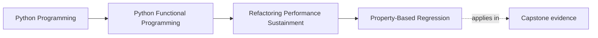
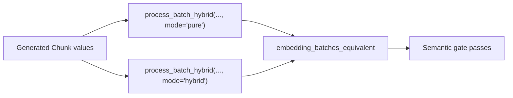

# Property-Based Regression

<!-- page-maps:start -->
## Page Maps




<!-- page-maps:end -->

Example tests ask whether a few chosen values behave correctly. Property-based
tests ask whether a domain statement survives many generated values and then
shrink a failure toward a small counterexample.

The difficult work is not adding `@given`. It is choosing a predicate that
describes the application contract rather than the current implementation.

## The FuncPipe pressure

Module 05 introduced a pure embedding route and a hybrid route that may use a
different internal representation. Module 10 needs to decide whether an
optimization can replace the current route.

This assertion is too weak:

```python
assert len(pure_results) == len(hybrid_results)
```

Both routes could produce the same number of chunks while changing source
metadata, losing a failure, or attaching a vector to the wrong text.

This assertion is too strong:

```python
assert type(pure_results) is type(hybrid_results)
```

It forbids exactly the internal representation change the optimization is meant
to explore.

## Define equivalence in domain terms

FuncPipe's `embedding_batches_equivalent` compares the public meaning of each
result:

- success and failure variants occur at the same positions;
- chunk text, source, tags, model, and expected dimension remain equal;
- vector values are numerically close under the declared tolerance; and
- failure values remain equal.

Representation identity is absent from the contract.



The predicate is reusable outside Hypothesis. That matters because the property
framework generates inputs; it should not own the meaning of equivalence.

## Generate application-owned values

The learning proof generates text and constructs real `Chunk` values:

```python
@given(texts=st.lists(st.text(min_size=1, max_size=32), max_size=8))
def test_optimized_embedding_preserves_the_domain_contract(
    texts: list[str],
) -> None:
    batch = [
        Chunk(
            text=ChunkText(content=text),
            metadata=ChunkMetadata(
                source="learning",
                tags=(),
                embedding_model="local-hash",
            ),
        )
        for text in texts
    ]

    pure = process_batch_hybrid(batch, mode="pure")
    optimized = process_batch_hybrid(batch, mode="hybrid")

    assert embedding_batches_equivalent(pure, optimized)
```

The bounds are intentional:

- empty batches establish the collection identity;
- one-item batches expose the smallest positional mismatch;
- varied Unicode text pressures deterministic embedding input handling; and
- a maximum of eight chunks keeps the teaching proof quick.

Larger generation is not automatically stronger. A bounded strategy that targets
the contract is more useful than an enormous strategy that makes failures slow to
reproduce.

## Understand the shrinking result

Introduce one deliberate metadata mismatch:

```python
changed = replace(
    batch[0],
    metadata=replace(batch[0].metadata, source="different"),
)
```

The smallest useful counterexample is one successful chunk whose source differs.
Hypothesis does not need a large corpus because provenance equality is part of the
predicate.

Read that failure as a design result:

- the optimized vector may still be numerically correct;
- the chunk is still not semantically equivalent;
- performance evidence cannot override the failed semantic gate; and
- the counterexample names the smallest public contract that changed.

## Laws and regression predicates are not interchangeable

An idempotence law has one implementation:

```python
clean_doc(clean_doc(doc)) == clean_doc(doc)
```

An equivalence predicate compares two routes:

```python
embedding_batches_equivalent(pure(batch), hybrid(batch))
```

A general example has chosen input and output:

```python
assert clean_doc(RawDoc("  hello  ")).abstract == "hello"
```

All three are useful. Calling every generated assertion a “law” makes review less
precise. Name the mathematical relationship or application contract actually
under test.

## Failure routes

### Reimplementing production logic in the test

If the test computes vectors with the same algorithm as the candidate, both may
share the same defect. Compare public values or use a simpler trusted oracle.

### Applying tolerance to identity

Numeric tolerance is appropriate for vectors. It is not appropriate for chunk
position, tags, source, model name, or failure codes.

### Generating invalid values accidentally

If most examples fail constructors, the test spends its effort proving validation
that belongs elsewhere. Generate valid `Chunk` values for equivalence; write
separate validation properties for invalid inputs.

### Depending on implementation types

Concrete container equality prevents safe representation changes and turns a
semantic regression test into an architecture lock.

## Run and read the proof

From `capstone/`:

```bash
pytest -q tests/unit/rag/domain/test_perf_equivalence.py
pytest -q tests/learning/test_module_10_sustainment.py \
  -k optimized_embedding_preserves_the_domain_contract
```

The first command exercises the predicate with focused examples. The learning
test varies batch contents and sizes through the real pure and hybrid routes.

When a property fails, read the minimized input before increasing example counts.
The smallest case often reveals that the predicate is missing a domain field or
that the implementation changed meaning.

## What the proof establishes

The property establishes equivalence for values generated by the declared
strategy and numeric tolerances. It guards text, metadata, success/failure shape,
and vector meaning across both routes.

It does not establish:

- that either route is fast;
- that every possible Python string or batch size was executed;
- that a hardware-specific implementation behaves identically;
- that the strategy covers serialized or external values; or
- that the equivalence predicate itself names every future domain contract.

The predicate must evolve deliberately when the public RAG model evolves.

Continue with [Async Property Testing](async-property-testing.md), where generated
pressure must preserve order and boundedness without relying on real-time sleeps.
