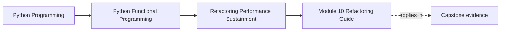

# Module 10 Refactoring Guide

<!-- page-maps:start -->
## Page Maps




<!-- page-maps:end -->

Use this guide when a proposed change is plausible but its acceptance reasoning is
spread across prose, source, tests, and measurements. The Module 10 refactor target
is not “more functional code.” It is one inspectable decision assembled from
evidence that already has clear owners.

## Before and after

### Before: one persuasive boolean

```python
def safe_to_merge() -> bool:
    return tests_exist() and benchmark_ms() < 80
```

This function hides several questions:

- which behavior do the tests claim?
- did the tests run or merely exist?
- is the candidate semantically equivalent?
- what happened to memory and throughput?
- does migration apply?
- which effects run when the function is called?

The boolean is easy to consume and hard to review.

### After: observations, decisions, composition

```python
claim_assessment = assess_evidence(claim, observed_paths)
budget_decision = evaluate_budget(budget, observation)

decision = review_change(
    ChangeEvidence(
        semantic_equivalent=equivalence_result,
        claims=(claim_assessment,),
        budget=budget_decision,
    )
)
```

Now:

- the shell owns `observed_paths`, measurements, and test execution;
- each classifier is pure and independently testable;
- irrelevant migration or scaling checks can remain absent;
- every blocker remains a value; and
- the final decision can be replayed from the same inputs.

## Refactor in this order

1. **Name the application behavior.** Use RAG terms, not implementation steps.
2. **Find the owner.** Locate the domain, policy, or boundary responsible for the
   behavior.
3. **Characterize the public result.** Write the focused proof before moving code.
4. **Separate observations.** Filesystem reads, clocks, profilers, and test
   execution remain at shells.
5. **Extract the smallest decision.** Classify paths, budget values, shape, or
   readiness without performing effects.
6. **Compose applicable decisions.** Do not require a migration review for a
   shape-preserving refactor or a scaling review for local execution.
7. **Preserve earlier modules.** Name the specific inherited laws affected by the
   change.
8. **State the proof limit.** Record what remains unknown.

The sequence protects against extracting an elegant rule for an observation that
was wrong or irrelevant.

## Review one FuncPipe optimization

For the pure-to-hybrid embedding proposal:

| Review question | Application answer |
| --- | --- |
| Behavior | public `Chunk` and `ErrInfo` meaning remains equivalent |
| Owner | `rag-domain` |
| Source | `rag/domain/perf.py` |
| Focused proof | `tests/unit/rag/domain/test_perf_equivalence.py` |
| Generated proof | Module 10 optimized-embedding learning test |
| Observation effect | benchmark shell supplies latency, memory, and throughput |
| Pure policy | `evaluate_budget` |
| Composed decision | `review_change` |
| Earlier contracts | Module 04 failure position, Module 05 metadata, Module 07 effect boundary |
| Not proved | workload representativeness and hardware-specific performance |

If this table cannot be completed, the change is not ready for a larger
confirmation command.

## Focused execution route

From `capstone/`:

```bash
pytest -q tests/unit/review/test_change.py
pytest -q tests/unit/rag/domain/test_perf_equivalence.py
pytest -q tests/learning/test_module_10_sustainment.py \
  -k 'optimized_embedding or change_review'
make review-check
```

Interpret results:

- the first command proves composed blocker behavior;
- the second proves the domain equivalence predicate;
- the third connects both ideas to learner-facing application cases; and
- `review-check` proves that published evidence routes are present.

None of these commands measures a real workload.

## Cumulative history route

Module 09 is the last tracked source state before sustainment review. Do not add
Module 10 review types to that reference state.

After changing live capstone source:

1. refresh generated history with the established course command;
2. confirm `capstone/_history/worktrees/module-10/` contains the live review
   package;
3. verify Modules 01–09 remain matched to their reference states; and
4. run history verification once the generated endpoint is current.

The meaningful comparison is:

```bash
git diff --no-index \
  capstone/module-reference-states/module-09/src/funcpipe_rag \
  capstone/_history/worktrees/module-10/src/funcpipe_rag
```

Status `1` is expected when the cumulative endpoint contains Module 10 changes.
Inspect whether the differences belong to sustainment review rather than treating
the status as a failed test.

## Self-review checklist

- [ ] The behavior is named in application terms.
- [ ] Every source and test path exists.
- [ ] The focused command asserts the stated behavior.
- [ ] Effects produce values before pure decisions consume them.
- [ ] Semantic equivalence precedes performance selection.
- [ ] Optional checks are included only when relevant.
- [ ] Independent blockers are not collapsed into one unexplained boolean.
- [ ] Exercises and answers point to the same live application surface.
- [ ] Module 09 remains free of Module 10 review concepts.
- [ ] The learner-facing page says what each proof cannot establish.

## Exit standard

You have completed the refactor when another learner can:

1. reconstruct the decision from supplied values;
2. run the focused proof without guessing a path;
3. explain why each blocker appears;
4. identify which earlier RAG contract is preserved; and
5. state what further evidence a broader claim would require.

That is the sustainment skill Module 10 adds to FuncPipe: not a larger platform,
but a clearer and executable way to judge changes to the application.
