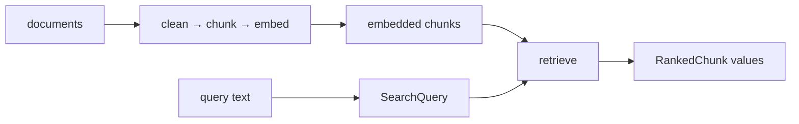

# Retrieval as Functional Composition

FuncPipe enters Module 10 with an embedded chunk index and no way to query it.
This lesson completes one local retrieval path by reusing ideas from the whole
course. The goal is not to introduce a retrieval framework. It is to show that
explicit values and pure functions can make a ranking contract small enough to
read, test, and change deliberately.

## Start from the missing behavior

An indexing pipeline answers:

> Which chunks and vectors did these documents produce?

A retrieval pipeline answers:

> Given this query and this index, which chunks come first, and why?

Module 09 answers only the first question. The live Module 10 endpoint adds the
second. Generation remains outside the course product.



This boundary matters for review. If the course called every embedded chunk a
“retrieval result,” learners could not tell whether ranking existed, which
ordering rule applied, or what an empty result meant.

## Reuse one embedding contract

Before retrieval, chunk embedding lived inside `embed_chunk`. Query text needs
the same transformation, but duplicating the algorithm would create two
contracts that could drift.

The live endpoint extracts:

```python
def embed_text(text: str) -> tuple[float, ...]:
    digest = hashlib.sha256(text.encode("utf-8")).hexdigest()
    step = 4
    return tuple(
        int(digest[i : i + step], 16) / (16**step - 1)
        for i in range(0, len(digest), step)
    )[:16]
```

`embed_chunk` delegates to `embed_text(chunk.text)`. That is an
equivalence-preserving refactor: every previously valid chunk gets the same
vector as before.

The extraction earns its name because two consumers now need the behavior.
Creating a generic “vector service” or protocol would add indirection without an
effect or substitution pressure.

## Give query state one legal shape

`SearchQuery` is an immutable product:

```python
@dataclass(frozen=True, slots=True)
class SearchQuery:
    text: str
    embedding: Embedding
    top_k: int
```

The three fields mean:

| Field | Meaning | Illegal state rejected |
| --- | --- | --- |
| `text` | the exact query input represented by the vector | blank query |
| `embedding` | the finite vector used for scoring plus its model label | empty vector |
| `top_k` | the maximum number of results requested | Boolean, zero, or negative limit |

The model label does not prove model compatibility with stored chunks. The
current pipeline chunk type does not persist an embedding-model label. That is a
known limit, not a reason to silently assume compatibility. A future model change
would need a migration pressure and a richer index contract.

`make_query` owns the local construction:

```python
def make_query(text: str, *, top_k: int = 3) -> SearchQuery:
    return SearchQuery(
        text=text,
        embedding=Embedding(
            vector=embed_text(text),
            model="local-sha256",
        ),
        top_k=top_k,
    )
```

Construction is pure. The same text and limit produce an equal query value.

## Keep scoring total over its declared domain

Cosine similarity is:

```text
cos(a, b) = dot(a, b) / (magnitude(a) * magnitude(b))
```

Here, `dot(a, b)` is the sum of each pair of components multiplied together,
and `magnitude(a)` is the square root of the sum of `a`'s squared components.

The formula is defined only when:

- both vectors have the same non-zero dimension;
- every component is finite; and
- neither vector has zero magnitude.

`cosine_similarity` checks those preconditions and raises `ValueError` for a
direct local contract violation. It does not use `Result` because this function
does not perform an expected external operation. A boundary that accepts
untrusted vectors could translate validation failures before calling the pure
core.

The returned score is clamped to `[-1.0, 1.0]` to contain tiny floating-point
overshoot. Clamping is not relevance normalization; it only preserves the
mathematical range of cosine similarity.

## Ranking needs a complete order

Sorting by score alone leaves ties dependent on encounter order. That is a
hidden input to published behavior.

FuncPipe orders by this key:

```python
(
    -score,
    chunk.doc_id,
    chunk.start,
    chunk.end,
    chunk.text,
)
```

The first component puts larger scores first. The remaining components create a
stable coordinate order for equal scores. The ordering contract is therefore
reproducible when a caller changes input sequence.

Consider three chunks:

| Chunk | Vector | Cosine score for query `(1, 0)` | Result |
| --- | --- | ---: | --- |
| document `b` | `(1, 0)` | `1.0` | rank 2 |
| document `c` | `(0, 1)` | `0.0` | omitted by `top_k=2` |
| document `a` | `(1, 0)` | `1.0` | rank 1 |

Documents `a` and `b` tie on score. Document ID breaks the tie, independent of
the input order shown in the table.

`RankedChunk` then binds three facts:

```python
RankedChunk(chunk=chunk, score=score, rank=rank)
```

A caller does not need to keep a parallel score list synchronized with a chunk
list. Non-finite scores, scores outside the cosine range, and ranks below one are
unrepresentable through normal construction.

## Read `retrieve` by cardinality and effects

The public type is conceptually:

```text
SearchQuery × Iterable[Chunk] → tuple[RankedChunk, ...]
```

This signature tells you:

- the operation is pure;
- the index is supplied rather than read from storage;
- ranking materializes all candidates to sort them;
- output is bounded by `top_k`; and
- an empty index is a valid empty result, not an error.

The full candidate set is materialized because exact global ranking requires a
comparison across candidates. This implementation is appropriate for a small
local teaching index. It does not claim bounded memory with respect to index
size.

A heap-based top-k implementation could reduce memory pressure. It would be
acceptable only if it preserved score semantics, the complete tie-break, result
shape, and error behavior. That is a real Module 10 refactoring question, not an
automatic optimization.

## Run the executable trace

From the course directory:

```bash
make capstone-retrieval-proof
```

Then read:

```text
capstone/tests/learning/test_module_10_retrieval.py
capstone/src/funcpipe_rag/rag/domain/retrieval.py
capstone/src/funcpipe_rag/rag/retrieval.py
capstone/src/funcpipe_rag/rag/stages.py
```

Use this order:

1. predict the result of the explicit tie case;
2. inspect the value invariants;
3. inspect the similarity preconditions;
4. inspect the sort key;
5. run the focused proof; and
6. state one claim the proof cannot support.

The final test passes two `RawDoc` values through cleaning, chunking, and
embedding before retrieving an exact local match. It connects the new behavior
to the application instead of testing an isolated sort helper only.

## Do not overclaim the fixture

SHA-256-derived vectors are deterministic fingerprints. Equal text gets an equal
vector, which makes exact-match mechanics easy to prove. Different texts do not
receive vectors based on linguistic meaning.

Therefore the proof supports:

- deterministic construction;
- exact local matching;
- cosine calculation over declared vectors;
- stable tie ordering;
- top-k truncation; and
- composition with the existing ingestion path.

It does not support:

- semantic similarity;
- paraphrase retrieval;
- relevance quality;
- production latency or memory;
- compatibility across embedding models;
- approximate nearest-neighbor behavior; or
- answer generation.

That distinction is part of functional design. A pure function can be perfectly
deterministic and still implement only a narrow model of the domain.

Continue with [Systematic Refactor](systematic-refactor.md). Use retrieval's
score and ordering contracts as the behavior that a future implementation must
characterize before it changes.
