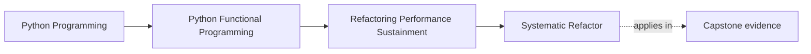
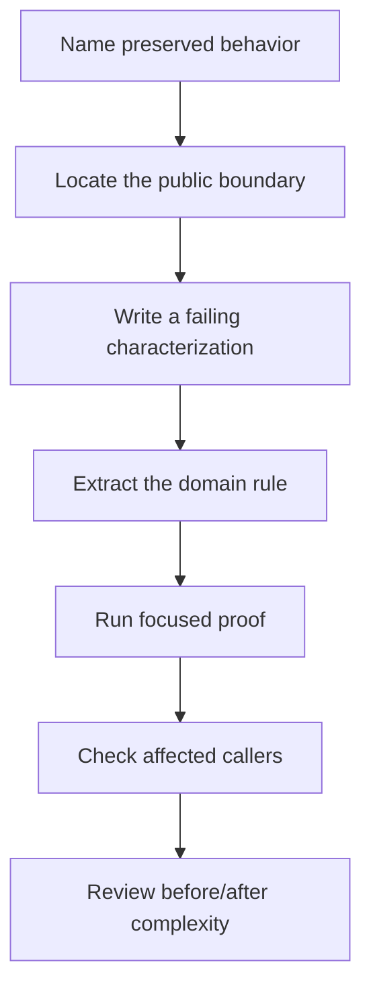

# Systematic Refactor

<!-- page-maps:start -->
## Page Maps




<!-- page-maps:end -->

A safe refactor begins by deciding which observable behavior must survive. Moving
code first and searching for a reason afterward is not systematic; it only makes
the diff systematic.

This core uses a real FuncPipe defect: the review inventory configured both
`rag/` and its child `rag/domain/`. A naïve count treated domain files twice. The
RAG application still ran, but the observation used to justify later work was
wrong.

## The pressure: overlapping reading routes

The two paths have different teaching purposes:

- `rag/` shows the application package as a whole;
- `rag/domain/` gives a learner a high-signal route into owned RAG values.

Removing the child path would make the reading map weaker. Keeping both and
summing their file counts makes the measurement false.

```python
def count_python_files(paths: list[Path]) -> int:
    return sum(
        1
        for path in paths
        for candidate in path.rglob("*.py")
        if candidate.is_file()
    )
```

If `rag/domain/chunk.py` is discovered under both configured roots, it contributes
two to the result. The problem is not recursion. The problem is that the fold
counts observations rather than identities.

## State the invariant before changing the fold

For this refactor:

> The inventory count equals the number of distinct Python files reachable from
> the configured paths.

That sentence makes several design decisions reviewable:

- overlapping roots are valid;
- a file contributes at most once;
- nonexistent roots contribute nothing;
- configuration order does not affect the count; and
- configured paths remain visible even when their discoveries overlap.

The invariant points to a set:

```python
def _count_python_files(paths: Iterable[Path]) -> int:
    return len(
        {
            candidate.resolve()
            for path in paths
            if path.exists()
            for candidate in path.rglob("*.py")
            if candidate.is_file()
        }
    )
```

The set is not a general “functional improvement.” It earns its place because file
identity, not encounter count, is the domain of this observation.

## Characterize the boundary, not the helper

The learning test calls `build_summary(PROJECT_ROOT)` and reconstructs the expected
set from the published `rag-model` paths:

```python
summary = build_summary(PROJECT_ROOT)
rag_group = next(
    group for group in summary["package_groups"]
    if group["name"] == "rag-model"
)
observed_files = {
    path.resolve()
    for relative in rag_group["paths"]
    for path in (PROJECT_ROOT / relative).rglob("*.py")
}

assert rag_group["python_file_count"] == len(observed_files)
```

This is stronger than directly testing `_count_python_files` with one hard-coded
number. It checks the public review summary, includes the real nested
configuration, and adapts when legitimate source files are added.

It is deliberately not a snapshot of the entire JSON report. An all-field
snapshot would fail whenever an unrelated package count changed and would hide the
single behavior under review.

## A reviewable refactor sequence



For the inventory correction:

1. **Name the behavior.** Counts represent distinct source files.
2. **Locate the boundary.** `build_summary` publishes the count.
3. **Characterize it.** Reconstruct file identities from the published paths.
4. **Change the rule.** Fold into a set of resolved paths.
5. **Run the focused proof.**
6. **Inspect callers.** Text and JSON renderers consume the same summary value.
7. **Review the result.** The configuration remains readable; counting becomes
   accurate.

This order matters. If the test were written after the implementation, it would be
easy to assert whatever the new helper happened to return.

## Run the proof

From `capstone/`:

```bash
pytest -q tests/learning/test_module_10_sustainment.py \
  -k review_inventory_counts_nested_sources_once
```

Expected result:

```text
1 passed
```

Then inspect the human-facing output:

```bash
funcpipe-rag-review summary --format text --project-root .
```

Find the `rag-model` line and its paths. The command performs filesystem I/O in
the shell. `_count_python_files` and the rendering logic operate on the discovered
values. The refactor does not move observation into the pure RAG pipeline.

## Failure routes worth testing

### Subtracting a constant

```python
count = recursive_count - 5
```

This passes until the child package gains or loses a file. It encodes the current
tree rather than the invariant.

### Deduplicating configured strings

```python
for path in set(configured_paths):
    ...
```

`rag/` and `rag/domain/` are distinct strings, so their overlapping discoveries
remain duplicated.

### Removing the child route

The number becomes correct by weakening the learner-facing package map. The
observation problem is hidden rather than solved.

### Rewriting unrelated RAG code

Nothing about counting review files requires changing cleaning, chunking,
embedding, retrieval, or adapters. A larger application diff would increase risk
without helping the invariant.

## What the proof establishes

The focused test proves that the real published package group counts unique Python
file identities when configured roots overlap. It also proves that the group still
publishes its reading paths.

It does not prove:

- that file count measures complexity or quality;
- that every source file belongs to the right review owner;
- that symlink policy is suitable for every repository;
- that any RAG behavioral test passed; or
- that the full review summary is stable.

Those are different claims and need different evidence.

## Carry the result into the capstone decision

`review_change` should consume trustworthy assessments. It does not repair weak
observations. This gives Module 10 a useful ordering:

1. make the observation honest;
2. classify it with a pure rule;
3. compose only relevant decisions; and
4. explain what remains unknown.

Before continuing, write one sentence naming the public behavior for a refactor
you are considering. If you cannot state it without mentioning implementation
steps, you are not ready to move the code.

Continue with [Performance Budgeting](performance-budgeting.md), where equivalent
behavior becomes a prerequisite for interpreting a speed or memory observation.
