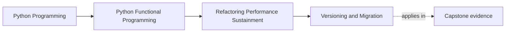
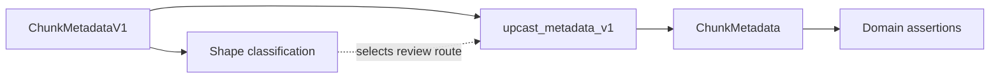

# Versioning and Migration

<!-- page-maps:start -->
## Page Maps




<!-- page-maps:end -->

A migration has two different questions:

1. Can the old value fit the new structural contract?
2. Does the translation preserve the application's meaning?

A field-set comparison can answer the first question. Only an executable
translator and its domain assertions can answer the second.

## The FuncPipe migration seam

The old in-process metadata value stores:

```python
@dataclass(frozen=True, slots=True)
class ChunkMetadataV1:
    source: str
    tags: list[str]
```

The current value stores:

```python
@dataclass(frozen=True, slots=True)
class ChunkMetadata:
    source: str
    tags: tuple[str, ...]
    embedding_model: str | None = None
    expected_dim: int | None = None
```

The new embedding fields are optional. An old value contains enough information
to construct the new shape, but a translator must still:

- preserve `source`;
- preserve tag order and contents;
- transfer ownership from mutable list to immutable tuple; and
- choose honest defaults for fields absent in V1.

## Classify shape without pretending to translate

`ContractShape` contains only field names and required fields:

```python
previous = ContractShape(
    "chunk-metadata",
    frozenset({"source", "tags"}),
    frozenset({"source", "tags"}),
)
current = ContractShape(
    "chunk-metadata",
    frozenset({"source", "tags", "embedding_model", "expected_dim"}),
    frozenset({"source", "tags"}),
)

assessment = assess_migration(previous, current)
assert assessment.compatibility == "backward-compatible"
```

“Backward-compatible” means an old structural value has all newly required fields.
It does not mean the Python translator is correct or any serialized format is
compatible.

The pure classifier uses a small decision table:

| Shape change | Classification | Reason |
| --- | --- | --- |
| add optional field | `backward-compatible` | old values still satisfy required fields |
| add required field | `requires-migration` | a rule must supply missing meaning |
| remove field | `incompatible` | the old contract contains a value the new shape cannot represent |
| change contract name | `incompatible` | the comparison no longer describes one contract |

## Prove the semantic translator

The shipped upcaster is deliberately small:

```python
def upcast_metadata_v1(v1: ChunkMetadataV1) -> ChunkMetadata:
    return ChunkMetadata(
        source=v1.source,
        tags=tuple(v1.tags),
    )
```

The learning proof checks the resulting domain value:

```python
migrated = upcast_metadata_v1(
    ChunkMetadataV1(source="manual", tags=["fp", "rag"])
)

assert migrated == ChunkMetadata(
    source="manual",
    tags=("fp", "rag"),
)
```

This comparison makes the default `None` values visible through dataclass
equality and proves list-to-tuple ownership transfer.



The dotted arrow is important: the shape classifier helps choose the route. It
does not perform or verify the translation.

## Required fields need a declared source of meaning

Suppose the current contract adds required `language: str`. The old value has no
language information:

```python
current = ContractShape(
    "chunk-metadata",
    frozenset({"source", "tags", "language"}),
    frozenset({"source", "tags", "language"}),
)
```

`assess_migration` returns `requires-migration`.

This translator is dishonest:

```python
def upcast(v1):
    return ChunkMetadata(..., language="en")
```

It invents knowledge. A defensible route must declare where language comes from:

- a documented default valid for the bounded corpus;
- a pure mapping supplied as input;
- a separate enrichment capability at an effect shell; or
- an explicit “unknown” value admitted by the new domain.

The choice changes the contract and belongs in review.

## Run the focused evidence

From `capstone/`:

```bash
pytest -q tests/unit/review/test_migration.py
pytest -q tests/learning/test_module_10_sustainment.py \
  -k metadata_migration_pairs_shape_review_with_an_executable_upcaster
```

The unit tests exercise optional addition, required addition, and removal. The
learning test pairs the real metadata shape with the real upcaster.

If a proposed change is not backward-compatible, pass its
`MigrationAssessment` into `ChangeEvidence`. `review_change` will name the
migration classification as a blocker until the application has the required
translation evidence.

## Failure routes

### Treating all added fields alike

An optional field with an honest default differs from a required field whose
meaning old data cannot supply.

### Trusting shape as semantics

Two fields can retain the same names while changing units, ordering, or
provenance. Structural compatibility is necessary but incomplete.

### Mutating the old value

Reusing the V1 tag list would let old and new contracts share ownership. The tuple
conversion makes the new value independent.

### Hidden I/O in the translator

A pure upcaster should replay deterministically. If enrichment needs storage or a
service, make that capability explicit at a shell and pass the resulting value to
pure translation.

### Claiming wire compatibility

The teaching proof operates on Python values. It does not parse JSON, migrate a
database, coordinate two running versions, or define a deployment window.

## What the evidence proves

The focused tests prove structural classification for the declared field rules
and semantic translation for `ChunkMetadataV1` into the current in-process value.

They do not prove:

- persisted-data migration;
- cross-language serialization;
- rolling deployment behavior;
- external consumer compatibility; or
- a universal versioning policy.

Those concerns should be added only when the application gains the corresponding
boundary. FuncPipe keeps the current lesson small enough to execute and review.

Continue with [Governance](governance.md), where important application claims are
connected to discoverable and runnable proof routes.
