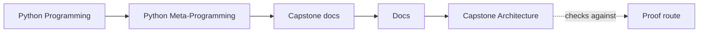
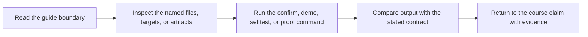

# Capstone Architecture

<!-- page-maps:start -->
## Guide Maps

<!-- page-maps:end -->

Use this guide when the capstone technically works but the mechanism boundaries still feel
blurred. The point of the architecture is not to look clever. The point is to keep each
kind of runtime pressure visible enough that you can say where behavior begins, where it
becomes public, and where it should be tested.

## The capstone in one sentence

This capstone builds a small plugin runtime that uses descriptors for configuration,
decorators for action metadata, and a metaclass for class-definition-time registration,
while still keeping public inspection separate from action execution.

If that sentence still sounds too compressed, stay in this guide before widening into tests
or extension work.

## Read the architecture in this order

1. Read the runtime story by time.
2. Read the ownership map by file.
3. Read the built-in plugins as pressure tests for the framework.
4. Read the common misreads and review questions.

That order keeps cause before implementation detail.

## Runtime story by time

| Time | What should happen | What must not happen | Main owner |
| --- | --- | --- | --- |
| class-definition time | fields and wrapped actions are collected, constructor signatures are generated, and plugins are registered | concrete plugin actions running during class creation | `framework.py` |
| attribute time | field descriptors validate, coerce, and store per-instance configuration | registry policy leaking into simple attribute access | `fields.py` |
| call time | action wrappers preserve signatures, invoke plugin behavior, and record visible history | hidden retries, caching, or policy that erases the callable contract | `actions.py` and `plugins.py` |
| inspection time | manifest, registry, and signature views are rendered from the public surface | action execution hidden inside "inspection" commands | `framework.py` and `cli.py` |

This time model matters because beginners often collapse every advanced Python feature into
"runtime magic." The capstone exists to separate those moments cleanly.

## Ownership map by file

### `framework.py`

Owns:

- class creation
- generated constructor signatures
- plugin registration
- manifest export
- public runtime helpers used by the CLI

Should not own:

- descriptor coercion details
- concrete delivery behavior
- wrapper-specific invocation history decisions

### `fields.py`

Owns:

- descriptor-backed configuration semantics
- defaults, required values, and coercion
- field metadata exported through manifests

Should not own:

- plugin registration
- action execution behavior
- public command assembly

### `actions.py`

Owns:

- action wrapping
- callable metadata preservation
- invocation-history recording

Should not own:

- field validation
- registry policy
- concrete delivery outputs

### `plugins.py`

Owns:

- concrete adapters that force the framework to stay honest
- realistic payload shaping
- ordinary runtime code that can be reviewed without framework folklore

Should not own:

- broad framework policy
- registration rules for the whole system
- hidden command-line behavior

### `cli.py`

Owns:

- public inspection and invocation commands
- conversion from runtime facts into inspectable CLI output
- durable review routes used by saved bundles

Should not own:

- private runtime tricks unavailable outside the CLI
- field semantics
- wrapper internals that belong in source and tests

## Why the architecture is split this way

The architecture teaches three durable lessons:

1. Advanced Python mechanisms are easiest to learn when each one owns one kind of pressure.
2. Public inspection is a different responsibility from execution.
3. Concrete plugins are not ornamental examples. They are the evidence that the abstraction
   still behaves like ordinary application code.

## Built-in plugins as pressure tests

| Plugin | What pressure it adds | Why the architecture needs it | Best proof surface |
| --- | --- | --- | --- |
| `console` | defaults, choices, and boolean coercion | proves the framework still handles everyday configuration cleanly | `make demo`, `make plugin`, `tests/test_fields.py` |
| `webhook` | required fields, integer coercion, and structured payload assembly | proves manifests stay observational while real runtime data stays concrete | `make plugin`, `make trace`, `tests/test_runtime.py` |
| `pager` | multiple actions, nested history, and JSON preview output | proves wrapper history and plugin behavior remain visible together | `make trace`, `tests/test_runtime.py`, `tests/test_cli.py` |

## Architecture questions to ask before opening more files

- Is this behavior happening at class-definition time, attribute time, call time, or inspection time?
- Which file should own that kind of pressure?
- Does the public surface show the behavior honestly, or only the private implementation?
- Which built-in plugin would reveal the weakness first?

If you cannot answer those questions yet, do not widen into bundle guides or extension work.

## Common misreads

| Misread | Why it is wrong | Better reading move |
| --- | --- | --- |
| "The metaclass owns the whole framework." | the metaclass owns class-definition-time rules, not every behavior | compare `framework.py` with `fields.py` and `actions.py` |
| "Manifest output proves runtime behavior." | manifests prove public exported structure, not invocation | pair `make manifest` with `make trace` |
| "Concrete plugins are just examples." | concrete plugins are the honesty check on framework claims | inspect `plugins.py` before proposing a framework change |
| "The CLI is the system." | the CLI reports the runtime; it should not secretly become the runtime | compare `cli.py` with runtime helpers and tests |

## Best companion routes

- Read [DESIGN_BOUNDARIES.md](design-boundaries.md) when the confusion is which mechanism should own a new rule.
- Read [PACKAGE_GUIDE.md](package-guide.md) when the confusion is file order, class names, or where to open source first.
- Read [COMMAND_GUIDE.md](command-guide.md) when the confusion is which command proves an architectural claim.
- Read [EXTENSION_GUIDE.md](extension-guide.md) when the architecture is clear but change placement is not.

## Good stopping point

Stop when you can explain:

- why this capstone needs descriptors, decorators, and a metaclass instead of only one of them
- which file owns class-definition-time behavior
- which file owns attribute ownership
- which file owns wrapper behavior
- why public inspection must stay separate from action execution
