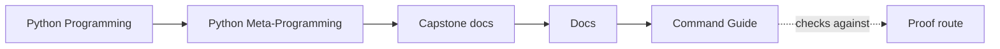
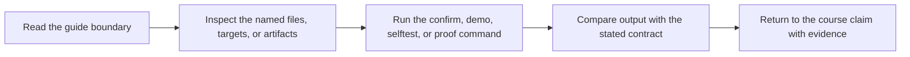

# Command Guide

<!-- page-maps:start -->
## Guide Maps

<!-- page-maps:end -->

Use this guide when you are already inside the capstone and need the smallest honest
command for the question in front of you. The goal is not command memorization. The goal
is choosing enough proof without jumping immediately to the broadest route.

## The first decision to make

Before running anything, decide which kind of question you have:

- public shape question
- one concrete runtime behavior question
- saved review artifact question
- strongest executable confidence question

If you skip that decision, every command feels equally plausible, and the capstone starts
to feel harder than it is.

## Start by question size

| If the question is about... | Start with | Escalate only if needed |
| --- | --- | --- |
| what the runtime exposes without invoking plugin behavior | `make manifest`, `make plugin`, `make field`, `make action`, `make registry`, or `make signatures` | `make inspect` |
| whether proposed action arguments satisfy the real call contract | `make bind-action` | `tests/test_runtime.py` |
| whether bound values match the supported runtime hint subset | `make check-action` | `tests/test_runtime.py` and `tests/test_cli.py` |
| what the metaclass knew and generated during one class creation | `make class-creation` | `tests/test_runtime.py` and `tests/test_cli.py` |
| which action layer owns wrapper metadata and explicit signature | `make action-wrapper` | `tests/test_runtime.py` |
| one realistic invocation path | `make demo` or `make trace` | `tests/test_runtime.py` or `make tour` |
| a durable artifact another reviewer can inspect later | `make inspect`, `make tour`, or `make verify-report` | `make proof` |
| the strongest local confidence route | `make confirm` | `make proof` |

## Recommended first commands

- Choose `make manifest` when you need the safest observational route.
- Choose `make registry` when the real question is "which plugins exist and in what order?"
- Choose `make field` or `make action` when one small contract is the pressure point.
- Choose `make bind-action` when call validation matters but execution does not.
- Choose `make check-action` when runtime hint matching or refusal matters but execution does not.
- Choose `make class-creation` when namespace, inheritance, or generated initialization timing matters.
- Choose `make action-wrapper` when wrapper ownership matters but execution does not.
- Choose `make trace` when configuration, invocation history, and result probably all matter.
- Choose `make inspect` when you need a saved route but do not yet need the strongest bundle.

## Routes to avoid by default

| Do not start with... | Because... | Better first move |
| --- | --- | --- |
| `make proof` | it is broader than most first questions need | choose one public, runtime, or saved-artifact route first |
| `make confirm` | it tells you whether the suite passes before it teaches what the suite is protecting | choose `make manifest`, `make registry`, or `make trace` first |
| `make demo` | it can hide the role of metadata and history when the question really needs trace output | choose `make trace` if wrapper visibility matters |
| `make inspect` | it may create a bundle before you know which one you actually need | choose a smaller command if the question is still narrow |

## Stable local commands

| Command | What it is for | What it gives you |
| --- | --- | --- |
| `make manifest` | inspect exported plugin schema without invocation | public manifest JSON |
| `make plugin` | inspect one concrete plugin contract | one plugin contract JSON |
| `make field` | inspect one descriptor-backed field contract | one field contract JSON |
| `make action` | inspect one decorator-backed action contract | one action contract JSON |
| `make action-wrapper` | inspect wrapper layers and preservation without execution | wrapper-chain audit JSON |
| `make bind-action` | validate one action call without construction or invocation | normalized bound-argument JSON |
| `make check-action` | check a narrow runtime hint subset without construction or invocation | checked, refused, and unchecked argument JSON |
| `make class-creation` | inspect stored class-creation provenance | namespace, declared/inherited members, and generation JSON |
| `make registry` | inspect registration determinism from the public surface | registry JSON |
| `make signatures` | inspect generated constructor and action signatures | signature JSON |
| `make demo` | invoke one realistic action | one invocation result |
| `make trace` | inspect one invocation with configuration and history | trace JSON |
| `make inspect` | build the saved inspection bundle | bundle under `artifacts/inspect/...` |
| `make tour` | build the saved walkthrough bundle | bundle under `artifacts/tour/...` |
| `make verify-report` | build the saved executable verification bundle | bundle under `artifacts/review/...` |
| `make confirm` | run the strongest local executable confirmation route | pytest success or failure |
| `make proof` | build the full guided proof route | all saved bundles together |

## Public runtime surfaces

Use these when the question is not yet about execution, only about what the runtime
publishes honestly from the public surface.

| Surface | What it settles | Best command |
| --- | --- | --- |
| manifest export | which field schema and action metadata the runtime exposes without invocation | `make manifest` or `make plugin` |
| registry export | which concrete plugins exist and in what deterministic order | `make registry` |
| generated signatures | which constructor and action call shapes the runtime exposes | `make signatures` |
| one field contract | how one descriptor-backed public contract appears from outside | `make field` |
| one action contract | how one decorator-backed callable surface appears from outside | `make action` |
| one action wrapper | which layer owns `ActionSpec`, `__signature__`, and `__wrapped__` | `make action-wrapper` |
| one action preflight | whether proposed arguments satisfy the stored action signature | `make bind-action` |
| one action contract check | whether bound values match supported hints and which hints are refused | `make check-action` |
| one class-creation audit | what namespace, metaclass, declarations, inheritance, and generation produced the class | `make class-creation` |

## One concrete behavior routes

Use these when the question is about runtime behavior rather than published shape.

| If you need to see... | Choose | Why |
| --- | --- | --- |
| one result only | `make demo` | smallest realistic invocation route |
| result plus config plus action history | `make trace` | strongest single runtime story before tests |

## Saved bundle routes

| Bundle command | Best when you need... | Do not choose it when... |
| --- | --- | --- |
| `make inspect` | a saved public-shape review route | the question is already about one invocation story |
| `make tour` | a saved guided story from manifest to trace | a smaller inspect bundle is enough |
| `make verify-report` | executable proof and public evidence in one durable package | you only need a quick local answer |

Each bundle also includes `bundle-manifest.json`, which records stable file paths, file
sizes, and SHA-256 hashes for the saved route.

## Command to ownership map

| Command | Kind of fact | Main output | First owning file | Best next proof surface |
| --- | --- | --- | --- | --- |
| `make manifest` | inspection-time fact | group-level field and action metadata | `src/incident_plugins/framework.py` | `tests/test_registry.py` or [PROOF_GUIDE.md](proof-guide.md) |
| `make plugin` | inspection-time fact | one concrete plugin contract | `src/incident_plugins/plugins.py` | `tests/test_runtime.py` |
| `make field` | inspection-time fact | one descriptor-backed field contract | `src/incident_plugins/fields.py` | `tests/test_fields.py` |
| `make action` | inspection-time fact | one decorator-backed action contract | `src/incident_plugins/actions.py` | `tests/test_runtime.py` |
| `make action-wrapper` | wrapper-structure fact | chain, signatures, and metadata ownership | `src/incident_plugins/actions.py` and `src/incident_plugins/framework.py` | `tests/test_runtime.py` and `tests/test_cli.py` |
| `make bind-action` | preflight fact | normalized arguments with execution explicitly absent | `src/incident_plugins/framework.py` | `tests/test_runtime.py` and `tests/test_cli.py` |
| `make check-action` | partial runtime-contract fact | checked, refused, and unchecked arguments with execution absent | `src/incident_plugins/actions.py` and `src/incident_plugins/framework.py` | `tests/test_runtime.py` and `tests/test_cli.py` |
| `make class-creation` | class-creation fact | prepared namespace, declared/inherited members, initializer generation, and registration | `src/incident_plugins/framework.py` | `tests/test_runtime.py` and `tests/test_cli.py` |
| `make registry` | class-definition fact made observable later | registered plugin names and order | `src/incident_plugins/framework.py` | `tests/test_registry.py` |
| `make signatures` | class-definition fact made observable later | generated constructor and action signatures | `src/incident_plugins/framework.py` and `src/incident_plugins/actions.py` | `tests/test_runtime.py` |
| `make demo` | call-time fact | one concrete invocation result | `src/incident_plugins/plugins.py` and `src/incident_plugins/actions.py` | [TEST_GUIDE.md](test-guide.md) |
| `make trace` | call-time fact with visible metadata | invocation history with config and action metadata | `src/incident_plugins/actions.py` and `src/incident_plugins/plugins.py` | `tests/test_runtime.py` or `tests/test_cli.py` |

## The confusing pairs

### `manifest` versus `registry`

`manifest` explains schema and action metadata. `registry` explains which plugins exist.

### `manifest` versus `plugin`

`manifest` shows the whole exported group. `plugin` isolates one concrete plugin contract.

### `field` versus `action`

`field` isolates descriptor-backed configuration. `action` isolates decorator-backed callable
metadata.

### `demo` versus `trace`

`demo` shows one result. `trace` shows result, configuration, and recorded history together.

### `bind-action` versus `trace`

`bind-action` validates the action shape without constructing a plugin. `trace` crosses
into construction and execution, then reports configuration and recorded history.

### `bind-action` versus `check-action`

`bind-action` proves only that values fit the callable's parameter shape.
`check-action` starts from those bound values and checks the deliberately small supported
hint subset. It reports unsupported and unannotated parameters instead of pretending
they passed.

### `action` versus `action-wrapper`

`action` reports the public action contract. `action-wrapper` follows the transformation
chain and identifies which layer owns preservation and policy metadata.

### `confirm` versus `proof`

`confirm` is the strongest local confirmation route. `proof` publishes the full guided review route.

## Default choices when unsure

- Choose `manifest` before `registry` unless plugin order is the actual question.
- Choose `field` or `action` before `plugin` when one small contract is the real pressure.
- Choose `trace` before `demo` when metadata or history might matter.
- Choose `inspect` before `tour` when the question is still mainly about ownership.
- Choose `confirm` before `proof` when a human-facing published bundle is not required.

## Honest escalation ladder

1. Start with one observational command.
2. Move to one behavior command only if the observational route is not enough.
3. Move to a saved bundle only when you need a durable review surface.
4. Move to `confirm` only when the claim needs executable confidence.
5. Move to `proof` only when the full published route is worth building.

## Artifact locations

- `make inspect` writes to `../../../../artifacts/inspect/python-programming/python-meta-programming`
- `make tour` writes to `../../../../artifacts/tour/python-programming/python-meta-programming`
- `make verify-report` writes to `../../../../artifacts/review/python-programming/python-meta-programming`

## Good stopping point

Stop when you can explain:

- which command you would run first for one public-shape question
- which command you would run first for one runtime-behavior question
- which bundle you would choose for another reviewer
- why `make confirm` is not automatically the right first move
