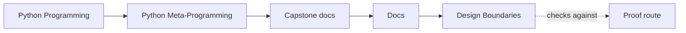
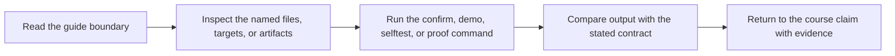

# Design Boundaries

<!-- page-maps:start -->
## Guide Maps

<!-- page-maps:end -->

Use this guide when the capstone technically makes sense but you still need to know why
each mechanism owns the behavior it owns. The capstone is small on purpose. If the
boundaries become vague, the metaprogramming story stops teaching and starts hand-waving.

## The main boundary question

Before proposing or reviewing any change, ask:

> Is this really a field rule, a wrapper rule, a class-definition rule, a concrete plugin
> behavior, or a public command/reporting rule?

That question is more important than whether the change "works," because a working change
in the wrong layer teaches the wrong lesson.

## Callable boundary

**Owner:** `actions.py`

This boundary owns:

- action wrapping
- preserved signatures and metadata
- action-history recording

This boundary does not own:

- field validation
- class registration
- manifest assembly

Review questions:

- Does the wrapper still behave like the original callable from the outside?
- Is the added runtime state visible enough to inspect later?
- Did wrapper policy stay separate from per-instance field semantics?

Reject or redesign when:

- the wrapper starts reaching into per-instance storage
- retry, caching, or validation policy swallows the original callable contract
- reviewers can no longer tell what the wrapped action really accepts

## Attribute boundary

**Owner:** `fields.py`

This boundary owns:

- descriptor-backed configuration rules
- coercion and validation for one field
- field metadata exported through the manifest

This boundary does not own:

- plugin registration
- action invocation behavior
- broad orchestration policy

Review questions:

- Is the rule really about attribute ownership or configuration shape?
- Is per-instance storage still isolated between instances?
- Is metadata exported clearly enough that the field remains observable?

Reject or redesign when:

- a descriptor starts owning behavior that is not really about attribute access
- per-instance state leaks across instances
- field objects begin to look like a hidden framework layer

## Class-creation boundary

**Owner:** `framework.py`

This boundary owns:

- plugin registration
- generated constructor signatures
- manifest assembly from declared fields and actions

This boundary does not own:

- concrete delivery behavior
- descriptor coercion details
- invocation history recording

Review questions:

- Is the change genuinely about class-definition-time work?
- Could a class decorator or explicit helper own the rule more honestly?
- Does the resulting public surface stay reviewable after class creation finishes?

Reject or redesign when:

- the metaclass exists only because it feels powerful
- a class decorator or explicit registration step could own the same rule more honestly
- class-definition work becomes surprising, heavy, or hard to test

## Concrete plugin boundary

**Owner:** `plugins.py`

This boundary owns:

- realistic adapter behavior
- concrete payload shaping
- ordinary runtime code that keeps the framework honest

This boundary does not own:

- framework-wide policy
- registration rules
- hidden inspection behavior

Review questions:

- Is this behavior specific to one plugin, or are we about to promote it too early?
- Does the plugin still look like ordinary application code?
- Would moving this into the framework make the abstraction less honest?

Reject or redesign when:

- a plugin-specific concern becomes framework policy without repeated need
- concrete behavior disappears into generic hooks too early
- reviewers cannot tell what one adapter actually does

## Governance boundary

**Owners:** `cli.py`, tests, and the proof guides

This boundary owns:

- public inspection and invocation routes
- saved review bundles
- executable confirmation through tests

This boundary does not own:

- private magic that cannot be reached from the public surface
- unreviewable import-time tricks
- dynamic execution hidden from ordinary inspection routes

Review questions:

- Can another reviewer observe the behavior without folklore?
- Does the CLI report the runtime, or is it secretly replacing it?
- Does the proof route still match the design claim it is supposed to defend?

Reject or redesign when:

- the runtime becomes easier to use than to observe
- debugging now requires folklore instead of public commands and tests
- the proof route no longer matches the design claims the capstone is meant to defend

## Definition-time sequence

1. `PluginMeta.__prepare__` returns `DefinitionNamespace`.
2. The class body executes and places fields and wrapped actions into that namespace.
3. Descriptors receive `__set_name__` and learn their storage keys.
4. `PluginMeta.__new__` gathers inherited and local fields and action specs.
5. A constructor signature is generated from the collected fields.
6. Concrete plugins receive their group and public plugin name.
7. Concrete plugins are registered in the deterministic runtime registry.

This sequence matters because beginners often confuse "defined on the class" with
"decided at runtime." The capstone separates those moments on purpose.

## Choose the lowest-power honest mechanism

| If the requirement is about... | Prefer this mechanism | First owning surface |
| --- | --- | --- |
| configuration validation, defaults, or schema metadata | descriptor | `fields.py` |
| invocation metadata, preserved signatures, or action history | decorator | `actions.py` |
| class registration, generated constructors, or manifest assembly | metaclass or framework helper | `framework.py` |
| one concrete adapter behavior | ordinary plugin class | `plugins.py` |
| one public inspection or invocation route | CLI command | `cli.py` |

## Strong proof pairings

- pair descriptors with `make field` and `tests/test_fields.py`
- pair decorators with `make action`, `make trace`, and runtime tests
- pair metaclass changes with `make registry`, `make signatures`, and `tests/test_registry.py`
- pair plugin changes with `make plugin`, `make demo`, and runtime tests
- pair CLI changes with `tests/test_cli.py` and the closest saved bundle route

## Good stopping point

Stop when you can name:

- which mechanism should own the next change
- which weaker mechanism would be insufficient
- which stronger mechanism would be unnecessary
- which proof route should defend the choice
