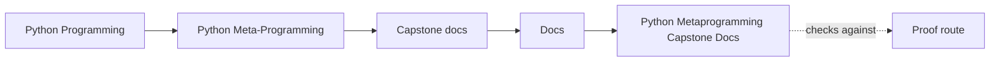
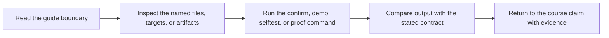

# Python Metaprogramming Capstone Docs

<!-- page-maps:start -->
## Guide Maps

<!-- page-maps:end -->

Use this page as the single honest entry point into the capstone docs. The capstone
already contains architecture notes, command guides, proof routes, and review bundles.
What most first-time readers need is not more pages. They need a reliable way to choose
the next page without losing the teaching thread.

## What this docs set is for

By the end of the capstone docs, you should be able to explain:

- why descriptors, decorators, and metaclasses each own different parts of the runtime
- how public inspection stays separate from action execution
- which command gives the smallest honest proof for a claim
- which source file and which test file you should open first for a specific question

If you cannot yet answer those four questions, stay in these docs before chasing more
source files.

## Start by learner state

| If you feel like... | Start here | Stop when you can... |
| --- | --- | --- |
| "I do not yet know what this project is trying to prove." | [README.md](../README.md), then this page | describe the capstone in plain language |
| "I know the project goal, but the file layout feels abstract." | [ARCHITECTURE.md](architecture.md), then [PACKAGE_GUIDE.md](package-guide.md) | name which file owns each mechanism |
| "I know the files, but I do not know which command proves what." | [COMMAND_GUIDE.md](command-guide.md), then [PROOF_GUIDE.md](proof-guide.md) | choose one smallest honest proof route |
| "I need one guided story from public shape to runtime behavior." | [WALKTHROUGH_GUIDE.md](walkthrough-guide.md), then [TOUR.md](tour.md) | explain one route from manifest to trace |
| "I want to change the capstone without making it magical." | [DESIGN_BOUNDARIES.md](design-boundaries.md), then [EXTENSION_GUIDE.md](extension-guide.md) | explain why one file owns the next change |
| "I need the closest executable proof for a design claim." | [TEST_GUIDE.md](test-guide.md), then [PROOF_GUIDE.md](proof-guide.md) | name the first test that should fail |

## First-day route for independent study

Use this route when you missed class and need one stable sequence instead of ten possible
starting points.

1. Run `make manifest`.
2. Read [README.md](../README.md).
3. Read [ARCHITECTURE.md](architecture.md).
4. Read [DESIGN_BOUNDARIES.md](design-boundaries.md).
5. Open `src/incident_plugins/framework.py`, then `fields.py`, then `actions.py`.
6. Read [PACKAGE_GUIDE.md](package-guide.md).
7. Read `tests/test_registry.py` and `tests/test_fields.py`.
8. Stop there unless your question now clearly requires commands, bundles, or runtime traces.

This route is intentionally incomplete. It gives you enough structure to understand the
metaprogramming contract before you widen into CLI review, saved bundles, or extension work.

## What the first-day route should settle

| Step | What you should learn |
| --- | --- |
| `make manifest` | the runtime can publish useful structure without invoking plugin behavior |
| `README.md` | the project goal, the capstone promise, and the command surface |
| `ARCHITECTURE.md` | which layer owns class creation, fields, wrappers, plugins, and CLI behavior |
| `DESIGN_BOUNDARIES.md` | how definition time, attribute time, call time, and inspection time differ |
| source files | where the mechanisms actually live, not just what they are called |
| registry and field tests | which proof surfaces protect class creation and descriptor behavior |

## Start by question

### "What is this project, and why does it exist?"

- [README.md](../README.md)
- [ARCHITECTURE.md](architecture.md)
- [WALKTHROUGH_GUIDE.md](walkthrough-guide.md)

### "Which file owns which mechanism?"

- [ARCHITECTURE.md](architecture.md)
- [DESIGN_BOUNDARIES.md](design-boundaries.md)
- [PACKAGE_GUIDE.md](package-guide.md)

### "Which command should I run first?"

- [COMMAND_GUIDE.md](command-guide.md)
- [PROOF_GUIDE.md](proof-guide.md)

### "How do I inspect the public runtime shape without triggering behavior?"

- [COMMAND_GUIDE.md](command-guide.md)
- [PROOF_GUIDE.md](proof-guide.md)
- [WALKTHROUGH_GUIDE.md](walkthrough-guide.md)

### "How do descriptors, decorators, and generated constructors fit together?"

- [DESIGN_BOUNDARIES.md](design-boundaries.md)
- [PACKAGE_GUIDE.md](package-guide.md)
- [ARCHITECTURE.md](architecture.md)

### "How do I review or extend this safely?"

- [EXTENSION_GUIDE.md](extension-guide.md)
- [TEST_GUIDE.md](test-guide.md)
- [PROOF_GUIDE.md](proof-guide.md)

### "How do I hand another reviewer a durable route?"

- [WALKTHROUGH_GUIDE.md](walkthrough-guide.md)
- [TOUR.md](tour.md)
- [PROOF_GUIDE.md](proof-guide.md)

## Routes to avoid on a first pass

Do not widen the route too early.

| Do not start with... | Because... | Start with... |
| --- | --- | --- |
| `make confirm` | it answers "does the suite pass?" before you know what the suite is proving | `make manifest` or `make registry` |
| `make proof` | it publishes a full proof route before you know which claim matters | `make inspect` or `make trace` |
| `tests/test_cli.py` | it is easier to misread public command behavior before understanding file ownership | `ARCHITECTURE.md` and `PACKAGE_GUIDE.md` |
| `plugins.py` | concrete adapters are easier to understand after the framework contract is clear | `framework.py`, `fields.py`, `actions.py` |

## Escalation rule

Use the smallest guide or command that settles the current question, then stop.

- Move from guide to source only after the guide names the owning file.
- Move from source to tests only after you can state the claim that still needs proof.
- Move from commands to saved bundles only when another reviewer needs a durable artifact.
- Move to `make confirm` or `make proof` only when a broad proof surface is genuinely needed.

## Self-check before you leave this page

Do not move on just because the page is finished. Move on when you can answer:

- What does this capstone prove about metaprogramming in ordinary Python terms?
- Which file owns registration?
- Which file owns descriptor-backed field behavior?
- Which file owns action wrapping and history?
- Which command would you choose first for one observational question?
- Which test file would you choose first for one definition-time question?

## Good stopping point

Stop after the first-day route when you can explain the capstone without using the words
"magic", "framework stuff", or "it happens somewhere in the metaclass."
