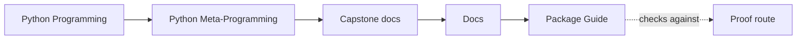
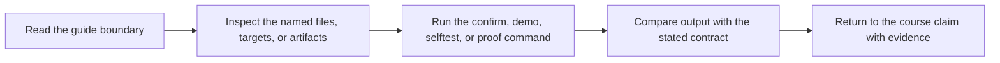

# Package Guide

<!-- page-maps:start -->
## Guide Maps

<!-- page-maps:end -->

Use this guide when the capstone still feels like a pile of Python hooks instead of a
system with named responsibilities. The goal is to know which file owns a kind of
metaprogramming pressure before you start chasing call stacks, test failures, or command output.

## Read the package in this order

1. `src/incident_plugins/framework.py`
2. `src/incident_plugins/fields.py`
3. `src/incident_plugins/actions.py`
4. `src/incident_plugins/plugins.py`
5. `src/incident_plugins/cli.py`
6. `tests/`

That route keeps definition-time authority first, attribute contracts second, wrapper
discipline third, concrete plugin behavior fourth, public review routes fifth, and proof last.

## Why that order teaches better

- `framework.py` tells you what happens when classes are created.
- `fields.py` tells you how configuration rules stay explicit.
- `actions.py` tells you how call-time behavior gains metadata without becoming opaque.
- `plugins.py` tells you whether the abstraction still behaves like ordinary code.
- `cli.py` tells you how the runtime becomes publicly inspectable.
- `tests/` tell you which claims are defended once you already know what each file owns.

If you start in the reverse order, the tests and CLI can look like the system instead of evidence about the system.

## Package responsibilities

| Surface | What it owns | What it should not own |
| --- | --- | --- |
| `framework.py` | metaclass registration, plugin construction, manifest export, and public runtime helpers | field coercion details or concrete delivery behavior |
| `fields.py` | descriptor-backed validation, coercion, and schema metadata | registry policy or action-history behavior |
| `actions.py` | action decorator metadata, signature preservation, and invocation recording | plugin registration or field storage |
| `plugins.py` | concrete incident-delivery plugins and realistic adapter behavior | framework-wide registry policy |
| `cli.py` | public inspection and invocation commands | hidden business logic not available from the runtime helpers |
| `tests/` | executable proof for import-time, class-definition-time, and invocation behavior | undocumented design authority |

## Start by question

- Open `framework.py` when you need to know what happens at class-definition time.
- Open `fields.py` when you need to know who validates configuration and when.
- Open `actions.py` when you need to prove that wrappers keep signatures and history visible.
- Open `plugins.py` when you need the concrete behavior that keeps the framework honest.
- Open `cli.py` when you need to inspect the public surface without importing private internals yourself.

## Best class and function route

| Question | Open this first | Then inspect |
| --- | --- | --- |
| How are plugin classes registered? | `framework.py` | `PluginMeta.__init__`, `_register_plugin()`, `PluginMeta.registry()` |
| How is the plugin constructor generated? | `framework.py` | `_build_signature()`, `_build_init()` |
| How are configuration values validated and stored? | `fields.py` | `Field`, `StringField`, `ChoiceField`, `Field.initialize()` |
| How is field ownership exposed without construction? | `framework.py` and `cli.py` | `inspect_field_ownership()` and `field-ownership` |
| How are field-system powers and limits exposed? | `framework.py` and `cli.py` | `inspect_field_system()` and `field-system` |
| How is class-creation ownership exposed? | `framework.py` and `cli.py` | `inspect_plugin_class_creation()` and `class-creation` |
| How are action signatures preserved and history recorded? | `actions.py` | `action()`, `ActionSpec.manifest()` |
| What concrete adapters make the framework honest? | `plugins.py` | `ConsoleNotifier`, `WebhookNotifier`, `PagerNotifier` |
| Which public commands expose the runtime? | `cli.py` | `_build_parser()` and the `_handle_*` functions |
| Which executable proof backs this claim? | `tests/` | `test_registry.py`, `test_fields.py`, `test_cli.py`, `test_runtime.py` |

## Concrete review scenarios

| Scenario | Best route | What it teaches |
| --- | --- | --- |
| inspect the public shape before invocation | `make manifest`, `make registry`, `make plugin` | what exists before runtime work starts |
| inspect one field's descriptor boundary | `make field-ownership` | declaring class, hook set, precedence category, storage owner, and metaclass collection |
| inspect the complete field-system boundary | `make field-system` | field coercion owners, storage slots, accepted powers, and deliberately rejected powers |
| inspect generated call shapes | `make signatures` | how declared fields become visible constructors and action shapes |
| inspect one concrete action | `make demo` or `make trace` | how one built-in adapter keeps the framework honest |
| inspect one saved review bundle | `make inspect`, `make tour`, or `make verify-report` | how ownership and proof surfaces stay durable for later review |

## Common reading mistakes

| Mistake | Why it hurts | Better move |
| --- | --- | --- |
| starting in `plugins.py` first | concrete adapters are easier to misread as the whole framework | start in `framework.py` |
| starting in `tests/` first | proof looks arbitrary before ownership is clear | read `framework.py`, `fields.py`, and `actions.py` first |
| treating `cli.py` as the source of truth | the CLI should report the runtime, not secretly replace it | compare CLI handlers with runtime helpers |
| reading every file end to end before asking a question | the route becomes passive and exhausting | read by question and owner |

## Companion guides

Read [DESIGN_BOUNDARIES.md](design-boundaries.md) when the mechanism boundaries still need a stronger sequence view.

Read [EXTENSION_GUIDE.md](extension-guide.md) when the framework is clear but the next change placement is not.

Read [COMMAND_GUIDE.md](command-guide.md) when the question is no longer only internal ownership, but what the package intentionally exports.

## Good stopping point

Stop when you can name:

- which file you would open first for a class-definition question
- which file you would open first for a descriptor question
- which file you would open first for a wrapper question
- why the concrete plugins come after the mechanism-owning files
