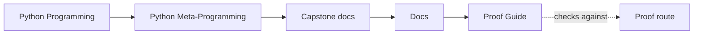
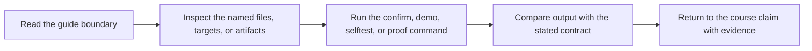

# Proof Guide

<!-- page-maps:start -->
## Guide Maps




<!-- page-maps:end -->

Use this guide when you need to connect a claim to the smallest repeatable proof route
that actually defends it. The capstone becomes confusing when readers collect evidence
without first deciding what they are trying to prove.

## The first proof question to ask

Ask this before choosing any command or test:

> Am I trying to prove public shape, runtime behavior, saved reviewability, or strongest
> executable confidence?

That question matters because different proof routes answer different kinds of claims.

## Start by claim

| If the claim is... | Start with | Escalate only if needed |
| --- | --- | --- |
| the runtime surface is observational | `make manifest` or `make registry` | `make inspect` |
| descriptor fields own validation and coercion | `make field` | `tests/test_fields.py` |
| descriptor lookup and storage ownership stay inspectable without construction | `make field-ownership` | `tests/test_fields.py` and `tests/test_cli.py` |
| field-system power stays bounded and inspectable without construction | `make field-system` | `tests/test_fields.py` and `tests/test_cli.py` |
| wrapper behavior stays visible | `make action` or `make trace` | `tests/test_runtime.py` or `tests/test_cli.py` |
| wrapper ownership stays inspectable without execution | `make action-wrapper` | `tests/test_runtime.py` and `tests/test_cli.py` |
| action arguments can be validated without execution | `make bind-action` | `tests/test_runtime.py` and `tests/test_cli.py` |
| supported action hints can be checked without overstating the contract | `make check-action` | `tests/test_runtime.py` and `tests/test_cli.py` |
| metaclass selection, hook ownership, and accepted or rejected class-creation powers remain observable without plugin construction | `make class-creation` | `tests/test_runtime.py` and `tests/test_cli.py` |
| application-wide mechanism choices remain explicit and reviewable | `make governance` | `tests/test_governance.py` and each decision's named mechanism tests |
| registration stays deterministic | `make registry` | `tests/test_registry.py` |
| one realistic invocation story is still honest | `make trace` | `make tour` or `tests/test_runtime.py` |
| saved review artifacts still match executable proof | `make verify-report` | `make proof` |

## What each proof size is good for

| Proof size | Best for | Not enough for |
| --- | --- | --- |
| one observational command | one narrow claim about public shape | full runtime or test confidence |
| one runtime command | one realistic invocation story | broad regression confidence |
| one saved bundle | another reviewer reading later | proving every local regression route |
| one test file | one focused executable claim | teaching the public review route by itself |
| `make confirm` | strongest local executable confidence | a saved human-facing review route |
| `make proof` | the full published review package | a quick first answer |

## Strongest local proof

Run:

```bash
make confirm
```

This is the strongest local executable confirmation route. Use it when the question is
"does the system still satisfy its core contracts?" Do not use it as a substitute for
understanding which contract is under pressure.

## Saved review routes

- `make inspect` writes the guided inspection bundle.
- `make tour` writes the guided walkthrough bundle.
- `make verify-report` writes executable proof together with public-surface evidence.

## Choose the saved bundle by review need

| If you need to review... | Choose this bundle | Do not start with |
| --- | --- | --- |
| public runtime shape without invocation | inspect bundle | verify-report bundle |
| one saved guided story from manifest to trace | tour bundle | inspect bundle plus ad hoc commands |
| strongest saved executable confirmation | verify-report bundle | confirm output alone |

Each bundle also includes `bundle-manifest.json`, which records stable file paths, file
sizes, and SHA-256 hashes for the saved route.

## Public-surface proof routes

Use these routes when you want evidence from the public surface before you open private internals.

```bash
make manifest
make registry
make plugin
make field
make field-ownership
make field-system
make action
make action-wrapper
make bind-action
make check-action
make class-creation
make governance
make signatures
make demo
make trace
```

These commands do not all answer the same question. They exist so you can prove one claim
without dragging in unrelated proof weight.

## Smallest honest routes

- Use `manifest` before `inspect` when one public schema question is enough.
- Use `field` before `tests/test_fields.py` when you still need to see the public contract first.
- Use `field-ownership` when the question is descriptor mechanics rather than exported schema.
- Use `field-system` when the question is system-wide field power rather than one
  descriptor's mechanics.
- Use `trace` before `verify-report` when one invocation story is enough.
- Use `confirm` before `proof` when the question is executable confidence rather than published review output.

## File to proof map

| Source file | Best public route | Best executable proof | Best saved review route |
| --- | --- | --- | --- |
| `src/incident_plugins/framework.py` | `make manifest`, `make registry`, `make signatures`, `make bind-action`, `make check-action`, and `make class-creation` | `tests/test_registry.py` and `tests/test_runtime.py` | `make inspect` or `make verify-report` |
| `src/incident_plugins/fields.py` | `make field`, `make field-ownership`, `make field-system`, and `make plugin` | `tests/test_fields.py` | `make inspect` |
| `src/incident_plugins/actions.py` | `make action`, `make action-wrapper`, `make check-action`, `make trace`, and `make signatures` | `tests/test_runtime.py` and `tests/test_cli.py` | `make tour` or `make verify-report` |
| `src/incident_plugins/governance.py` | `make governance` | `tests/test_governance.py` and the named mechanism tests | `make inspect` or `make verify-report` |
| `src/incident_plugins/plugins.py` | `make plugin`, `make demo`, and `make trace` | `tests/test_runtime.py` | `make tour` |
| `src/incident_plugins/cli.py` | `make manifest`, `make registry`, `make governance`, `make trace`, and `make demo` | `tests/test_cli.py` | `make inspect`, `make tour`, or `make verify-report` |
| `scripts/write_bundle_manifest.py` | `make inspect`, `make tour`, or `make verify-report` | `tests/test_bundle_manifest.py` | the matching bundle directory under `artifacts/` |

## Failure-first proof questions

Ask these when you are not sure which proof route is honest enough:

- Which test should fail first if registration starts doing hidden work during class creation?
- Which test should fail first if descriptor state leaks across instances?
- Which public route should change first if the manifest stops being observational?
- Which saved bundle should become less trustworthy first if the CLI stops exposing real runtime facts?

Those questions keep proof tied to ownership instead of to habit.

## Review pressure to route

| If you need to review... | Start with | Then run or inspect | Escalate with |
| --- | --- | --- | --- |
| public shape without invocation | [COMMAND_GUIDE.md](command-guide.md) | `make manifest`, `make registry`, or `make inspect` | this guide |
| one concrete field or action contract | [COMMAND_GUIDE.md](command-guide.md) | `make field`, `make field-ownership`, `make field-system`, `make action`, or `make inspect` | [TEST_GUIDE.md](test-guide.md) |
| one application-wide mechanism decision | [DESIGN_BOUNDARIES.md](design-boundaries.md) | `make governance`, then the decision's named mechanism report | `tests/test_governance.py` and the named mechanism tests |
| one realistic invocation story | [INDEX.md](index.md) or [COMMAND_GUIDE.md](command-guide.md) | `make demo`, `make trace`, or `make tour` | `tests/test_runtime.py` |
| source ownership for a change | [PACKAGE_GUIDE.md](package-guide.md) or [EXTENSION_GUIDE.md](extension-guide.md) | the matching public route from the file map | [TEST_GUIDE.md](test-guide.md) |
| which proof file should fail first | [TEST_GUIDE.md](test-guide.md) | the matching test file | [PACKAGE_GUIDE.md](package-guide.md) |
| a saved artifact bundle for another reviewer | this guide | `make inspect`, `make tour`, or `make verify-report` | `make proof` |

## Good stopping point

Stop when you can answer:

- what kind of claim you are trying to prove
- what the smallest honest route is for that claim
- what stronger route you would choose next if the first one were not enough
- which test file should fail first for the same claim
