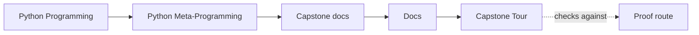
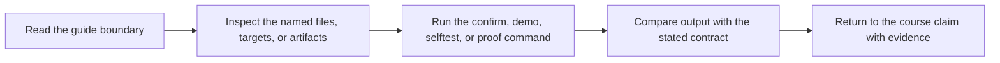

# Capstone Tour

<!-- page-maps:start -->
## Guide Maps

<!-- page-maps:end -->

Use this tour when you want a guided source walk instead of jumping straight into the
whole package. Use `make tour` when you want this route captured as a saved bundle rather
than reconstructed from one-off reading and command output.

## What this tour is for

This tour is not a replacement for the walkthrough commands. It is the source-reading
companion to them. Use it when the public route already makes sense and you now want to
see which source files make that route true.

## Before you begin

Run or review these first:

1. `make manifest`
2. `make registry`
3. `make trace`

Those commands give you the public story. The tour then shows how the source supports it.

## Stop 1: `framework.py`

Read `PluginMeta`, then `PluginBase.manifest()`, then `build_manifest()`.

What to learn here:

- what happens at class-definition time
- how plugins are registered
- how manifests are assembled without executing plugin behavior

Keep [DESIGN_BOUNDARIES.md](design-boundaries.md) nearby if the class-definition sequence
is still harder to hold than the file names.

## Stop 2: `fields.py`

Read `Field`, then one concrete specialization such as `StringField`.

What to learn here:

- how configuration rules stay explicit
- how descriptor ownership differs from wrapper or framework ownership
- how field metadata becomes public without hiding its logic

## Stop 3: `actions.py`

Read `action()`.

Focus on:

- what the wrapper preserves
- what extra runtime state it adds
- how history stays inspectable instead of vanishing into helper code

## Stop 4: `plugins.py`

Read `ConsoleNotifier`, `WebhookNotifier`, and `PagerNotifier`.

What to learn here:

- how concrete adapters keep the framework honest
- how ordinary application behavior survives inside a metaprogramming-heavy runtime
- why plugin-specific logic should not be promoted into the framework too early

Use [PACKAGE_GUIDE.md](package-guide.md) when the differences between the built-in
plugins are more useful than the shared framework machinery.

## Stop 5: `cli.py`

Read `_build_parser()` and one or two `_handle_*` functions.

What to learn here:

- how public inspection and invocation routes are assembled
- how the CLI reports runtime facts instead of replacing them
- which commands produce saved bundle evidence for later review

## Stop 6: tests

Read tests last, not first. The tests are strongest when you already know which claim
each source file is trying to own.

Start with:

- `tests/test_registry.py`
- `tests/test_fields.py`
- `tests/test_runtime.py`

Then widen only if your current question needs CLI or bundle proof.

## Best command route during the tour

1. Run `make inspect` to inspect the public shape.
2. Run `make demo` to see one concrete action result.
3. Run `make trace` to see configuration and action history.
4. Run `make tour` to save that full route for review.
5. Run `make confirm` when you want the stronger executable proof.

## Questions to ask at each stop

- What claim from the public route is this file making true?
- Which other file would be the next owner if this one did less?
- Which test would fail first if this file violated its boundary?
- Does the source still explain the runtime more clearly than the runtime hides the source?

## What this guide prevents

- starting with the metaclass before you understand the public consequences
- reading source as isolated tricks instead of as one reviewable system
- treating concrete plugins as examples that do not matter
- reading the whole capstone without one explicit guided order

## Good stopping point

Stop when you can explain one path from public manifest and trace output back to the
owning source files without opening the entire tree at once.
