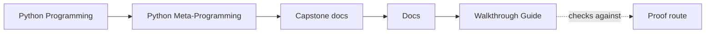
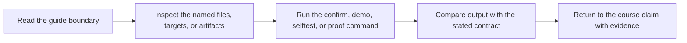

# Walkthrough Guide

<!-- page-maps:start -->
## Guide Maps

<!-- page-maps:end -->

Use this guide when you want to understand the capstone as one human review route instead
of as a pile of advanced Python mechanisms. The walkthrough is the bridge between "I know
these features exist" and "I can explain what this runtime is doing in a disciplined order."

## What this walkthrough is trying to teach

By the end of the route, you should be able to explain:

- what the runtime exposes before invocation
- which concrete plugins are actually registered
- what one action does at runtime
- how configuration and wrapper history stay visible in trace output
- where you would open source next if one step felt surprising

If the walkthrough is not teaching those five things, you are moving too quickly or opening
too many files at once.

## Two honest walkthrough sizes

### First pass

Stop after `make trace` when the goal is to understand one honest public story from schema
to invocation history.

### Deeper pass

Add `make confirm` only when the question becomes executable confidence rather than guided
explanation.

## Recommended walkthrough

1. Run `make manifest`.
2. Run `make registry`.
3. Run `make demo`.
4. Run `make trace`.
5. Run `make confirm` only if the question now requires stronger executable proof.

That sequence is deliberate:

- `manifest` shows public shape
- `registry` shows definition-time consequences
- `demo` shows one concrete result
- `trace` shows the same result with more reviewable evidence

## What to notice at each stop

| Step | Notice this | If it is unclear, open |
| --- | --- | --- |
| `make manifest` | inspection stays observational and does not execute plugin actions | `framework.py` and [ARCHITECTURE.md](architecture.md) |
| `make registry` | registration is visible as stable runtime data rather than hidden folklore | `framework.py` and `tests/test_registry.py` |
| `make demo` | one realistic plugin action still looks like ordinary runtime code | `plugins.py` and `actions.py` |
| `make trace` | configuration, invocation history, and result remain visible together | `actions.py`, `plugins.py`, and [TEST_GUIDE.md](test-guide.md) |
| `make confirm` | executable proof agrees with the story you already saw | `tests/` and [PROOF_GUIDE.md](proof-guide.md) |

## When to stop widening the route

Do not keep widening just because more guides exist.

- Stop after `manifest` if your only question is public schema shape.
- Stop after `registry` if your only question is deterministic registration.
- Stop after `demo` if you only need one concrete action result.
- Stop after `trace` if you now understand one honest runtime story.
- Only continue to `confirm` when you need stronger confidence than narrative review can provide.

## Best source files during the walkthrough

Read these only when one walkthrough step feels surprising:

- `src/incident_plugins/cli.py`
- `src/incident_plugins/framework.py`
- `src/incident_plugins/actions.py`
- `src/incident_plugins/plugins.py`
- `tests/test_cli.py`

## Failure-first questions for the walkthrough

- If manifest output started executing plugin actions, which step would reveal the problem first?
- If registration became hidden or nondeterministic, which step would stop making sense first?
- If action wrappers stopped recording history honestly, which walkthrough step would become weaker first?
- If the CLI started inventing behavior instead of reporting runtime facts, where would you notice it first?

Those questions help you review the walkthrough as a proof route, not just as a tour.

## What this guide prevents

- starting with the metaclass before understanding the public consequences
- treating manifest output as if it proved runtime invocation by itself
- skipping trace review and missing the recorded wrapper history
- running the whole suite before you can explain one guided story

## Best companion guides

- Read [COMMAND_GUIDE.md](command-guide.md) when the main uncertainty is which command should come next.
- Read [PROOF_GUIDE.md](proof-guide.md) when the main uncertainty is how much evidence is enough.
- Read [TOUR.md](tour.md) when you want the same route turned into a source-reading journey.
- Read [EXTENSION_GUIDE.md](extension-guide.md) when the route is clear but the next safe change is not.

## Good stopping point

Stop when you can explain one plugin action from public manifest to trace output without
opening the entire source tree or defaulting to the full test route.
