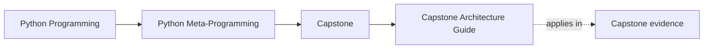

# Capstone Architecture Guide

<!-- page-maps:start -->
## Page Maps



```mermaid
flowchart LR
  class["Class creation<br/>framework.py"] --> attribute["Attribute access<br/>fields.py"]
  attribute --> call["Call boundary<br/>actions.py"]
  call --> concrete["Concrete behavior<br/>plugins.py"]
  class --> observe["Observation<br/>cli.py"]
  attribute --> observe
  call --> observe
  observe --> govern["Decision record<br/>governance.py"]
```
<!-- page-maps:end -->

Use this page after a transfer report identifies the expected owner. The architecture is
small enough to trace, but dense enough that reading every file from top to bottom can
hide the boundary under review.

## Architecture in one sentence

The incident-plugin capstone uses a metaclass for bounded class-family creation,
descriptors for configuration attributes, decorators for action call boundaries,
ordinary classes for delivery behavior, a CLI for observation, and a separate
governance record for mechanism decisions.

No layer is allowed to absorb all six responsibilities.

## Timing and owner map

| Timing | Owner | Public report | What must remain outside |
| --- | --- | --- | --- |
| import and class definition | `framework.py` | `class-creation`, `registry`, `manifest` | plugin invocation, package discovery, external I/O |
| descriptor name binding and attribute access | `fields.py` | `field`, `field-ownership`, `field-system` | action history, registry policy, transaction framework |
| decorator application and action call | `actions.py` | `action`, `action-wrapper`, `check-action`, `trace` | field storage and class-family construction |
| concrete delivery invocation | `plugins.py` | `plugin`, `demo`, `trace` | framework-wide policy |
| observation after facts exist | `cli.py` and public helpers | every JSON command | new hidden behavior that only the CLI implements |
| application review | `governance.py` | `governance` | implementation of the mechanisms being judged |

The CLI reports owners; it does not become the owner. Governance records decisions; it
does not implement or prove the mechanisms.

## Class-creation boundary

`framework.py` owns facts that genuinely involve the class family:

- prepared namespace event capture
- collection of declared fields and action specs
- generated constructor signature
- stable group and plugin names
- deterministic registration and duplicate refusal
- manifest assembly from stored contracts

Inspect with:

```bash
make capstone-class-creation
make capstone-registry
make capstone-signatures
```

The first report separates preparation, shaping, and registration. The registry report
exposes completed-class state. Signatures expose generated public call shapes.

Reject additions such as package scanning, network access, action invocation, or
automatic metaclass conflict repair. Those are not facts required to construct one class.

## Attribute boundary

`fields.py` owns repeated configuration semantics:

- public and private storage names
- coercion and validation
- required/default behavior
- per-instance storage
- exported field metadata

Inspect the layers separately:

```bash
make capstone-field
make capstone-field-ownership
make capstone-field-system
```

`field` shows the external schema. `field-ownership` shows descriptor mechanics.
`field-system` shows accepted and rejected system powers. A learner should not infer
descriptor storage from schema alone.

The application rejects cache freshness, external storage authority, arbitrary wrapper
composition, broad annotation inference, and transaction semantics. Those concerns
would require different owners and proof.

## Callable boundary

`actions.py` owns one action transformation:

- `ActionSpec` metadata
- preserved names, documentation, and `__wrapped__`
- explicit action signature
- call-time history recording

Inspect without execution:

```bash
make capstone-action
make capstone-action-wrapper
make capstone-bind-action
make capstone-check-action
```

Only use `capstone-trace` when construction, invocation, result, and history are part of
the claim.

Retry, cache, and general runtime typing remain course-lab comparisons. The capstone
action wrapper does not need every policy taught in Module 05.

## Concrete application boundary

`plugins.py` and `scenarios.py` keep the framework honest by supplying ordinary delivery
behavior. They own concrete configuration use, payload formatting, and adapter results.

Inspect with `capstone-plugin`; execute deliberately with `demo` or `capstone-trace`.

Do not move plugin-specific formatting into the metaclass, field base class, or action
decorator merely to reduce visible code. Ordinary code is a feature when the behavior is
ordinary.

## Observation boundary

`cli.py` exposes public commands, but delegates runtime facts to the owning helpers. A
reviewer should be able to follow:

```text
CLI parser → handler → public helper → stored/runtime fact → JSON
```

Warning signs:

- a handler recomputes a fact differently from the framework
- only the CLI knows a policy rule
- an observational command constructs a plugin for convenience
- an error is converted into a misleading successful report

`tests/test_cli.py` pairs public shape with non-construction and non-execution claims.

## Governance boundary

`governance.py` records:

- approved mechanisms and owners
- the constrained process-global registry
- rejected powers and lower-power alternatives
- observability, rollback, and proof routes

Run `capstone-governance`, then follow each decision to the named report and tests.

Do not add a mechanism implementation to `governance.py`. A decision record stays useful
because it can review the application without becoming another hidden runtime layer.

## Cross-boundary trace

For one `ConsoleNotifier` declaration:

1. Python selects `PluginMeta`.
2. `PluginMeta.__prepare__` supplies the recording namespace.
3. field objects receive names and storage keys.
4. action decorators publish callable contracts.
5. `PluginMeta` collects those facts and generates the constructor.
6. the completed class enters the registry.
7. observational CLI commands report stored facts without an instance.
8. only `demo` or `trace` constructs the plugin and invokes an action.
9. governance reviews whether each mechanism earned its place.

This sequence is the integration value of the capstone. Each earlier course lab isolates
one step so this combined trace remains explainable.

## Ownership review

For any proposed change, ask:

1. What timing does the requirement need?
2. Is the owner one call, one attribute, one class, or the class family?
3. Which lower-power owner almost solves it?
4. Which public report will expose the result?
5. Which focused assertion should fail first?
6. What wider responsibility must remain outside?

## Good stopping point

Stop when you can:

- trace a report to its owning source
- separate class, attribute, callable, concrete, observation, and governance boundaries
- name construction and invocation timing
- reject one plausible but wrongly placed extension
- return to the matching course module when a mechanism itself is unclear
