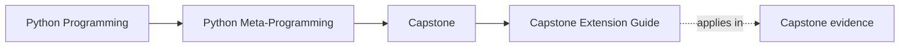

# Capstone Extension Guide

<!-- page-maps:start -->
## Page Maps

<!-- page-maps:end -->

Read the first diagram as a timing map: this guide is for the moment when a learner wants
to change the capstone without turning it into a bag of magic. Read the second diagram as
the loop for safe change: identify the kind of extension, place it at the lowest owning
layer, prove the change publicly, then update the teaching route so another learner can
follow the same reasoning later.

This guide exists because beginners often make the same expensive mistake: they see
metaprogramming in the project and assume every new feature belongs in the metaclass. In
this capstone, the opposite rule is safer and more educational:

> add the behavior at the lowest layer that can own it honestly.

That rule keeps the design readable, keeps the proof routes small, and preserves the main
teaching idea of the course: metaprogramming is a precision tool, not a license to hide
ordinary behavior.

## Use this change-placement ladder first

| If you want to add... | Start at this layer | Why this layer owns it | First public proof |
| --- | --- | --- | --- |
| a new concrete plugin | `plugins.py` | plugin behavior is a domain example, not a new framework rule | `make plugin` |
| a new field type or validation rule | `fields.py` | field coercion and descriptor behavior belong with field ownership | `make field` |
| a new action on an existing plugin | plugin method plus `@action` | invocation behavior belongs at the runtime surface first | `make action` |
| new registry policy | `registry.py` | registration rules belong where classes are tracked | `make registry` |
| new manifest shape shared across plugins | `runtime.py` or manifest-producing layer | output contracts belong where public representation is built | `make manifest` |
| class-definition-time behavior | metaclass layer only after failure elsewhere | this is the highest-power tool and hardest to debug | tests plus trace and registry proof |

If you cannot explain why the chosen layer owns the change, you are not ready to edit yet.

## Safe extension routes

### Add a new plugin

Start in `plugins.py` and keep the work concrete. A new plugin should demonstrate the
framework, not widen it. The healthy route is:

1. Add one new subclass with a small, explicit responsibility.
2. Reuse existing field and action machinery before inventing new framework rules.
3. Run `make plugin` to check public registration and manifest shape.
4. Run `make trace` or the matching runtime tests if the plugin changes observable action flow.

This route is educationally strong because learners can see the framework being used
correctly before they are asked to change the framework itself.

### Add a new field type

Start in `fields.py` when the new requirement is about declaration, coercion, validation,
or descriptor behavior. A field extension is healthy when:

1. The field can explain its own rule without plugin-specific hacks.
2. Coercion happens where field access already expects it.
3. Manifest output still describes the field without executing plugin work.
4. `make field` and field tests prove both definition-time and runtime behavior.

If the "new field" needs special behavior only one plugin cares about, that is often a
plugin concern, not a new field abstraction.

### Add a new action

Start with one plugin method and `@action` when the change is about invocation, history,
wrapping, or public call behavior. Keep the first extension narrow:

1. Add one action to one plugin.
2. Prove signature visibility and history recording remain intact.
3. Run `make action`.
4. Run `make trace` if the teaching value depends on seeing the execution path.

This route protects the capstone from a common failure mode: turning decorators into hidden
control flow before the learner understands the plain method being wrapped.

### Add registry or manifest rules

Only move to `registry.py` or the manifest-building layer when the change is genuinely
shared across many plugins. Ask two questions first:

- Would the same rule apply even if the current plugin examples disappeared?
- Would duplicating the rule in two plugins clearly be worse than centralizing it?

If the answer to both is not clearly yes, you probably do not need a framework-level change.

## Unsafe extension patterns

### Moving upward too early

Do not start with the metaclass, registry, or manifest machinery just because those layers
look powerful. Higher-power layers create bigger blast radius, weaker local reasoning, and
harder debugging.

### Smuggling runtime work into definition-time layers

Do not make manifest generation execute plugin methods. Do not make registration depend on
runtime state. Do not make class creation do work that learners expect to happen later.

### Hiding proof inside convenience helpers

Do not bury registry resets, fixture state, or review evidence inside unrelated helpers.
The capstone teaches observability. If a reviewer cannot point to the proof route, the
extension is not ready.

## The four sentences every extension must answer

Before you keep a change, write down these answers:

1. Why does this layer own the behavior?
2. Why was a lower-power layer insufficient?
3. What public command, saved bundle, or test now proves the change?
4. Which capstone guide must change so the learner route stays honest?

If you cannot answer all four, the extension is still conceptually unstable.

## Extension review table

| Question | Good answer shape | Warning sign |
| --- | --- | --- |
| Where does the change belong? | one named file or one narrow ownership layer | "a bit everywhere" |
| Why not use the metaclass? | plugin, field, or decorator layer already owns it | "the metaclass is more powerful" |
| How do you prove it? | one command plus one matching test or saved bundle | "the tests pass somewhere" |
| What changed for learners? | one updated guide, map, or walkthrough step | no teaching surface changed |

## What not to do during an extension

- Do not widen the metaclass when a plugin, field, action, or registry layer still owns the change.
- Do not jump straight to tests without first deciding what public behavior should change.
- Do not accept a framework edit that only exists to avoid writing one explicit plugin example.
- Do not leave local capstone guides untouched when the recommended review route has changed.

## Good stopping point

Stop the extension pass when you can say:

- what changed
- why that layer owns it
- how a learner can prove it
- why the capstone is still easier to understand than before the edit
