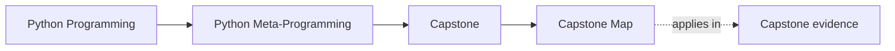
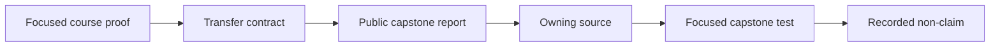

# Capstone Map

<!-- page-maps:start -->
## Page Maps




<!-- page-maps:end -->

This map connects each completed module to one observational application question. The
flow is strict: focused course proof comes first; the capstone report, owning source,
focused application test, and non-claim follow.

Generate the executable version:

```bash
make transfer-route MODULE=1
make transfer-route-test
```

Change `MODULE` from 1 through 10. The target validator checks repository, course, and
local capstone entrypoints so this page cannot rely on invented commands.

## Modules 01–03: transfer observation and evidence

### Module 01 — runtime objects

- Course claim: functions, classes, modules, and instances expose distinct runtime
  identities and relationships.
- Command: `capstone-manifest`.
- Owner: manifest helpers in `framework.py`.
- Ask: which plugin classes, fields, and actions exist on the public surface?
- Proves: imported runtime structure is published deterministically.
- Does not prove: plugin construction or action execution succeeds.

### Module 02 — safe observation

- Course claim: the observation route must not quietly become business execution.
- Command: `capstone-manifest`.
- Owner: `framework.py` manifest helpers and `cli.py`.
- Ask: which facts are exported without invoking plugin actions?
- Proves: manifest inspection remains non-invoking.
- Does not prove: every possible Python attribute inspection is passive.

Module 01 and Module 02 intentionally reuse a command. The learner question changes from
“what exists?” to “what executed while I learned it?”

### Module 03 — signatures and evidence

- Course claim: Python signature rules can validate argument shape without invocation.
- Command: `capstone-bind-action`.
- Owner: action binding helpers in `framework.py`.
- Ask: do proposed arguments fit the stored action signature?
- Proves: required, optional, positional, and keyword rules accept the shape.
- Does not prove: hint compatibility, plugin configuration, or runtime success.

After each command, open `tests/test_runtime.py` and `tests/test_cli.py` only for the
focused assertion matching the claim.

## Modules 04–05: transfer wrapper ownership and policy

### Module 04 — transparent wrappers

- Course claim: wrapper transformations preserve explicit metadata and provenance.
- Command: `capstone-action-wrapper`.
- Owner: `actions.py` and wrapper inspection in `framework.py`.
- Ask: which layer owns `ActionSpec`, `__signature__`, and `__wrapped__`?
- Proves: the wrapper chain remains structurally observable without execution.
- Does not prove: invoking the wrapped action succeeds.

### Module 05 — callable policy

- Course claim: runtime policy names its supported contract and refused surfaces.
- Command: `capstone-check-action`.
- Owner: hint policy in `actions.py` and binding in `framework.py`.
- Ask: which bound values match the deliberately supported runtime hints?
- Proves: supported hints are checked and unsupported hints are reported.
- Does not prove: complete runtime typing or successful invocation.

Do not use `capstone-trace` as the first transfer for either module. Trace crosses into
construction and execution. It becomes useful later when the question is specifically
about invocation history.

## Modules 06–08: transfer class and attribute ownership

### Module 06 — lower-power class customization

- Course claim: helpers, properties, descriptors, and class decorators remain preferred
  when they can own the requirement after class creation.
- Command: `capstone-class-creation`.
- Owner: stored provenance in `framework.py`.
- Ask: which reported requirements could a finished-class mechanism still own?
- Proves: generated structure and registration owners are separated.
- Does not prove: `PluginMeta` is automatically the best owner.

### Module 07 — descriptor lookup

- Course claim: descriptor category, lookup precedence, and storage ownership are
  predictable.
- Command: `capstone-field-ownership`.
- Owner: `fields.py` and field collection in `framework.py`.
- Ask: which descriptor owns `endpoint` lookup and where does the value live?
- Proves: hook category, class access, collection, and storage key are visible.
- Does not prove: cache, external storage, or transaction behavior.

### Module 08 — descriptor systems

- Course claim: field-system powers must be accepted or rejected explicitly.
- Command: `capstone-field-system`.
- Owner: the collected system spanning `fields.py` and `framework.py`.
- Ask: which field powers belong in this application?
- Proves: coercion, validation, and storage owners are named beside rejected wider powers.
- Does not prove: a production ORM, cache, or external persistence layer.

Module 06 uses a class-creation report to search for lower-power alternatives. Module 07
then narrows to one descriptor. Module 08 widens only to the field system actually
required by the application.

## Modules 09–10: transfer class creation and governance

### Module 09 — class creation

- Course claim: namespace preparation, class shaping, and registration have different
  timing and owners.
- Command: `capstone-class-creation`.
- Owner: `PluginMeta` in `framework.py`.
- Ask: what requires preparation before the class exists, and what waits until the
  completed class?
- Proves: stored provenance exposes each hook and generated output.
- Does not prove: package discovery, I/O, or automatic metaclass conflict repair belongs
  in class creation.

Module 06 and Module 09 reuse the same report for opposite review directions: Module 06
tries to move power downward; Module 09 identifies the facts that remain genuinely
pre-class.

### Module 10 — governance

- Course claim: runtime powers require approve, constrain, or reject decisions.
- Command: `capstone-governance`.
- Owner: `governance.py` plus the owner named by each decision.
- Ask: which powers earned their cost and which remain outside the application?
- Proves: decisions name observability, rollback, proof, and rejected alternatives.
- Does not prove: the underlying behavior without its mechanism report and focused tests.

For an approved metaclass decision, compare `governance` with `class-creation`. For a
constrained registry, compare it with `registry`. A policy record never proves its own
mechanism.

## Command levels

| Level | Form | Use |
| --- | --- | --- |
| repository | `make PROGRAM=python-programming/python-meta-programming capstone-field-system` | published site and program route |
| course | `make capstone-field-system` | normal learning session |
| capstone | `make field-system` | local source review |

`make transfer-route-test` proves that all three forms exist for all ten module
contracts.

## Transfer review record

For one module, retain:

1. completed course claim
2. focused course test
3. rendered transfer contract
4. capstone JSON output
5. owning source file
6. matching focused capstone assertion
7. one explicit non-claim

Stop when that record is complete. Do not widen into a saved bundle or full suite unless
another claim requires it.
