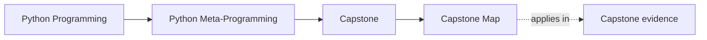

# Capstone Map

<!-- page-maps:start -->
## Page Maps

<!-- page-maps:end -->

This map keeps the course attached to one executable system. The capstone is a plugin
runtime for incident delivery adapters, and each major course mechanism has a clearly
named home inside it.

## Start by question

| If you need to know... | Start with | Then inspect |
| --- | --- | --- |
| what the runtime exposes without execution | `capstone-manifest` and `capstone-registry` | `framework.py`, `manifest.json`, and [Capstone Architecture Guide](capstone-architecture-guide.md) |
| where wrapper behavior really lives | [Capstone Architecture Guide](capstone-architecture-guide.md) | `actions.py` and `tests/test_runtime.py` |
| where field ownership and validation live | [Capstone File Guide](capstone-file-guide.md) | `fields.py` and `tests/test_fields.py` |
| whether class creation is honest | [Capstone Architecture Guide](capstone-architecture-guide.md) | `framework.py` and `tests/test_registry.py` |
| which route to hand to another reviewer | [Capstone Walkthrough](capstone-walkthrough.md) | `inspect`, `capstone-tour`, or `capstone-verify-report` |

## Mechanism to file map

- introspection and manifest export: `capstone/src/incident_plugins/framework.py`
- action wrappers and signature preservation: `capstone/src/incident_plugins/actions.py`
- descriptor-backed field contracts: `capstone/src/incident_plugins/fields.py`
- concrete plugin classes and realistic behavior: `capstone/src/incident_plugins/plugins.py`
- proof and regression coverage: `capstone/tests/`

## Module to capstone route

| Module stage | Inspect this file or surface | Why it matters | Prove it with |
| --- | --- | --- | --- |
| Modules 01-03 | `framework.py` and manifest output | fields and actions stay inspectable without execution | `inspect` then read `manifest.json` |
| Modules 04-05 | `actions.py` | wrapper policy, preserved metadata, and action history | `proof` then inspect `trace.json` and `test_runtime.py` |
| Module 06 | generated constructor behavior in `framework.py` | class customization before metaclasses | `test` then read `test_runtime.py` |
| Modules 07-08 | `fields.py` | descriptor-backed validation, coercion, and per-instance storage | `test` then read `test_fields.py` |
| Module 09 | registration logic in `framework.py` and registry output | definition-time registration and duplicate prevention | `inspect` then read `registry.json` and `test_registry.py` |
| Module 10 | `cli.py` plus saved proof bundles | public review surface stays observational and reviewable | `capstone-verify-report` then read `pytest.txt`, `manifest.json`, and `trace.json` |

## Practical reading order

1. Start with one public surface such as `manifest`, `registry`, or `trace`.
2. Read the matching page in this capstone shelf so the ownership claim is explicit.
3. Read the owning file in `framework.py`, `fields.py`, `actions.py`, or `plugins.py`.
4. Read the matching tests only after you know what the file is claiming to own.
5. Escalate to saved bundles only when another reviewer needs the route preserved.

## Good stopping point

Stop when you can inspect one surface, explain one owning boundary, and prove one claim
without widening into the whole repository.
