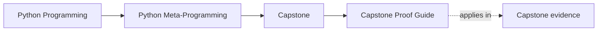
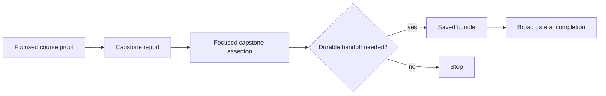

# Capstone Proof Guide

<!-- page-maps:start -->
## Page Maps




<!-- page-maps:end -->

Use this guide after the corresponding course lab and focused tests pass. Capstone proof
begins with one observational report, then one assertion that protects the same claim.
The broad suite belongs near completion, not at the start of a bounded review.

## Proof record

For every transfer, record:

1. course claim
2. focused course test
3. transfer contract
4. capstone report
5. owning source
6. focused capstone assertion
7. non-claim
8. next escalation condition

Generate items 1, 3, 4, 5, and 7 with:

```bash
make transfer-route MODULE=7
```

The learner must still locate and explain the focused assertions.

## Module proof map

| Module | Capstone report | First test surface | Protected claim |
| --- | --- | --- | --- |
| 01 | `capstone-manifest` | `test_registry.py`, `test_runtime.py` | public classes, fields, and actions are deterministic |
| 02 | `capstone-manifest` | `test_cli.py`, `test_runtime.py` | manifest observation does not invoke actions |
| 03 | `capstone-bind-action` | `test_runtime.py`, `test_cli.py` | signature binding occurs without construction or invocation |
| 04 | `capstone-action-wrapper` | `test_runtime.py`, `test_cli.py` | metadata, signature, and wrapper provenance remain visible |
| 05 | `capstone-check-action` | `test_runtime.py`, `test_cli.py` | supported hints are checked and unsupported hints are refused |
| 06 | `capstone-class-creation` | `test_runtime.py` | lower-power and class-creation owners remain distinguishable |
| 07 | `capstone-field-ownership` | `test_fields.py`, `test_cli.py` | descriptor category, collection, and storage are inspectable |
| 08 | `capstone-field-system` | `test_fields.py`, `test_cli.py` | accepted and rejected field-system powers are explicit |
| 09 | `capstone-class-creation` | `test_registry.py`, `test_runtime.py`, `test_cli.py` | namespace, shaping, and registration timing are stored |
| 10 | `capstone-governance` | `test_governance.py`, `test_cli.py` | decisions connect owners, reports, rollback, and proof |

The first test surface is not always one file because public CLI evidence and mechanism
behavior are separate claims.

## Proof sizes

### One public report

Best for:

- learning the shape of one capstone contract
- confirming that construction or execution is absent
- choosing the owning source before reading implementation

Not enough for:

- regression confidence
- implementation invariants not exposed publicly
- runtime success

### One focused test file or test selection

Best for:

- the invariant that should fail first after a change
- timing, cleanup, ordering, and failure behavior
- comparing public output with internal ownership

Not enough for:

- every capstone contract
- a durable review artifact
- explaining the course progression by itself

### One saved bundle

Use `inspect`, `capstone-tour`, or `capstone-verify-report` when another reviewer needs a
stable artifact with hashes and route instructions.

A bundle preserves evidence; it does not make a vague claim precise.

### Broad course gate

Use:

```bash
make PROGRAM=python-programming/python-meta-programming test
```

once near completion after focused routes pass. It provides course and capstone
regression confidence. It does not replace the proof record.

## Evidence comparisons

### Manifest versus runtime success

`capstone-manifest` proves exported structure. It does not construct a plugin or invoke
an action. A successful manifest cannot prove that configuration values are valid.

### Binding versus hint checking

`capstone-bind-action` uses Python call-shape rules. `capstone-check-action` starts from
bound values and evaluates a deliberately small supported hint subset. Neither invokes
the action.

### Wrapper report versus trace

`capstone-action-wrapper` proves structural preservation without execution.
`capstone-trace` proves one deliberate construction and invocation story. Use the first
for wrapper ownership and the second for runtime history.

### Class creation versus governance

`capstone-class-creation` proves what the hooks produced and when. `capstone-governance`
records whether the application approves or rejects those powers. Mechanism evidence and
design approval are different proof classes.

## Failure-first review questions

Ask which assertion should fail first if:

- manifest generation starts invoking a plugin action
- a wrapper loses `__wrapped__` or its explicit signature
- hint checking silently accepts an unsupported generic
- a field stores data on the shared descriptor
- registry order becomes nondeterministic
- package discovery enters class creation
- governance approves a power without naming rollback or proof

If no focused assertion is identifiable, the transfer record is incomplete even when
the broad suite passes.

## Saved bundle selection

| Review need | Route | First files |
| --- | --- | --- |
| public shape and ownership | `inspect` | `manifest.json`, ownership reports, `governance.json` |
| guided application story | `capstone-tour` | `route.txt`, focused reports, `trace.json` |
| executable report | `capstone-verify-report` | pytest output and public evidence |
| every published artifact | `proof` | all bundle manifests |

Use bundle manifests to confirm file hashes and sizes. Do not compare a stale saved
artifact with new source without rebuilding the route.

## Proof anti-patterns

- Starting with the broad test because the claim is unclear.
- Citing a JSON key without naming the code that owns it.
- Treating an `executed: false` report as runtime behavior proof.
- Treating one successful trace as determinism or broad regression proof.
- Treating governance decisions as substitutes for mechanism tests.
- Reading all tests before identifying which invariant matters.

## Reviewer exit signal

Stop when you can say:

- which completed course claim was transferred
- which public capstone report exposed it
- which assertion protects it
- what the evidence refuses to prove
- why no broader route was needed yet
